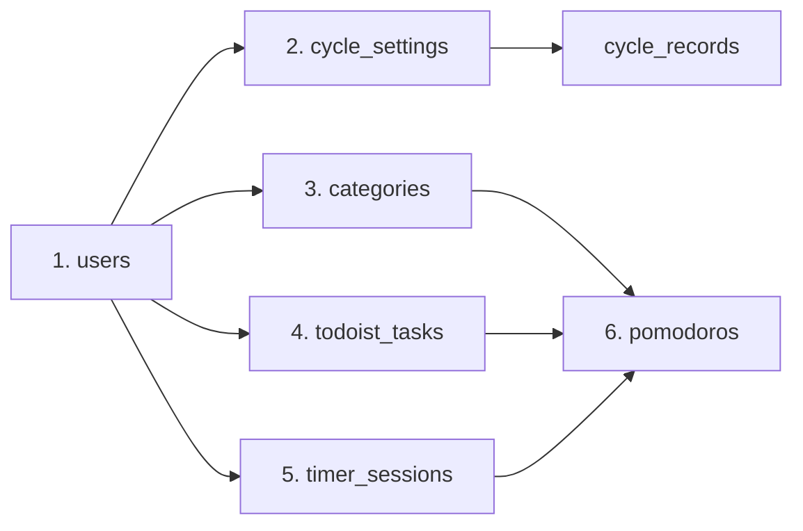

# PostgreSQL 데이터베이스 설계

NestJS 서버는 PostgreSQL과 Drizzle ORM을 사용합니다. 현재 Drizzle schema는 8개 테이블로 구성되어 있습니다. 현재 타이머처럼 세션 종료 시 초기화하는 상태, 세션 중에만 누적하는 변경 이벤트, 종료 후에도 보존하는 실행·통계 기록을 서로 다른 구조로 관리합니다.

## 현재 데이터 모델

사용자는 Category와 CycleSetting을 설정하고 focus 또는 break session을 실행합니다. 실제 타이머 실행 구간은 TimerSession으로 저장하고, focus 결과는 Category와 Todoist Task별 Pomodoro 기록으로 나누어 통계에 사용합니다.

| 개념 | 역할 | 테이블 |
| --- | --- | --- |
| User | 데이터 소유권의 기준이며 현재 타이머·cycle 상태도 보관 | `users` |
| Category | 집중 기록을 분류하는 사용자별 기준 | `categories` |
| CycleSetting | Pomodoro·휴식 시간과 반복 횟수 설정 | `cycle_settings` |
| CycleRecord | 완료된 cycle의 이행 결과 | `cycle_records` |
| TimerSession | 실제로 실행한 focus 또는 break의 시작·종료·일시 정지 기록 | `timer_sessions` |
| Pomodoro | 한 focus session을 Category와 Todoist Task별로 나눈 통계용 기록 | `pomodoros` |
| TodoistTask | 외부 Task metadata와 앱에서 측정한 누적 집중시간 | `todoist_tasks` |
| Room | 방 목록을 재구성하기 위한 metadata. WebRTC 연결 상태는 포함하지 않음 | `rooms` |

TimerSession과 Pomodoro는 기록 단위가 다릅니다. TimerSession은 focus 또는 break의 실제 실행 구간 하나를 나타내고, Pomodoro는 focus 구간을 Category와 Todoist Task 조합별로 나눈 통계 기록입니다.
변경 이벤트를 시간순으로 결합하는 과정은 [session segmentation 구현](./problem-solving.mdx#session-segmentation)에서 설명합니다.

## ERD

ERD에는 Drizzle의 TypeScript property가 아니라 실제 PostgreSQL에 생성되는 `snake_case` 컬럼명을 사용했습니다.

<figure className="erd-figure">
  <a
    className="erd-preview-link"
    href="/img/postgresql-erd.svg"
    target="_blank"
    rel="noopener noreferrer"
    aria-label="PostgreSQL ERD SVG 원본을 새 탭에서 열기"
  >
    
  </a>
  <figcaption>
    이미지를 클릭하면 SVG 원본을 새 탭에서 열어 화질 저하 없이 확대할 수 있습니다.
  </figcaption>
</figure>

<p>
  <a href="/img/postgresql-erd.svg" target="_blank" rel="noopener noreferrer">
    SVG 원본 열기
  </a>
  <a
    href="/diagrams/postgresql-erd.mmd"
    target="_blank"
    rel="noopener noreferrer"
  >
    Mermaid 원본 보기
  </a>
</p>

:::info 현재 구현 범위

- 신규 Pomodoro 생성 경로는 아직 생성된 TimerSession UUID를 `timer_session_id`에 직접 연결하지 않습니다.
- `cycle_records`는 장기 이력을 저장할 수 있는 구조지만, 현재 write path는 프론트엔드가 보낸 최근 10개 배열로 기존 row를 전체 교체합니다.
- 설정값 범위와 `start_time < end_time`은 PostgreSQL `CHECK`가 아니라 DTO와 애플리케이션 로직에서 검증합니다.

:::

## 설계 원칙

현재 데이터 모델은 다음 세 질문을 순서대로 다룹니다.

1. 어떤 상태의 데이터를 저장하도록 허용할 것인가?
2. 허용된 상태로 변경하는 도중 일부만 반영되거나 동시 요청이 충돌하지 않게 하려면 어떻게 할 것인가?
3. 서로 다른 속도로 생성되고 사라지는 데이터를 어디에 저장할 것인가?

### 1. 유효한 상태만 저장

데이터 무결성(Data Integrity)은 데이터가 시스템의 규칙을 위반하지 않고 서로 모순되지 않는 상태를 유지하는 것을 의미합니다. API에서 데이터를 미리 검사하더라도 동시 요청, ETL, 새로운 service와 직접 SQL 같은 다른 write 경로가 생길 수 있으므로, 깨지면 안 되는 규칙은 가능한 범위에서 PostgreSQL 제약조건으로도 표현했습니다.

| 제약조건 | 프로젝트에서 막는 잘못된 상태 |
| --- | --- |
| Primary Key | 동일한 ID를 가진 row가 두 개 생기는 상태 |
| Foreign Key | 존재하지 않는 User나 CycleSetting을 필수 관계로 참조하는 상태 |
| 복합 UNIQUE | 같은 사용자가 동일한 Category·CycleSetting 이름이나 Todoist Task ID를 중복해서 가지는 상태 |
| Partial unique index | 한 사용자에게 `is_current = true`인 Category나 CycleSetting이 두 개 이상 존재하는 상태 |
| PostgreSQL enum | TimerSession의 `kind`에 `pomo`, `break` 이외의 문자열이 들어가는 상태 |

#### 애플리케이션 검사만으로 부족한 이유

Category 이름 중복 여부를 먼저 조회한 뒤 insert한다고 가정할 수 있습니다. 동시에 들어온 두 요청은 둘 다 “아직 같은 이름이 없다”고 판단한 후 같은 값을 저장할 수 있습니다. `(user_id, name)` 복합 UNIQUE는 마지막 insert 시점에도 규칙을 검사하므로 둘 중 하나를 거부합니다.

`is_current`에는 일반적인 `UNIQUE (user_id, is_current)`를 사용할 수 없습니다. 그렇게 하면 `false`인 Category도 사용자당 하나만 만들 수 있기 때문입니다. 대신 `is_current = true`인 row에만 적용되는 partial unique index를 사용합니다.

```sql
CREATE UNIQUE INDEX categories_user_id_is_current_unique
ON categories (user_id)
WHERE is_current = true;
```

이 index는 현재 Category를 사용자당 **최대 하나**로 제한합니다. 모든 Category가 `false`인 상태까지 막아서 “항상 정확히 하나”를 보장하는 것은 아닙니다.

#### 삭제 이후의 데이터도 설계에 포함

| 관계 | 삭제 정책 | 의미 |
| --- | --- | --- |
| User → 사용자 소유 데이터 | `CASCADE` | User가 삭제되면 그 사용자에게 완전히 종속된 데이터도 제거 |
| CycleSetting → CycleRecord | `CASCADE` | 부모 설정 없이 해석할 수 없는 cycle 기록도 제거 |
| Category → Pomodoro | `SET NULL` | Category가 삭제돼도 과거 집중시간 row는 보존 |
| TodoistTask → Pomodoro | 기본 `NO ACTION` | 과거 기록이 참조하는 Task의 물리 삭제를 차단하고 비활성화 방식 사용 |

현재 PostgreSQL schema가 모든 도메인 규칙을 보장하는 것은 아닙니다. 설정 숫자의 최소·최대, `start_time < end_time`, 서로 연결된 Pomodoro와 Category가 같은 User 소유인지 같은 규칙은 아직 DB constraint로 강제하지 않습니다.

### 2. 관련 변경을 함께 반영

여러 write가 하나의 기능을 완성한다면 일부만 반영되어서는 안 됩니다. Transaction은 이 작업들을 하나의 commit 단위로 묶어 모두 성공하면 commit하고, 하나라도 실패하면 전부 rollback합니다.

현재 다음 작업을 transaction으로 처리합니다.

- User와 기본 CycleSetting 생성
- Category 변경과 사용자의 `category_change_info_array` 동기화
- CycleSetting 수정과 `cycle_records` 전체 교체
- Pomodoro 저장과 Todoist `total_focus_duration` 증가
- Todoist Task upsert, soft deactivation과 결과 조회

#### Transaction과 row lock의 차이

Transaction은 여러 작업의 all-or-nothing을 보장하지만, 조회한 값을 서버에서 수정한 뒤 다시 저장하는 read-modify-write의 동시 실행까지 자동으로 순서대로 만들지는 않습니다.

초기 JSONB 배열이 `[A]`이고 두 요청이 동시에 원소를 추가한다고 가정할 수 있습니다.

```text
요청 1: [A] 조회 → [A, B] 계산
요청 2: [A] 조회 → [A, C] 계산
요청 1: [A, B] 저장
요청 2: [A, C] 저장

최종 결과: [A, C]
요청 1이 추가한 B가 사라짐
```

이런 Lost Update 위험이 있는 서버 경로에서는 transaction 안에서 `SELECT ... FOR UPDATE`를 사용합니다. 먼저 User row를 잠근 요청이 commit하거나 rollback할 때까지 다음 요청이 기다리므로, 다음 요청은 `[A, B]`라는 최신 값을 읽고 `[A, B, C]`를 계산할 수 있습니다.

| 수단 | 역할 | 프로젝트 사례 |
| --- | --- | --- |
| Transaction | 여러 write를 모두 반영하거나 모두 취소 | Pomodoro 저장과 Todoist 집중시간 증가 |
| `SELECT ... FOR UPDATE` | 같은 row의 read-modify-write를 순서대로 처리 | Task 변경, Category 이름·색상과 이벤트 배열 동기화 |
| 단일 SQL JSONB 병합 | 선행 조회 없이 현재 JSONB의 최상위 key 변경 | `timers_states`, `current_cycle_info` |
| SQL 컬럼 증분 | 현재 숫자를 애플리케이션에서 읽지 않고 DB에서 직접 증가 | `total_focus_duration + duration` |

<details>
<summary>실제 Drizzle 코드 패턴 보기</summary>

```ts
const [user] = await tx
  .select({
    id: schema.users.id,
    taskChangeInfoArray: schema.users.taskChangeInfoArray,
  })
  .from(schema.users)
  .where(eq(schema.users.userEmail, userEmail))
  .for("update");
```

```ts
await db
  .update(schema.users)
  .set({
    timersStates: sql`${schema.users.timersStates} || ${JSON.stringify(update)}::jsonb`,
  })
  .where(eq(schema.users.userEmail, userEmail));
```

</details>

`jsonb || jsonb`는 deep merge가 아니라 최상위 key의 shallow merge입니다. 같은 key를 동시에 변경하면 마지막 update가 이기고 nested object는 재귀적으로 합쳐지지 않습니다. `FOR UPDATE`도 같은 잠금 규칙을 따르는 서버 writer를 직렬화할 뿐, 클라이언트가 오래전에 읽은 배열 전체를 보내 덮어쓰는 문제까지 해결하지는 않습니다.

### 3. 데이터 생명주기별 저장 경계

여기서 생명주기는 생성 시점만 뜻하지 않습니다. 데이터가 실행 중 어떻게 변경되고, 언제 초기화·삭제되며, 어느 저장소에서 얼마나 오래 유효한지를 함께 뜻합니다.

| 데이터 | 변경과 종료 방식 | 저장 경계 |
| --- | --- | --- |
| `timer_sessions`, `pomodoros` | 일반 타이머 실행 경로에서 세션 종료 시 생성하고 이력으로 보존 | 독립 row |
| `cycle_records` | cycle 종료 시 생성. 현재는 최근 10개 배열로 전체 교체 | 독립 row |
| `timers_states`, `current_cycle_info` | 실행 중 갱신하고 세션 또는 cycle 종료 시 reset | User의 JSONB snapshot |
| `task_change_info_array`, `category_change_info_array` | 세션 중 변경 시각을 누적하고 종료 후 현재 선택 하나로 reset | User의 JSONB 이벤트 배열 |
| `todoist_tasks` | 외부 metadata는 동기화하고 집중시간은 누적. 사라진 Task는 비활성화 | PostgreSQL cache와 앱 집계 |
| Peer, Transport, Producer, Consumer | 현재 연결 동안만 유효하고 프로세스 종료 시 소멸 | 서버 메모리 |

Snapshot은 다시 접속했을 때 실행 상태를 복원하기 위한 현재 값입니다. 반면 TimerSession과 Pomodoro는 종료된 세션의 이력이므로 별도 row로 저장하며 자동 만료 기간은 두지 않았습니다. 사용자 계정을 삭제하면 해당 사용자의 row도 `CASCADE`로 삭제됩니다.

Todoist Task도 외부 응답에서 사라졌다고 바로 삭제하지 않습니다. `is_active = false`로 전환해 외부 상태와 로컬 누적 집중시간을 보존합니다.

<details>
<summary>MongoDB → PostgreSQL 마이그레이션 상세 기록</summary>

## 마이그레이션 배경

Pomodoro는 처음에 MongoDB와 Mongoose로 구현했습니다. 이후 Category, CycleSetting, TodoistTask처럼 서로 관계를 맺는 개념이 늘어날수록 제가 도메인을 생각하는 방식과 실제 저장 구조 사이의 차이가 커졌습니다. 머릿속에서는 자연스럽게 1:N 관계와 무결성 규칙을 떠올렸지만, 코드에서는 `userEmail`, ObjectId 배열, `populate()`와 애플리케이션 조회 규칙으로 관계를 다시 표현해야 했습니다. 새 개념을 추가할 때마다 이 번역 과정을 매번 다시 거쳐야 했고, 그때마다 머릿속 모델과 실제 저장 구조가 어긋난다는 느낌이 반복됐습니다.

이 불일치를 줄이고 데이터의 관계를 UUID 외래키와 데이터베이스 제약조건으로 직접 표현하기 위해 PostgreSQL로 전환했습니다. 성능 문제를 해결하기 위한 전환이라기보다, 도메인의 관계형 mental model과 저장 모델을 일치시키고 무결성을 DB가 보장하게 하는 것이 주된 목적이었습니다.

이 기록은 [기존 Mongoose schema](https://github.com/Yonghwan-Song/pomodoro/tree/main/nest-server/src/schemas), [현재 Drizzle schema](https://github.com/Yonghwan-Song/pomodoro/blob/main/nest-server/src/postgresql/schema.ts), [migration ETL](https://github.com/Yonghwan-Song/pomodoro/blob/main/nest-server/src/database-migration/migrate.ts)과 당시 남긴 설계 기록을 기준으로 작성했습니다.

## MongoDB에서 PostgreSQL로의 변환

<details>
<summary>전체 collection과 field 매핑 보기</summary>

### 전체 매핑

| MongoDB document 또는 field | PostgreSQL 대상 | 변환 전략 |
| --- | --- | --- |
| `User` | `users` | scalar field, 평탄화된 설정, JSONB 상태를 함께 저장 |
| `User.categories[]` | `categories.user_id` | 부모의 ObjectId 배열을 제거하고 child table의 FK로 역전 |
| `User.cycleSettings[]` | `cycle_settings.user_id` | 부모의 ObjectId 배열을 제거하고 child table의 FK로 역전 |
| `User.autoStartSetting` | `users`의 boolean 컬럼 3개 | 고정 구조 설정을 평탄화 |
| `User.goals`와 timer 관련 상태 | `users`의 JSONB 컬럼 | 설정 snapshot과 세션 단위 임시 배열의 기존 구조 유지 |
| `Category` | `categories` | UUID PK와 User FK를 갖는 독립 테이블 |
| `CycleSetting.pomoSetting` | `cycle_settings`의 integer 컬럼 5개 | 고정 구조 설정을 평탄화 |
| `CycleSetting.cycleStat[]` | `cycle_records` | embedded array의 원소를 각각 child row로 정규화 |
| `TodayRecord` | `timer_sessions` | focus와 break를 모두 기록하는 실행 session table |
| `TodayRecord.pause` | `timer_sessions.pause` | pause 객체와 event 배열을 JSONB로 유지 |
| `Pomodoro` | `pomodoros` | Category와 Todoist task 기준으로 나뉜 focus segment table |
| `TodoistTaskTracking` | `todoist_tasks` | 외부 API metadata와 앱의 누적 집중시간을 관리하는 local task table |
| `Room` | `rooms` | room metadata만 영속화 |
| `Room.peers` 및 media state | 영속화하지 않음 | WebRTC 연결에 종속된 runtime-only 상태 |

</details>

### 1. 이메일 연결을 UUID 외래키로 변경

MongoDB에서는 Category, CycleSetting, TodayRecord, Pomodoro, TodoistTaskTracking이 `userEmail`을 각 document에 저장했습니다. 이는 데이터를 읽기 쉽다는 장점이 있지만, 문자열 값만으로는 User document의 존재와 참조 무결성을 데이터베이스가 보장하지 못합니다.

PostgreSQL에서는 `users.id`를 UUID PK로 만들고 각 child table이 `user_id`로 이를 참조하도록 변경했습니다.

```text
MongoDB:    Category.userEmail == User.userEmail
PostgreSQL: categories.user_id  -> users.id
```

ETL은 User를 먼저 insert한 뒤 `userEmail → UUID` Map을 구성합니다. 이후 각 collection을 변환할 때 이 Map으로 외래키를 결정합니다. 원본 MongoDB ObjectId는 새 모델의 식별자로 재사용하지 않고 PostgreSQL에서 UUID를 새로 생성했습니다.

이 결정으로 얻은 효과는 다음과 같습니다.

- 존재하지 않는 사용자를 참조하는 child row를 DB 수준에서 차단합니다.
- 이메일이 관계를 표현하는 키와 로그인·조회용 속성이라는 두 역할을 동시에 담당하지 않습니다.
- `ON DELETE CASCADE`와 같은 관계형 삭제 정책을 적용할 수 있습니다.

### 2. 고정된 설정 객체를 컬럼으로 평탄화

다음 두 embedded object는 구조와 필드 수가 고정돼 있었습니다.

```text
User.autoStartSetting
  ├─ doesPomoStartAutomatically
  ├─ doesBreakStartAutomatically
  └─ doesCycleStartAutomatically

CycleSetting.pomoSetting
  ├─ pomoDuration
  ├─ shortBreakDuration
  ├─ longBreakDuration
  ├─ numOfPomo
  └─ numOfCycle
```

따라서 JSONB 하나로 옮기지 않고 각각 boolean과 integer 컬럼으로 평탄화했습니다. API 응답에서 기존 객체 형태가 필요하면 service layer가 row를 다시 객체로 조립합니다. 저장 구조를 기존 API 응답 구조와 반드시 동일하게 유지하지 않고, DB와 API의 책임을 분리한 선택입니다.

평탄화의 장점은 다음과 같습니다.

- JSON path 없이 일반적인 SQL 조건과 projection을 사용할 수 있습니다.
- 한 설정만 변경할 때 JSON 객체 전체를 read-modify-write하지 않아도 됩니다.
- 타입, `NOT NULL`, default를 컬럼 단위로 선언할 수 있습니다.

`autoStartSetting`은 `cycle_settings`와 같은 "설정"이라는 이유로 한데 묶는 방안도 고려했습니다. 하지만 CycleSetting은 특정 cycle 안에서만 의미가 있는 반면, `autoStartSetting`은 cycle 설정과 무관하게 언제든 바로 적용되는 값이라 성격이 다르다고 판단해 묶지 않았습니다. `users`와 별도의 1:1 테이블로 분리하는 안도 검토했지만, 이 값은 설정 화면에서 가끔 바뀔 뿐이라 분리로 얻는 이점이 크지 않다고 보고 `users`의 컬럼으로 남겼습니다. 반대로 `timersStates`는 세션 중 반복적으로 갱신되는 현재 상태라는 이유로 컬럼 평탄화 대신 JSONB로 남겨두었는데([아래 4번](#4-중첩-상태는-선택적으로-jsonb-유지) 참고), 갱신 빈도와 값의 성격이 저장 방식을 가르는 기준이 됐습니다.

반면 MongoDB `pomoSetting`에 있던 일부 `min`/`max` validation은 현재 PostgreSQL `CHECK` constraint로 이전되지 않았습니다. 따라서 “모든 validation을 DB로 이전했다”기보다, **저장 구조와 관계 무결성을 먼저 이전했고 범위 검증은 후속 개선 대상**이라고 보는 것이 정확합니다.

### 3. Embedded array를 child table로 정규화

MongoDB의 `CycleSetting.cycleStat[]`에는 cycle 완료 결과가 embedded sub-document로 들어갔습니다. 기록이 계속 쌓이면 document와 네트워크 payload가 함께 커질 수 있어, 프론트엔드는 오래된 원소를 `shift()`하고 최근 10개만 서버에 전송했습니다. 그 결과 UI에 필요한 최근 평균은 계산할 수 있었지만 장기 cycle 이력을 보존할 수 없었습니다.

PostgreSQL 설계 중에는 이 배열을 JSONB로 옮기는 안도 검토했습니다. 그러나 JSONB 배열은 하나의 row 안에서 배열이 계속 커지고 전체 배열을 교체하는 기존 문제를 반복할 수 있어, 각 원소를 독립적인 `cycle_records` row로 분리했습니다.

각 배열 원소를 `cycle_records` row로 변환하고 다음 1:N 관계를 만들었습니다.

```text
cycle_settings (1) ─── (N) cycle_records
```

목표 write model에서는 기록을 추가할 때 완료된 row 하나만 `INSERT`하고, 화면에서 최근 10개가 필요할 때 `ORDER BY end DESC LIMIT 10`을 적용할 수 있습니다. 저장 범위와 화면 표시 범위를 분리했기 때문에 pagination, 기간 조회, retention과 archival 정책도 별도로 선택할 수 있습니다.

`ratio`, `cycle_adherence_rate`, `start`, `end`가 일반 컬럼이 된 것은 추가적인 장점입니다. 장기 데이터가 쌓이면 기간별 집계, 설정별 비교, 변화 추세와 상관관계 탐색에 일반 SQL을 사용할 수 있습니다. 이것은 최초 문제를 해결하면서 확보한 분석 가능성이며, 테이블 구조만으로 인과관계를 설명할 수 있다는 의미는 아닙니다.

현재 공식 FE는 정상 상태에서 여전히 최근 10개의 FIFO 배열을 보내고, BE는 전달받은 전체 배열로 기존 child row를 `DELETE` 후 `INSERT`합니다. DTO와 DB가 10개 제한을 강제하는 것은 아닙니다. 즉, **스키마는 장기 이력을 저장할 수 있지만 현재 write model은 아직 MongoDB 시절의 배열 계약을 유지**하고 있습니다.

### 4. 중첩 상태는 선택적으로 JSONB 유지

JSONB 선택 이유는 하나가 아니었습니다. 현재 상태를 복원하기 위한 snapshot, 세션이 끝나면 reset되는 임시 이벤트 배열, migration 호환성, 외부 API metadata cache라는 서로 다른 이유가 있었습니다.

| JSONB 컬럼 | 확인되는 선택 이유와 현재 사용 방식 |
| --- | --- |
| `users.timers_states` | 중첩된 pause 배열을 포함한 사용자별 현재 타이머 snapshot. 서버는 최상위 key 단위의 partial merge도 수행 |
| `users.task_change_info_array` | 세션 중 task 변경 시각을 모아 segment를 계산하고 세션 종료 후 reset하는 객체 배열 |
| `users.category_change_info_array` | category별 segment와 진행 상태를 계산하고 세션 종료 후 reset하는 객체 배열 |
| `users.current_cycle_info` | 사용자별 현재 cycle snapshot. JSONB를 평탄화보다 우선한 필드 고유의 비교 근거는 기록에서 확인되지 않음 |
| `users.goals` | 주간 목표와 요일별 목표 7개를 전체 설정 단위로 검증하고 교체 |
| `timer_sessions.pause` | migration과 Timeline read path를 단순하게 유지하기 위해 JSONB를 선택했다는 이유가 코드에 명시됨 |
| `todoist_tasks.task_data` | Todoist API의 Task 객체를 통째로 upsert하고 복원하는 metadata cache. 이는 현재 사용 방식에서 확인되는 효과 |

JSONB는 schema가 없다는 뜻이 아닙니다. Drizzle의 `$type<T>()`로 애플리케이션의 TypeScript 타입을 연결했습니다. 다만 이 타입은 compile-time 검사일 뿐 PostgreSQL에 저장되는 JSON 내부 구조를 검증하지 않으므로, 신뢰 경계에서는 DTO validation이 필요합니다.

예를 들어 pause event가 독립적인 분석 대상이 되거나 배열이 지속적으로 커진다면 `session_pauses` 테이블로 분리하는 것이 더 적절합니다. 현재 선택은 영구적인 원칙이 아니라 현재 query pattern에 대한 결정입니다.

### 검토했지만 채택하지 않은 대안

설계 기록에는 최종안만 있지 않고 중간에 검토한 대안도 남아 있습니다. 이를 과거의 실수로 단정하기보다, migration 범위와 데이터 사용 방식에 따라 선택한 trade-off로 정리했습니다.

| 검토한 안 | 최종 선택 | 판단 |
| --- | --- | --- |
| `cycleStat` JSONB 배열 | `cycle_records` 1:N 테이블 | 기록을 독립 row로 저장할 수 있게 분리. 현재 write path는 최근 10개 배열 계약을 유지 |
| `pomoSetting` JSONB | integer 컬럼 5개 | 고정 구조에 컬럼별 타입·제약과 부분 수정을 적용 |
| TodayRecord와 Pomodoro를 한 row로 통합 | `timer_sessions 1:N pomodoros` | 실행 session과 category/task별 분석 segment의 단위가 다름 |
| pause event를 즉시 별도 테이블로 분리 | `timer_sessions.pause` JSONB | migration과 기존 Timeline 경로를 우선하고 분석 대상이 될 때 분리 |
| User 설정과 runtime 상태를 별도 1:1 테이블로 분리 | 1차 migration에서는 `users`에 유지 | 기존 조회 계약과 migration 범위를 우선 |

이 표는 모든 대안의 정확한 검토 순서를 재현하지 않습니다. 설계 기록의 초안과 최종 schema를 비교해 확인할 수 있는 변화만 정리했습니다.

### 5. TodayRecord와 Pomodoro를 서로 다른 데이터 단위로 정의

이 마이그레이션은 MongoDB의 TodayRecord document 하나를 `timer_sessions`와 `pomodoros` 두 테이블로 단순 분할한 작업이 아닙니다.

```text
MongoDB todayrecords document 1개
  └─ PostgreSQL timer_sessions row 1개

MongoDB pomodoros document N개
  └─ PostgreSQL pomodoros row N개
      └─ timer_session_id로 원본 focus session을 연결할 수 있음
         (현재 신규 저장 경로는 이 FK를 채우지 않음)
```

- **TimerSession**은 사용자가 실제로 실행한 focus 또는 break 구간입니다. 시작·종료 시각, countdown 값, pause 기록을 보관합니다.
- **Pomodoro**는 focus session을 Category와 Todoist Task 조합에 따라 나눈 통계용 segment입니다.

한 focus session 도중 Category 또는 Todoist Task를 바꾸면 Pomodoro row가 여러 개 생길 수 있고, break session은 Pomodoro를 만들지 않습니다. `1:N` 관계는 schema에 정의돼 있지만, 현재 신규 저장 경로는 두 데이터를 별도 요청으로 저장하고 `timer_session_id`를 채우지 않아 실제 신규 row가 연결되지는 않습니다. 
[변경 이벤트를 segment로 변환하는 과정](./problem-solving.mdx#session-segmentation)을 별도로 정리했습니다.

#### 레거시 관계 backfill

기존 MongoDB document 사이에는 session ID가 없었습니다. ETL에서는 이를 관계 backfill 문제로 다루고 다음 규칙을 적용했습니다.

```text
Pomodoro.userEmail == TodayRecord.userEmail
TodayRecord.kind == "pomo"
TodayRecord.startTime <= Pomodoro.startTime
Pomodoro.startTime < TodayRecord.endTime
```

위 조건은 관계를 설명하기 위한 predicate이며 실제 ETL이 SQL `WHERE`나 interval join으로 실행한 것은 아닙니다. ETL은 TodayRecord를 먼저 `timer_sessions`에 insert하고 반환된 UUID와 focus 구간을 사용자별 배열로 구성합니다. 이후 각 Pomodoro에 대해 같은 사용자의 배열을 JavaScript `filter()`로 검색합니다.

끝 시각을 포함하지 않는 `[startTime, endTime)` 구간을 사용해 이전 session의 종료와 다음 session의 시작이 같은 경우 중복 매칭을 피했습니다.

<details>
<summary>매칭 결과별 nullable FK 처리 보기</summary>

| 매칭 결과 | `pomodoros.timer_session_id` 처리 |
| --- | --- |
| 후보가 정확히 1개 | 해당 TimerSession UUID 저장 |
| 후보가 없음 | `NULL`로 보존 |
| 후보가 2개 이상 | 잘못된 임의 선택 대신 `NULL`로 보존 |
| `isDummy = true` | 매칭하지 않고 `NULL` |
| 원본 `startTime`이 없음 | fallback 시각은 저장하되 FK는 `NULL` |

</details>

레거시 데이터가 불완전할 때 “가장 가까운 session”을 강제로 선택하면 정상적으로 보이는 잘못된 관계가 만들어집니다. 이 경우 `NULL`은 실패를 숨기는 값이 아니라, **관계를 확실히 알 수 없다는 정보를 보존하는 모델링 선택**입니다.

Pomodoro의 `duration` 합계와 TimerSession의 `time_counted_down`을 매칭 기준으로 사용하지 않았습니다. segment duration은 분 단위 변환 과정에서 반올림 손실이 생길 수 있고, legacy 경로에 따라 countdown 단위가 일관되지 않을 가능성이 있기 때문입니다.

### 6. Todoist task를 local reference로 관리

MongoDB의 `TodoistTaskTracking`은 외부 `taskId`와 누적 집중시간을 저장했습니다. PostgreSQL의 `todoist_tasks`는 이를 다음 두 종류의 데이터로 확장합니다.

- Todoist API metadata cache: `task_data`, `is_active`, `synced_at`, `parent_task_id`
- Pomodoro 애플리케이션의 aggregate: `total_focus_duration`

`(user_id, todoist_task_id)` 복합 UNIQUE를 사용해 사용자별 외부 task 하나가 local row 하나에 대응하게 했습니다. API 동기화에서 사라진 task도 바로 삭제하지 않고 `is_active = false`로 전환할 수 있게 해, 과거 Pomodoro의 FK와 누적 통계를 보존합니다.

`parent_task_id`는 같은 테이블의 `id`를 참조해 Todoist 계층을 표현합니다. 하지만 현재 FK는 부모 row의 존재만 보장하며 부모와 자식의 `user_id`가 같은지는 보장하지 않습니다. 이를 DB 수준에서 강제하려면 `(id, user_id)`와 `(parent_task_id, user_id)`를 이용한 복합 FK가 필요합니다.

### 7. 영속 상태와 WebRTC runtime 상태 분리

`rooms`에는 방의 ID, 이름, 영구 room 여부, 최대 인원, 생성·수정 시각을 저장합니다. 서버가 시작되면 현재 구현은 이 중 ID, 이름, 영구 room 여부를 읽어 빈 메모리 Room을 다시 만듭니다. 연결된 Peer, Transport, Producer, Consumer는 현재 연결에만 유효하므로 PostgreSQL에 저장하지 않습니다.

```text
PostgreSQL rooms         In-memory runtime
├─ id                    roomMap
├─ name                    └─ Room
├─ is_permanent               └─ peers
├─ max_peers                      └─ Peer
├─ created_at                        ├─ transports
└─ updated_at                        ├─ producerMap
                                      └─ consumerMap
```

따라서 서버 재시작 후 복원되는 것은 방 metadata이지 이전 WebRTC 연결이 아닙니다. 비영구 Room은 마지막 Peer가 나가 방이 비면 DB에서도 삭제됩니다.

<details>
<summary>ETL 실행 순서와 ID 매핑 보기</summary>

### ETL 실행 순서와 ID 매핑

외래키 의존성을 만족시키기 위해 부모 데이터를 먼저 insert하고 생성된 UUID를 Map에 보관했습니다.



주요 lookup은 다음과 같습니다.

| Map | 용도 |
| --- | --- |
| `userEmail → User UUID` | 모든 사용자 소유 row의 `user_id` 결정 |
| `Category ObjectId → Category UUID` | Pomodoro의 `category_id` 결정 |
| `(User UUID, Todoist task ID) → TodoistTask UUID` | Pomodoro의 `todoist_task_id` 결정 |
| 사용자별 TimerSession 시간 구간 | legacy Pomodoro의 `timer_session_id` 추론 |

이 Map들은 각 row를 처리할 때마다 DB를 다시 조회하는 lookup을 줄입니다. 현재 relation audit은 Pomodoro session 매칭의 matched/unmatched/ambiguous 수를 console에 출력하는 수준이며, 모든 skip 원인을 DB나 파일에 구조화해 보존하지는 않습니다.

</details>

<details>
<summary>nullable 컬럼의 의미 보기</summary>

### 설계에서 의도적으로 사용한 NULL

관계형 모델에서는 `NULL`을 무조건 제거하기보다 “정보가 없음”과 실제 값 `0`, `false`, 빈 객체를 구분하는 데 사용했습니다.

| nullable 컬럼 | `NULL`의 의미 |
| --- | --- |
| `cycle_settings.average_adherence_rate` | 아직 계산된 이행률 정보가 없음 |
| `todoist_tasks.parent_task_id` | root task이거나 계층 관계가 아직 구성되지 않음 |
| `todoist_tasks.task_data` | legacy tracking에는 외부 Task 객체가 없었음 |
| `todoist_tasks.synced_at` | 최초 API 동기화 전 |
| `pomodoros.category_id` | category가 없거나 삭제됨 |
| `pomodoros.todoist_task_id` | legacy 외부 task를 local row와 연결하지 못함 |
| `pomodoros.timer_session_id` | 대응 session이 없거나 관계가 모호함 |

예를 들어 `average_adherence_rate = 0`은 이행률이 실제로 0%라는 뜻이고, `NULL`은 아직 계산할 정보가 없다는 뜻입니다. 임의의 default로 두 상태를 합치지 않았습니다.

</details>

## 현재 구현의 한계

이 문서는 목표 설계와 현재 구현을 구분합니다. 다음 항목은 schema에 표현됐거나 migration 문서에서 계획했지만 아직 end-to-end로 완료되지 않았습니다.

:::caution 현재 상태

- `rooms` 테이블과 PostgreSQL 기반 runtime load/write는 구현됐지만, MongoDB rooms collection은 현재 ETL script의 migration 대상에 포함되지 않습니다.
- `cycle_records` 테이블은 장기 이력을 저장할 수 있지만, 현재 공식 FE와 BE는 최근 10개 배열의 전체 교체 계약을 유지합니다. 단일 record INSERT와 조회 시점의 `LIMIT 10`은 후속 작업입니다.
- `pomodoros.timer_session_id`는 legacy ETL에서 추론하지만, 신규 Pomodoro 생성 경로는 아직 생성된 TimerSession UUID를 직접 전달하지 않습니다.
- Todoist의 `total_focus_duration`은 legacy tracking 값을 복사하며, Pomodoro를 source of truth로 사용한 migration 후 aggregate rebuild는 실행하지 않습니다.
- `todoist_tasks.parent_task_id` self-reference는 schema에 있지만 ETL과 현재 sync 경로가 계층 값을 채우지는 않습니다.
- 단일 FK는 참조 row의 존재를 보장하지만 Category, TodoistTask, TimerSession이 Pomodoro와 같은 사용자인지는 복합 FK로 강제하지 않습니다. 현재 ETL과 service lookup이 동일 사용자를 선택하는 애플리케이션 규칙에 의존합니다.
- `pomodoros (user_id, start_time)`와 `timer_sessions (user_id, start_time)`는 둘 다 현재 unique index입니다. segment 생성 규칙과 실제 데이터를 기준으로 동일 timestamp segment나 session이 가능한지 계속 검증해야 합니다.

:::

이를 숨기기보다 완료된 schema 설계, 실제 데이터 이전 범위, 후속 개선을 구분해 기록했습니다.

## 회고와 다음 단계

이번 전환에서 가장 중요한 판단은 “MongoDB의 object를 PostgreSQL의 table로 어떻게 복사할 것인가”가 아니라, **각 데이터의 정체성과 생명주기를 다시 정의한 것**이었습니다.

- User 소유 관계는 이메일 문자열이 아니라 UUID FK로 표현했습니다.
- 무한히 커질 수 있는 embedded 이력은 child table로 정규화해 저장과 조회 범위를 분리할 기반을 만들었습니다.
- 고정 구조 설정은 일반 컬럼으로 평탄화했습니다.
- snapshot, 세션 임시 배열, migration 호환 데이터와 외부 API cache는 각각의 이유를 검토해 JSONB로 유지했습니다.
- 확실하지 않은 legacy 관계는 nullable FK로 정직하게 표현했습니다.
- 영속 metadata와 WebRTC runtime state를 분리했습니다.

다음 단계에서는 신규 TimerSession과 Pomodoro를 하나의 transaction에서 UUID로 직접 연결하고, tenant 일치를 보장하는 복합 FK와 설정 범위의 `CHECK` constraint를 검토할 예정입니다. 또한 Todoist aggregate rebuild와 migration audit을 추가해 row 수뿐 아니라 관계와 집계 결과까지 자동 검증할 수 있도록 개선할 계획입니다.

</details>
