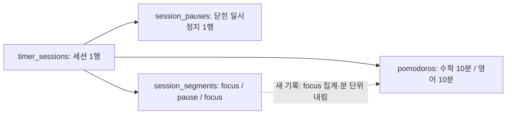
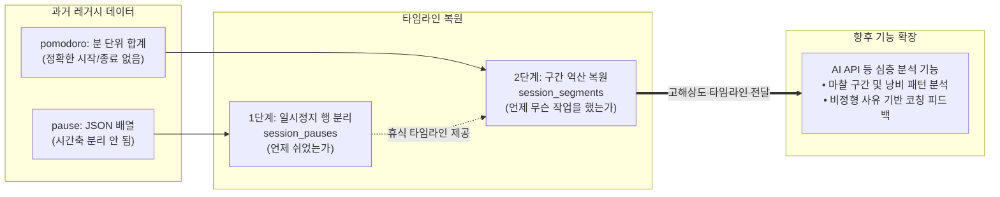

import DiagramPopout from "../../src/components/DiagramPopout";

import Collapse from "../../src/components/Collapse";

# 데이터베이스

PostgreSQL과 Drizzle ORM을 사용합니다. 아래 테이블과 관계는 `nest-server/src/postgresql/schema.ts`의 현재 정의를 기준으로 합니다. 컬럼은 본문에서 Drizzle의 camelCase 이름으로, ERD에서는 실제 DB의 snake_case 이름으로 표기합니다.

## 이 문서에서 쓰는 용어

| 용어 | 뜻 |
| --- | --- |
| 세션 | 타이머를 한 번 돌린 구간입니다. 집중 세션과 휴식 세션이 있습니다. |
| 사이클 | 집중 세션을 정해진 횟수만큼 반복하고, 그 사이에 짧은 휴식을, 마지막에 긴 휴식을 한 번 두는 묶음입니다. |
| 사이클 설정 | 사이클을 구성하는 값 5개(집중·짧은 휴식·긴 휴식 시간, 집중 반복 횟수, 사이클 반복 횟수)의 묶음입니다. 사용자는 여러 개를 만들어 두고 그중 하나를 선택해 사용합니다. |
| `ratio` | 한 사이클에서 실제로 집중한 시간을 그 사이클에 실제로 걸린 시간으로 나눈 값입니다. |
| 이행률(`cycleAdherenceRate`) | `ratio`를 목표 `ratio`로 나눈 값입니다. 목표 `ratio`는 사이클 설정값으로 계산한 목표 집중 시간을 목표 사이클 길이로 나눈 값입니다. 1에 가까울수록 설정한 대로 수행한 것입니다. |
| Task | Todoist에서 가져온 할 일입니다. 집중 시간을 카테고리뿐 아니라 Task별로도 기록합니다. |

## 테이블 구성

| 테이블 | 저장하는 내용 |
| --- | --- |
| `users` | 사용자 정보, 타이머 진행 상태, 자동 시작 설정, 목표 집중 시간 |
| `categories` | 사용자별 카테고리 이름, 색상, 통계 표시 여부 |
| `cycle_settings` | 집중·휴식 시간과 반복 횟수 등 사이클 설정 |
| `cycle_records` | 사이클을 수행한 시간과 이행률 |
| `timer_sessions` | 집중·휴식 세션의 시작·종료, 목표 시간·수정량, 조기 종료, 총 일시정지 시간 |
| `session_pauses` | 세션 안에서 닫힌 일시정지의 시작·종료와 사유 |
| `session_segments` | 작업·카테고리 변경과 focus/pause 경계로 나눈 ms 단위 타임라인 |
| `pomodoros` | 카테고리와 Task별로 나누어 저장한 집중 시간 |
| `todoist_tasks` | Todoist Task 정보, 상위 Task와의 관계, 누적 집중 시간 |
| `rooms` | 스터디 방 이름, 최대 참여 인원 등의 설정 |
{/* TODO: 사용자 정보를 제외한 column들 분리 */}

### 세션, 일시정지, 구간, 집중 시간 기록 {#session-records}

한 번의 타이머 실행을 서로 다른 단위로 보관합니다.

- `timer_sessions`는 집중(`kind = pomo`) 또는 휴식(`kind = break`) 한 세션의 전체 구간과 수행 결과입니다.
- `session_pauses`는 완료된 일시정지 한 번을 한 행으로 저장합니다. 진행 중인 일시정지는 `users.timersStates.pause`에 있습니다.
- `session_segments`는 세션 안에서 카테고리·Task 또는 focus/pause 상태가 바뀔 때 나눈 구간입니다. 같은 일시정지 안에서도 작업이 바뀌면 여러 pause segment가 될 수 있습니다.
- `pomodoros`는 focus 구간을 작업·카테고리 기준으로 집계한 분 단위 집중 시간입니다. pause segment는 합산하지 않습니다.

예를 들어 09:00~09:25에 수학 10분, 일시정지 5분, 영어 10분을 수행했다면 세션은 1행, 일시정지는 1행, segment는 3행, pomodoro는 2행입니다. 새 기록의 segment는 클라이언트가 만든 ms 단위 배열을 저장합니다. 과거 기록은 이미 저장된 pomodoro와 pause로부터 [세션 구간을 역복원](./timeline-backfill/session-segments-backfill.mdx)했습니다.

<DiagramPopout>



</DiagramPopout>

클라이언트가 변경 이력으로 구간을 만드는 과정은 [Session Segmentation](../problem-solving.mdx#session-segmentation)에, 기존 pause JSON을 행으로 옮긴 절차는 [Pause 행 분리](./timeline-backfill/session-pause-backfill.mdx)에 적었습니다.

#### FE 세션 맥락 보존과 향후 AI API 연계를 위한 정제 {#purpose-for-llm-context}

단순 타이머 기록이나 통계 UI(막대 그래프 등)를 렌더링하는 용도라면, 기존처럼 분 단위 집계인 `pomodoros`와 세션의 총 집중 시간만으로도 충분합니다. 그러나 `session_pauses`와 `session_segments`를 독립된 테이블과 ms 단위 타임라인으로 정규화·복원한 핵심 목적은, **프론트엔드(FE)에서 사용자가 실제로 겪은 작업 전환과 일시정지 맥락을 데이터베이스에 손실 없이 그대로 전달·저장하여 향후 AI API 등 심층 분석 기능에 대비하기 위함**입니다.

<DiagramPopout>



</DiagramPopout>

- **FE 맥락 전달의 중요성과 AI API의 필요성**:  
  "오늘 4시간 집중했고 3번 일시정지했다"는 단순 수치 데이터(Structured Data)는 전통적인 SQL 집계나 차트로도 표현할 수 있습니다. 하지만 이는 *"사용자가 왜 특정 시점에 집중을 멈추었는가?"*, *"어떤 성격의 작업에서 마찰(Friction)이 발생하는가?"*와 같은 **질적 원인(Qualitative Cause)**을 설명하지 못합니다. 향후 AI API를 연동하여 가치 있는 분석을 도출하려면, 클라이언트(FE)에서 일어난 구체적인 활동 맥락과 비정형 데이터(사유 텍스트, 할 일 명칭)가 DB에 온전히 보존되어 있어야 합니다.

- **타임라인 복원의 2단계 파이프라인**:
  - **[1단계: 일시정지 행 분리 (session_pauses)](./timeline-backfill/session-pause-backfill.mdx)**: 세션 내부에 JSON 배열로 갇혀 있던 일시정지 내역을 독립 행으로 분리하여, 정확히 언제 휴식이 발생했는지에 대한 시간축을 확립했습니다.
  - **[2단계: 세션 구간 역산 복원 (session_segments)](./timeline-backfill/session-segments-backfill.mdx)**: 1단계의 일시정지 타임라인을 기준으로, 과거 분 단위 집중 기록을 밀리초 단위의 연속 구간으로 역산 배치하여 "무슨 작업을 언제 수행했는가"를 복원했습니다.

- **비정형 텍스트와 세부 구간의 결합**:  
  - **일시정지 및 조기 종료 사유 (`reason`, `earlyEndReason`)**: 단순 시간 누수가 아니라 사용자가 직접 남긴 비정형 사유(예: "자료/레퍼런스 탐색", "집중력 저하/SNS", "긴급 용무")를 개별 pause 구간에 매핑합니다.
  - **작업명 및 카테고리 스냅샷 (`taskContent`, `categoryName`)**: Todoist에서 연동된 구체적인 할 일 제목(예: "WebRTC 소켓 재연결 디버깅")을 ms 단위 focus 구간에 연결합니다.
  - 이를 통해 향후 AI API는 *"사용자는 고난도 디버깅 작업 시 15~20분 전후로 '참고자료 탐색' 목적의 일시정지가 집중적으로 발생하며, 단순 반복 작업 시에는 '피로/딴짓'으로 인한 조기 종료 빈도가 높다"*와 같이 **작업 성격과 일시정지 사유 간의 인과적 집중 패턴**을 심도 있게 분석하고 맞춤형 코칭 피드백을 생성할 수 있습니다.

- **불변 텍스트 스냅샷의 필요성**:  
  사용자가 며칠 뒤 Todoist에서 할 일을 완료하여 삭제하거나 카테고리명을 변경하더라도, AI가 과거의 특정 날짜를 분석할 때 당시의 작업 맥락이 유실되어서는 안 됩니다. `session_segments`에 `taskContent`, `categoryName`을 텍스트 스냅샷으로 보존하도록 설계한 이유 역시 **AI 모델에 제공될 과거 시점의 비정형 맥락 데이터 무결성을 보장**하기 위한 결정입니다.

### 세션의 목표와 종료 정보 {#session-target-and-end}

| 컬럼 | 의미 |
| --- | --- |
| `startTime`, `endTime` | 세션 시작·종료 시각(epoch ms) |
| `timeCountedDown` | 실제 카운트다운 시간(ms) |
| `plannedDuration` | 시작 시 목표 시간(ms). 과거에 기록하지 않은 값은 NULL |
| `editedDuration` | +5/−5 등 목표 수정량의 합(ms). 기본값 0, 과거 미상 값은 NULL 가능 |
| `isEarlyEnded`, `earlyEndReason` | End 버튼으로 끊었는지와 선택 사유. 목표 시간과의 비교로 판정하지 않음 |
| `totalPauseLength` | 닫힌 일시정지 시간의 합(ms)을 저장한 값. 자식 행 변경 시 자동 재계산되지 않음 |

최종 목표 시간은 `plannedDuration + editedDuration`입니다. `earlyEndReason`은 조기 종료일 때만 가질 수 있습니다. 완료된 세션에 `pause` JSONB 컬럼은 더 이상 없으며, 개별 일시정지는 `session_pauses`로 읽습니다.

### session_segments의 컬럼과 스냅샷 {#session-segments}

| 컬럼 | 의미와 NULL 처리 |
| --- | --- |
| `id` | UUID 기본 키 |
| `userId`, `timerSessionId` | 사용자·세션 FK. 삭제 시 NULL로 바뀌며 구간 행은 남음 |
| `sequenceOrder` | 세션 안의 배열 순서. 0부터 부여 |
| `type` | `focus` 또는 `pause` |
| `startTime`, `duration` | 구간 시작 시각과 길이(ms) |
| `endTime` | `startTime + duration` 생성 컬럼. INSERT에서 제외 |
| `categoryName`, `taskId`, `taskContent` | 카테고리명, Todoist 원본 Task ID와 제목을 저장한 스냅샷 |
| `categoryId`, `todoistTaskId` | 현재 카테고리·Task 행과 연결하는 선택 FK. 삭제되면 NULL |
| `reason` | pause 구간의 선택 사유. focus와 빈 문자열은 NULL로 저장 |

`taskId`는 Todoist의 문자열 ID이고 `todoistTaskId`는 로컬 `todoist_tasks.id`의 UUID입니다. 빈 owner 문자열은 NULL로 바꾸지만 `uncategorized`라는 이름은 유지합니다. 해당 사용자의 카테고리·Task 행을 찾지 못해도 FK를 NULL로 두고 구간을 저장합니다.

이름과 제목을 함께 저장하므로 연결된 행이 삭제돼도 스냅샷 값은 남습니다. 새 세션에서는 저장 시점의 값을 담습니다. 백필에서 현재 카테고리명·Task 제목을 조회해 채운 값은 과거 시점의 값과 같다고 보장할 수 없습니다.

휴식 세션의 진행 구간도 `type = focus`입니다. 집중 시간을 집계할 때는 부모 세션의 `kind = pomo`와 구간의 `type = focus`를 함께 확인해야 합니다. 세션이 삭제돼 `timerSessionId`가 NULL이면 부모의 종류도 조인으로 확인할 수 없습니다.

## ERD

<DiagramPopout>
  
</DiagramPopout>

- 각 테이블의 기본 키는 UUID입니다. 사용자에 속한 카테고리, 사이클 설정, Task, 세션, 집중 시간 기록은 `userId`로 `users`를 참조합니다.
- `cycle_records`는 어떤 사이클 설정으로 수행한 기록인지 `cycleSettingId`로 연결합니다.
- `todoist_tasks`의 `parentTaskId`는 같은 테이블의 다른 행을 참조하여 상위·하위 Task 관계를 나타냅니다.
- `session_pauses.timerSessionId`는 필수 FK입니다. `session_segments`의 사용자·세션·카테고리·Task FK는 모두 NULL을 허용합니다.
- `rooms`는 다른 테이블과 연결하지 않았습니다. 현재 접속한 참여자 정보는 서버 메모리에서 관리합니다.

`pomodoros.timerSessionId`는 마이그레이션 과정에서 집중 시간 기록과 세션 기록을 연결하기 위해 추가한 외래 키입니다. 기존 데이터 중 대응하는 세션을 찾을 수 없는 경우가 있어 `NULL`을 허용했습니다. 현재 `POST /today-records`는 새 세션의 ID를 같은 요청에서 저장하는 `pomodoros.timerSessionId`와 `session_segments.timerSessionId`에 넣습니다.

### JSONB로 저장한 데이터

현재 JSONB는 `users`의 진행 중 타이머 상태·변경 배열·사이클 상태·목표 설정과 `todoist_tasks.taskData`에 사용합니다. 진행 중 pause는 종료 시각이 없을 수 있고 각 구간에 선택 사유가 있습니다. 완료된 세션의 pause는 별도 행으로 분리했습니다. [Pause 행 분리](./timeline-backfill/session-pause-backfill.mdx)는 이 변경의 이력입니다.

<Collapse title={"JSONB 타입과 컬럼 정의"}>

JSONB에 사용하는 TypeScript 타입입니다. `Task`는 Todoist SDK에서 제공하는 타입을 사용합니다.

```ts
import type { Task } from '@doist/todoist-sdk';

type TimersStates = {
  duration: number;
  pause: {
    totalLength: number;
    record: { start: number; end: number | undefined; reason: string | null }[];
  };
  repetitionCount: number;
  running: boolean;
  startTime: number;
};

type TaskChangeInfo = {
  id: string;
  taskChangeTimestamp: number;
};

type CategoryChangeInfo = {
  categoryName: string;
  categoryChangeTimestamp: number;
  color: string;
  progress: number;
};

type CycleInfo = {
  totalFocusDuration: number;
  cycleDuration: number;
  cycleStartTimestamp: number;
  veryFirstCycleStartTimestamp: number;
  totalDurationOfSetOfCycles: number;
};

export interface Goal {
  minimum: number;
  ideal: number;
}

export type DailyGoals = [Goal, Goal, Goal, Goal, Goal, Goal, Goal];

export interface Goals {
  weeklyGoal: Goal;
  dailyGoals: DailyGoals;
}
```

`users`의 JSONB 컬럼입니다.

```ts
timersStates: jsonb()
  .$type<TimersStates>()
  .default({
    duration: 25,
    pause: { totalLength: 0, record: [] },
    repetitionCount: 0,
    running: false,
    startTime: 0,
  })
  .notNull(),
taskChangeInfoArray: jsonb().$type<TaskChangeInfo[]>().default([]).notNull(),
categoryChangeInfoArray: jsonb()
  .$type<CategoryChangeInfo[]>()
  .default([
    {
      categoryName: 'uncategorized',
      categoryChangeTimestamp: 0,
      color: '#f04005',
      progress: 0,
    },
  ])
  .notNull(),
// Reset when a cylce ends
currentCycleInfo: jsonb()
  .$type<CycleInfo>()
  .default({
    totalFocusDuration: 100 * 60,
    cycleDuration: 130 * 60,
    cycleStartTimestamp: 0,
    veryFirstCycleStartTimestamp: 0,
    totalDurationOfSetOfCycles: 130 * 60,
  })
  .notNull(),

goals: jsonb()
  .$type<Goals>()
  .default({
    weeklyGoal: { minimum: 30, ideal: 40 },
    dailyGoals: [
      { minimum: 4, ideal: 6 },
      { minimum: 4, ideal: 6 },
      { minimum: 4, ideal: 6 },
      { minimum: 4, ideal: 6 },
      { minimum: 4, ideal: 6 },
      { minimum: 4, ideal: 6 },
      { minimum: 4, ideal: 6 },
    ],
  })
  .notNull(),
```

`todoist_tasks`의 JSONB 컬럼입니다. 기존 데이터 중 Task 객체가 없는 경우가 있어 `NULL`을 허용합니다.

```ts
taskData: jsonb().$type<Task>(),
```

TypeScript의 JSONB 타입 선언은 기존 DB 값의 내부 구조를 검사하거나 자동 변경하지 않습니다. 예전에 저장된 진행 중 pause에 `reason`이 없으면 클라이언트가 읽을 때 NULL로 정규화합니다.

</Collapse>

### 삭제 시 처리

| 삭제 대상 | 연결된 데이터의 처리 |
| --- | --- |
| 사용자 | 카테고리·사이클 설정·Task·세션·pomodoro는 CASCADE 삭제. 사이클 기록과 pause도 부모를 따라 삭제 |
| 사용자 또는 세션 | `session_segments.userId` 또는 `timerSessionId`는 SET NULL. 구간 행과 스냅샷 보존 |
| 세션 | `session_pauses`는 CASCADE 삭제, `pomodoros.timerSessionId`는 SET NULL |
| 카테고리 | `pomodoros.categoryId`, `session_segments.categoryId`는 SET NULL |
| Task | `session_segments.todoistTaskId`, 하위 Task의 `parentTaskId`는 SET NULL |

`pomodoros.todoistTaskId`에는 `onDelete`를 지정하지 않아 기본값 `NO ACTION`이 적용됩니다. 참조하는 pomodoro가 남아 있으면 그 Task만 삭제할 수 없습니다. 사용자 삭제 시에는 해당 사용자의 pomodoro도 함께 삭제됩니다.

카테고리가 삭제되면 pomodoro에는 기존 이름·색상이 남지 않습니다. 반면 segment에는 `categoryName`이 남으며 색상 스냅샷 컬럼은 없습니다. Task 제목은 segment의 `taskContent`에 남습니다.

## 제약조건과 인덱스

### 사용자별 이름 중복 방지

`categories`와 `cycle_settings`에는 `(userId, name)` 조합에 UNIQUE 제약조건을 설정했습니다. 같은 사용자가 동일한 이름을 중복해서 만들 수는 없지만, 서로 다른 사용자는 같은 이름을 사용할 수 있습니다.

`todoist_tasks`도 `(userId, todoistTaskId)` 조합이 중복되지 않도록 했습니다.

### 현재 선택된 항목

카테고리와 사이클 설정은 각각 사용자당 최대 하나만 `isCurrent: true`가 될 수 있도록 Partial Unique Index를 설정했습니다.

```ts
uniqueIndex('categories_user_id_is_current_unique')
  .on(table.userId)
  .where(sql`${table.isCurrent} = true`)
```

`isCurrent`가 `true`인 행에만 적용되므로, 선택되지 않은 항목은 여러 개 저장할 수 있습니다. 반드시 하나를 선택하도록 강제하는 것은 아닙니다.

### 사용자와 시작 시각

`timer_sessions`와 `pomodoros`에는 `(userId, startTime DESC)` 조합으로 Unique Index를 설정했습니다. 같은 사용자의 기록에 동일한 시작 시각이 중복해서 저장되는 것을 막습니다.

앞에서 본 것처럼 하나의 집중 세션이 여러 `pomodoros` 행으로 나뉘지만, 각 행의 `startTime`이 카테고리를 바꾼 시각이라 서로 다르므로 이 제약과 충돌하지 않습니다.

정렬 방향 `DESC`는 유일성에는 영향을 주지 않습니다. 사용자별 기록을 최신순으로 조회하는 데 이 인덱스를 그대로 쓰기 위한 것입니다.

### 세션·pause·segment의 제약조건 {#session-constraints}

- `timer_sessions`: 종료 ≥ 시작, 목표 시간·최종 목표 시간·카운트다운·총 pause 시간 ≥ 0입니다. `editedDuration` 자체는 음수가 될 수 있습니다. 목표 관련 컬럼이 NULL이면 해당 CHECK는 미상 값을 허용합니다.
- `timer_sessions`: `isEarlyEnded OR earlyEndReason IS NULL`로 조기 종료가 아닌 행의 사유를 금지합니다.
- `session_pauses`: 종료 ≥ 시작이고 `(timerSessionId, startTime)`이 유일합니다. 길이 0인 pause도 스키마상 허용됩니다. `duration = endTime - startTime`은 생성 컬럼입니다.
- `session_segments`: `duration >= 0`이고 `(timerSessionId, sequenceOrder)`가 유일합니다. `timerSessionId`가 NULL인 행에는 PostgreSQL 기본 UNIQUE의 NULL 처리 규칙에 따라 같은 순서 값이 있을 수 있습니다.
- `session_segments`: `(timerSessionId, startTime)`, `(userId, startTime)`에 조회용 일반 인덱스가 있습니다.

구간 간 겹침, 세션 범위 안에 있는지, `totalPauseLength`와 자식 합이 같은지는 위 행 단위 CHECK만으로 보장되지 않습니다. 생성 컬럼이 자동 계산하는 것은 해당 행의 종료 시각 또는 길이입니다.

## 조회와 트랜잭션

### 집중 시간 조회

- 통계용 Pomodoro 기록을 조회할 때는 연결된 카테고리의 이름, 색상, 통계 표시 여부도 함께 가져옵니다.
- 오늘의 총 집중 시간은 사용자와 날짜로 기록을 찾고, `SUM(duration)`으로 합산합니다. 기록이 없으면 0을 반환합니다.

### 세션 완료 시 저장 {#saving-completed-sessions}

현재 `TodayRecordsService.createTodayRecord`는 `POST /today-records` 요청을 다음 순서로 하나의 PostgreSQL 트랜잭션에서 처리합니다.

1. `timer_sessions`에 세션을 저장하고 ID를 받습니다.
2. 닫힌 pause를 `session_pauses`에 저장합니다.
3. 요청의 `segments` 배열을 `session_segments`에 저장합니다. 집중·휴식 세션 모두 전달하며, `sequenceOrder`는 배열 순서입니다.
4. 집중 세션이면 요청의 `pomodoroRecordArr`를 `pomodoros`에 저장하고 Task별 누적 집중 시간을 갱신합니다.

세션 FK는 위에서 생성한 ID를 사용합니다. 트랜잭션 안에서 오류를 던지면 함께 롤백됩니다. 카테고리·Task FK를 찾지 못하는 구간은 NULL로 저장하며, 연동 해제 등으로 누적 갱신 대상 Task가 없어진 경우에는 그 갱신을 건너뜁니다.

새 segment는 서버가 pomodoro에서 역산하지 않습니다. 클라이언트가 변경 이력으로 만든 배열을 저장하며, [과거 기록의 백필](./timeline-backfill/session-segments-backfill.mdx)만 저장된 pomodoro와 pause를 입력으로 사용합니다.

## MongoDB 문서를 PostgreSQL 테이블로 변환한 기준

기존 MongoDB의 `User` 문서에는 사용자 정보, 설정, 진행 중인 타이머 상태, 다른 문서의 참조가 함께 들어 있었습니다. 이를 PostgreSQL로 옮길 때는 기본 타입을 대응시키는 작업과, 중첩 객체(subdocument)·배열의 저장 구조를 결정하는 작업이 필요했습니다.

정규화와 참조 무결성을 기본으로 고려하되, 중첩된 값을 모두 같은 방식으로 변환하지는 않았습니다. 각 데이터의 역할, 생명주기, 조회·갱신 단위를 살펴보고 **개별 컬럼으로 평탄화할지, JSONB로 유지할지, 별도 테이블의 행으로 분리할지** 결정했습니다.


<Collapse title={"MongoDB User 스키마 vs PostgreSQL users 테이블 정의 비교"}>

```typescript
// 1. 기존 MongoDB Mongoose User 스키마 (nest-server/src/schemas/user.schema.ts)
@Schema()
export class User {
  @Prop({ unique: true })
  firebaseUid: string;

  @Prop({ unique: true })
  userEmail: string;

  @Prop()
  userNickname: string;

  // 1:N 참조는 부모 문서 내 ObjectId 배열로 보관
  @Prop({ type: [{ type: mongoose.Schema.Types.ObjectId, ref: 'CycleSetting' }] })
  cycleSettings: CycleSetting[];

  @Prop({ type: [{ type: mongoose.Schema.Types.ObjectId, ref: 'Category' }] })
  categories: Category[];

  // 진행 중 타이머 상태는 중첩 객체(Raw)로 보관
  @Prop(raw({
    duration: { type: Number },
    pause: {
      totalLength: { type: Number },
      record: [{ start: Number, end: Number }]
    },
    running: { type: Boolean },
    startTime: { type: Number }
  }))
  timersStates: TimersStates;
}
```

```typescript
// 2. 이관된 PostgreSQL Drizzle users 테이블 (nest-server/src/postgresql/schema.ts)
export const users = pgTable('users', {
  id: uuid().defaultRandom().primaryKey(),
  firebaseUid: varchar({ length: 255 }).notNull().unique(),
  userEmail: varchar({ length: 255 }).notNull().unique(),
  userNickname: varchar({ length: 255 }),

  // 1:N 참조 배열은 자식 테이블(cycle_settings, categories)의 userId 외래 키로 분리하여 정규화
  // 진행 중인 타이머 상태는 UPDATE 빈도가 높으므로 단일 JSONB 컬럼으로 유지
  timersStates: jsonb().$type<TimersStates>().notNull(),
  taskChangeInfoArray: jsonb().$type<TaskChangeInfo[]>().default([]).notNull(),
  categoryChangeInfoArray: jsonb().$type<CategoryChangeInfo[]>().default([]).notNull(),
});
```

</Collapse>

<!--- Questions
  - subdocument이라고 표현하는게 맞는지? MongoDB에서 subdocument과 그냥 field 자체가 json형태를 띄는 것과는 다른것으로 알고있는데, 잘못 알고있는것인지, 아니면 그냥 엄밀하게 subdocument는 아니지만 그렇게 표현해도 괜찮은것인지 궁금.
  - 그리고 적절한 곳에 Collapse component를 이용해서 user schema와 user table 정의를 보여주는게 좋을 것 같아.-->

### 기본 타입과 문서 참조의 변환

문자열과 boolean 같은 기본 타입 필드는 개별 컬럼으로 대응시켰습니다. 이때는 구조 변경보다 타입의 범위, `NULL` 허용 여부, 기본값과 제약조건을 확인하는 것이 주된 작업입니다. 숫자도 의미에 따라 구분하여, 사이클 설정의 시간·횟수는 `integer`, 밀리초 단위의 시작·종료 시각은 `bigint`, 이행률은 `double precision`으로 옮겼습니다.

`User.cycleSettings`와 `User.categories`는 다른 컬렉션의 문서를 가리키는 `ObjectId[]`였습니다. 각 사이클 설정과 카테고리는 사용자 한 명에게 속하므로, 각각 `cycle_settings`, `categories` 테이블로 옮기고 자식 행의 `userId`가 `users.id`를 참조하도록 했습니다. 부모에 ID 배열을 저장하던 관계를 자식의 외래 키로 표현한 것입니다.

참조 배열이라고 해서 항상 중간 연결 테이블을 만드는 것은 아닙니다. 이 프로젝트에서는 1:N 관계이므로 자식의 외래 키로 충분하며, 같은 항목을 여러 사용자가 공유하는 N:M 관계라면 별도 연결 테이블을 검토해야 합니다.

<!--- Questions
  - 사실 이부분도 mongoose level에서는 `Number`로 통일되는데, 실제 MongoDB Atlas에 접속해서 확인해보면, Integer인것도 있고 double인 것도 있더라고.. 그래서 숫자도 의미에 따라 구분한것은 맞긴 한데, 그냥 디테일하게 적지 않아도 되려나? `그러니까, MongoDB에 저장된 실제 type과는 별개로... PostgreSQL에는 1:1대응이 잘 안되는 것 같으니 다시 판단을 했다.` 이렇게 하면 되나?
  - 그리고 그냥 bigint와 double precision등으로 설정한 이유도 찾아줄 수 있어?
  - 그리고 내 기억에 timestamp냐 bigint냐 둘중 하나를 고민했던 것도 있었는데, 이게 AI와 이야기 하면서 구현한 것이라서 기억이 잘 안나.
  - 참조 배열이라고 항상 연결 테이블을 만드는게 아니라는 증거를 나에게 설명해줘. 나는 잘 모르겠음. `ObjectId[]`를 type으로 갖는 mongoose schema field는 무조건 별개의 테이블이 존재할 수 밖에 없는거 아닌가? 애초에 저런 type을 사용한 것의 전제가 ObjectId를 unique key로 갖는 collection이 존재한다는 거잖아.-->

### 중첩 객체와 배열을 판단한 기준

중첩된 값은 다음 두 가지를 기준으로 검토했습니다.

**기준 A. 진행 중인 상태인가, 완료된 기록인가?**
기존 행을 계속 갱신(`UPDATE`)하는 데이터인지, 완료될 때마다 새 행을 추가(`INSERT`)해 쌓는 데이터인지 구분합니다. 판별은 "언제 초기화되는가"로 합니다. 세션 종료나 사이클 종료처럼 값이 되돌아가는 시점이 있으면 진행 중인 상태이고, 한번 만들어진 뒤 그대로 남으면 완료된 기록입니다.

**기준 B. 내부 요소를 하나씩 다뤄야 하는가?**
객체의 각 필드나 배열의 각 항목을 개별적으로 조회·제약·연결할 필요가 있는지 봅니다. 필요하면 필드는 개별 컬럼으로, 배열 항목은 별도 테이블의 행으로 만들어 타입·기본값·외래 키를 지정할 수 있게 합니다. 필요 없으면 묶음 그대로 JSONB에 둡니다.

두 기준은 서로 다른 것을 정합니다. A는 **행을 갱신할지 추가할지**를, B는 **한 컬럼에 담을지 풀어낼지**를 정합니다.

**기준 B의 예시: 일시정지 내역(`pause.record`)**
<Collapse title={"pause객체 안의 record array field"}>
```ts
import { Prop, Schema, SchemaFactory, raw } from '@nestjs/mongoose';

interface Pause {
  totalLength: number;
  record: { start: number; end: number }[]; // <--
}

@Schema()
export class TodayRecord {
  @Prop({ required: true })
  userEmail: string;

  // NOTE: If kind is 'pomo', I think it is possible to connect many pomodoro sessions to one TodayRecord.
  @Prop()
  kind: 'pomo' | 'break';

  @Prop()
  startTime: number;

  @Prop()
  endTime: number;

  @Prop()
  timeCountedDown: number;

  @Prop(
    raw({
      type: {
        totalLength: Number,
        record: [{ start: Number, end: Number }],
      },
      default: { totalLength: 0, record: [] },
    }),
  )
  pause: Pause; // <--
}

export const TodayRecordSchema = SchemaFactory.createForClass(TodayRecord);
```
</Collapse>

오전 9시부터 9시 30분까지 진행한 세션에 9시 10분부터 9시 15분까지의 일시정지가 있다고 가정합니다. 최초 이관 당시 서버는 세션의 시작·종료 시각과 `pause`를 함께 가져왔고, Timeline은 이 정보로 일시정지를 표시했습니다. 당시에는 구간마다 별도 행을 만들 필요가 없다고 판단하여 `timer_sessions.pause`의 JSONB로 저장했습니다.

이후 일시정지 구간 자체의 독립적인 시계열 분석과 비정형 사유(`reason`) 보관, 그리고 향후 LLM 기반 집중 패턴 분석 기능(`feature/ai-report`)과의 연계를 위해 `session_pauses`로 분리했습니다. 위 JSONB 선택은 최초 이관 시점의 판단입니다. 현재는 닫힌 일시정지를 독립된 행으로 저장하고, 작업 변경까지 포함한 상세 타임라인은 `session_segments`로 보관합니다.

함께 조회한다는 사실만으로 JSONB를 선택하는 것은 아닙니다. 아래의 `cycleStat`은 현재 사이클 설정과 함께 조회하지만, 완료 기록을 독립적으로 보관·분석하려는 의도로 별도 테이블로 분리했습니다.

<Collapse title={"cycleStat 객체 배열을 cycle_records의 개별 행으로 변환한 코드"}>

기존 `schemas/cycleSetting.schema.ts`에서 관련 부분을 발췌했습니다. `cycleStat`에는 다른 문서의 ObjectId 대신, 사이클 수행 결과 객체 자체가 들어 있습니다.

```ts
export type CycleRecord = {
  ratio: number;
  cycleAdherenceRate: number;
  start: number;
  end: number;
};

@Schema({ timestamps: true })
export class CycleSetting extends Document {
  // 다른 필드는 생략

  @Prop({ type: Array, default: [] })
  // DESIGN: Separate table
  // CycleSetting : cycleStat -> 1 : N
  cycleStat: [CycleRecord];
}
```

배열의 각 요소는 시작·종료 시각과 이행률을 가진 수행 기록 한 건입니다. 예를 들어 “이 설정으로 수행한 사이클의 이행률이 날짜에 따라 어떻게 달라졌는가?”를 분석하려면 각 기록을 개별적으로 다루게 됩니다. 이 필요를 고려해 `postgresql/schema.ts`에서는 다음과 같이 별도 테이블을 정의했습니다.

```ts
export const cycleRecords = pgTable('cycle_records', {
  id: uuid().defaultRandom().primaryKey(),
  cycleSettingId: uuid()
    .notNull()
    .references(() => cycleSettings.id, { onDelete: 'cascade' }),
  ratio: doublePrecision().notNull(),
  cycleAdherenceRate: doublePrecision().notNull(),
  start: bigint({ mode: 'number' }).notNull(),
  end: bigint({ mode: 'number' }).notNull(),
});
```

`database-migration/migrate.ts`에서는 사이클 설정을 먼저 저장한 뒤, 그 ID를 배열의 각 요소에 붙여 삽입합니다. 아래는 해당 이관 코드의 핵심 부분입니다.

```ts
const stats = doc.cycleStat ?? [];
if (stats.length > 0) {
  const recordsToInsert = stats.map((s: any) => ({
    cycleSettingId: insertedSetting.id,
    ratio: s.ratio,
    cycleAdherenceRate: s.cycleAdherenceRate,
    start: s.start,
    end: s.end,
  }));

  await db.insert(schema.cycleRecords).values(recordsToInsert);
}
```

즉, 설정 문서 안에 기록 객체가 3개 있었다면, 이관 후에는 같은 `cycleSettingId`를 가진 `cycle_records` 행 3개가 생깁니다. 기준 B에서 판단한 것은 이처럼 **내장된 배열의 각 항목을 독립된 행으로 다룰 필요가 있는지**였습니다.

</Collapse>

이 질문을 바탕으로 선택한 구조는 다음과 같습니다.

- [관련 Mongodb schema 정의 링크](https://github.com/Yonghwan-Song/pomodoro/tree/79396a8335030989bf509097e157f8b465e13734/nest-server/src/schemas)
- [PostgreSQL table정의 링크](https://github.com/Yonghwan-Song/pomodoro/blob/79396a8335030989bf509097e157f8b465e13734/nest-server/src/postgresql/schema.ts#L4)

| 기존 데이터 | 변환 결과 | 기준 | 판단의 중심 |
| --- | --- | --- | --- |
| `autoStartSetting` | `users`의 boolean 컬럼 3개 | B | 항목이 3개로 정해져 있고 각각 boolean 타입과 기본값을 지정할 수 있음 |
| `CycleSetting.pomoSetting` | `cycle_settings`의 숫자 컬럼 5개 | B | 시간·횟수 항목이 5개로 정해져 있어 각각 정수 컬럼으로 정의 |
| `timersStates` | `users`의 JSONB | A | 진행 중인 타이머를 표현하고 복원하는 상태 묶음 |
| `taskChangeInfoArray`, `categoryChangeInfoArray` | `users`의 JSONB | A | 현재 세션의 시간 분할 계산 등에 사용한 뒤 초기화하는 변경 내역 |
| `currentCycleInfo` | `users`의 JSONB | A | 사이클 진행과 이행률 계산에 사용하는 현재 상태 |
| `goals` | `users`의 JSONB | B | 주간·요일별 현재 목표를 하나의 설정 묶음으로 보관 |
| `CycleSetting.cycleStat` | `cycle_records`의 여러 행 | A·B | 설정과 구분하여 조회·보관할 완료된 사이클 기록 |
| 세션의 `pause` | 최초 이관에서는 JSONB, 현재는 `session_pauses` | B | 완료된 일시정지를 독립된 구간으로 조회·관리하도록 분리 |

<Collapse title={"기준 적용 설명"}>

#### 설정 항목별로 타입과 기본값을 지정하도록 평탄화 — 기준 B

`autoStartSetting`에는 집중·휴식·사이클을 자동으로 시작할지 정하는 항목 3개가 있습니다. 각 값은 사용자가 켜고 끌 수 있지만, 항목의 이름과 boolean이라는 타입은 정해져 있습니다. 이를 개별 컬럼으로 풀어 각 항목에 boolean 타입, 기본값 `false`, `NOT NULL`을 직접 지정했습니다.

`pomoSetting`도 집중·짧은 휴식·긴 휴식 시간과 집중·사이클 반복 횟수라는 항목 5개가 정해져 있습니다. 각 항목을 `cycle_settings`의 정수 컬럼으로 만들고 기본값과 `NOT NULL`을 지정했습니다. 클라이언트에는 서버가 이 컬럼들을 다시 `pomoSetting` 객체로 묶어 응답하므로, 저장 형태를 바꿔도 기존 API의 객체 구조를 유지할 수 있습니다.

다만 정수 컬럼으로 만드는 것만으로 허용 범위까지 제한되지는 않습니다. 예를 들어 기존 Mongoose 정의의 `pomoDuration`에는 1~1000이라는 범위가 있지만, 현재 PostgreSQL 스키마에는 이 범위를 강제하는 `CHECK`가 없습니다. 필드의 타입을 옮기는 작업과 최솟값·최댓값 같은 검증 규칙을 옮기는 작업은 각각 확인해야 합니다.

#### 자동 시작 옵션은 사이클별 설정과 분리해서 저장 — 기준 A·B와 별개인 "어느 테이블에 둘지"

자동 시작 옵션을 어느 테이블에 둘지는 평탄화 여부와 별도로 판단했습니다. `pomoSetting`은 사용자가 만들어 둔 각 사이클 설정에 속합니다. 반면 `autoStartSetting`은 어떤 사이클 설정을 선택했는지와 별개로 적용하는 사용자 옵션입니다.

예를 들어 집중 세션 도중 자동 휴식 시작을 켜면, 진행 중인 세션을 초기화하지 않고 다음 휴식의 시작 방식에 적용합니다. 세션이나 사이클이 끝나도 이 옵션은 유지됩니다. 이런 적용 범위와 변경 시점의 차이를 고려해, 자동 시작 옵션은 `cycle_settings`에 넣지 않고 `users`에 두었습니다. 사용자별 설정 테이블을 따로 만들 수도 있다는 점은 아래에서 설명합니다.

#### 진행 중인 타이머 상태는 기존 객체·배열 구조를 JSONB로 유지 — 기준 A·B

`timersStates`는 실행 여부, 시작 시각, 일시정지 구간 등을 저장하여 진행 중인 타이머를 복원하는 데 사용합니다. `taskChangeInfoArray`와 `categoryChangeInfoArray`에는 집중 세션 도중 작업이나 카테고리를 바꾼 시점이 추가됩니다. 세션이 끝나면 이 배열로 작업·카테고리별 집중 시간을 계산해 별도 기록으로 저장하고, 배열은 다음 세션을 위한 상태로 초기화합니다.

이번 이관에서는 이러한 상태 객체와 배열을 JSONB로 유지하여, 기존 코드가 사용하던 구조를 크게 바꾸지 않고 저장·복원할 수 있도록 했습니다. 특히 변경 배열의 각 항목을 영구 이력으로 보관하는 테이블은 만들지 않았습니다. 세션 안에서 시간을 계산하기 위한 데이터라는 현재 용도를 우선한 선택입니다.

이것만이 가능한 저장 방식은 아닙니다. `timersStates`의 실행 여부·시작 시각은 개별 컬럼으로 풀고 일시정지 배열만 JSONB로 남길 수도 있습니다. 현재 구현은 이런 세부 분해까지 진행하지 않고 기존 상태 객체를 유지한 것입니다.

`currentCycleInfo`도 JSONB로 유지했지만 초기화 시점은 다릅니다. 개별 집중 세션마다 전체를 초기화하지 않고, 설정한 사이클 반복의 마지막 집중 세션이 끝나면 `cycleStartTimestamp`와 `veryFirstCycleStartTimestamp`를 0으로, 시간 관련 값들을 선택한 설정의 목표값으로 되돌립니다. 이 값은 현재 실행을 위한 상태이고, 완료된 수행 결과는 `cycleStat`으로 구분합니다.

#### 목표 설정과 완료된 세션의 일시정지 배열도 JSONB로 유지 — 기준 B {#goals-and-completed-pauses}

`goals`에는 주간 목표와 요일별 목표 7개가 들어 있습니다. 현재 서버는 전달받은 목표 객체로 `users.goals`를 갱신합니다. 이번 이관에서는 이 저장 방식을 JSONB로 유지했습니다. 앞의 자동 시작 옵션처럼 필드별로 평탄화하는 선택도 가능하며, 기존 대화 기록만으로는 JSONB를 택한 추가 근거가 명확하지 않습니다.

요일별 목표를 각각 조회·관리하는 요구가 커지면 요일당 한 행을 갖는 목표 테이블을 검토할 수 있습니다. “지난달에는 목표를 얼마로 설정했는가?”처럼 변경 이력을 보려면 별도의 작업이 필요합니다. 현재 목표를 덮어쓰는 대신, 변경 시점과 당시 목표를 추가 기록으로 저장해야 합니다.

완료된 세션의 `pause.record`는 진행 중인 타이머 상태와 달리 세션 기록에 남는 배열입니다. MongoDB에서 옮길 때는 해당 세션의 Timeline을 그릴 때 세션과 함께 읽으므로 `timer_sessions.pause`의 JSONB 안에 두었습니다. 그 배열을 `session_pauses` 행으로 복사한 작업은 [완료된 세션의 일시정지를 행으로 옮긴 방법](./timeline-backfill/session-pause-backfill.mdx)에 적었습니다.

#### 완료된 기록은 별도 행으로 분리 — 기준 A·B

`cycleStat`은 사이클 설정 문서 안에 들어 있던 완료 기록 배열입니다. 설정값 자체와 수행 결과는 역할이 다르므로(기준 A), 각 요소를 `cycle_records`의 행으로 만들고 `cycleSettingId`로 설정과 연결했습니다(기준 B).

`cycleStat`과 작업·카테고리 변경 배열은 모두 객체 배열이지만, 전자는 완료된 수행 기록이고 후자는 현재 세션의 계산에 사용하는 상태입니다. **배열이라는 형태보다, 요소를 독립된 기록으로 보관하고 사용할 필요가 있는지가 분리의 기준**이었습니다.

다만 테이블 분리와 전체 이력 누적은 아직 별개의 단계입니다. 현재 API는 클라이언트가 보내는 최근 최대 10개 기록 배열에 맞춰 기존 `cycle_records`를 삭제하고 다시 삽입합니다. 모든 기록을 계속 보관하려면 완료된 기록 한 건을 추가하는 방식으로 API와 클라이언트를 변경해야 합니다. `averageAdherenceRate`도 현재는 `cycle_settings`의 컬럼으로 유지하며, 조회 시 원본 기록에서 계산하는 방식으로 전환한 상태는 아닙니다.
</Collapse>

### 객체를 어떻게 저장할지와 어느 테이블에 둘지는 각각 결정

`autoStartSetting` 같은 중첩 객체를 옮길 때는 다음 두 가지를 각각 결정할 수 있습니다.

1. **한 컬럼에 담을 것인가, 여러 컬럼으로 풀 것인가?** 객체 전체를 JSONB 컬럼 하나에 저장하거나, 내부의 자동 시작 설정값 3개를 각각 boolean 컬럼으로 만들 수 있습니다.
2. **그 컬럼들을 `users`에 둘 것인가, 별도 설정 테이블에 둘 것인가?** JSONB를 선택했든 boolean 컬럼 3개를 선택했든, 사용자 정보와 같은 행에 저장할 수도 있고 별도 테이블의 행에 저장할 수도 있습니다.

예를 들어 사용자별 설정을 담는 `user_settings` 테이블을 만든다고 가정하면, 다음 네 조합이 모두 가능합니다.

| 설정값을 담는 방식 | `users`에 저장 | 별도 `user_settings`에 저장 |
| --- | --- | --- |
| JSONB | 사용자 행의 `autoStartSetting` 컬럼에 객체 저장 | 설정 행의 `autoStartSetting` 컬럼에 객체 저장 |
| 평탄화 | 사용자 행의 boolean 컬럼 3개에 저장 **(현재 구현)** | 설정 행의 boolean 컬럼 3개에 저장 |

별도 테이블을 만든다면 설정 행에 `userId`를 두어 어느 사용자의 설정인지 연결합니다. 이 컬럼을 `users.id`를 참조하는 외래 키이자 기본 키로 정의하면, 같은 사용자의 설정 행이 여러 개 생기는 것도 막을 수 있습니다.

따라서 `autoStartSetting`을 boolean 컬럼 3개로 풀었다고 해서 반드시 `users`에 두어야 하는 것은 아닙니다. 나중에 사용자 정보와 설정을 따로 관리하기로 하면, 그 컬럼 3개를 그대로 `user_settings`로 옮길 수 있습니다. JSONB로 저장한 타이머 상태 역시 객체 구조를 유지한 채 별도 타이머 상태 테이블로 옮길 수 있습니다.

이 예시의 테이블 분리는 사용자 한 명의 설정 묶음을 별도 행에 두는 1:1 분리입니다. 앞의 `cycleStat`처럼 배열의 각 기록을 여러 행으로 만드는 1:N 분리와는 구분해야 합니다. 현재 자동 시작 옵션 컬럼 3개, `goals`, `timersStates`, `currentCycleInfo` 등은 `users`에 남아 있습니다. 이 데이터를 사용자별 설정·타이머 상태 테이블로 옮기는 것은 향후 검토 사항입니다.

### 결정한 구조로 데이터를 이관한 방법

위 구조에 맞춰 변환 스크립트를 작성했습니다.

- 사용자를 먼저 PostgreSQL에 저장하고, 이메일로 새 사용자 UUID를 찾을 수 있는 매핑을 만들었습니다. 예를 들어 기존 사이클 설정 문서의 `userEmail`로 이 매핑을 조회한 뒤, 찾은 UUID를 `cycle_settings.userId`에 넣었습니다.
- 다른 문서의 ObjectId를 참조하던 필드에도 같은 방법을 사용했습니다. 카테고리를 옮길 때 기존 ObjectId와 새 카테고리 UUID를 매핑해 두고, Pomodoro 기록이 가리키던 ObjectId를 새 UUID로 바꾸어 `pomodoros.categoryId`에 넣었습니다. 기존 문서 간 연결을 새 테이블의 외래 키로 다시 연결한 것입니다.
- `autoStartSetting`과 `pomoSetting`은 내부 값을 꺼내 개별 컬럼에 넣고, `cycleStat`은 생성된 사이클 설정의 ID를 붙여 여러 행으로 저장했습니다.
- JSONB도 기존 객체를 그대로 복사하지 않고 필요한 필드를 골라 새 객체를 만들었습니다. 예를 들어 `timersStates.pause.record`의 각 요소에서는 `start`와 `end`만 가져왔습니다. 이 구간들을 별도 문서로 식별하는 데 사용하지 않는 MongoDB의 `_id`는 옮기지 않았습니다. 값이 누락된 경우에는 `timersStates.running`에 `false`, 일시정지 구간 배열에 `[]`를 넣는 식으로 기본값을 적용했습니다.
- 과거 Pomodoro 기록과 대응하는 세션을 찾을 수 없는 경우에는 `timerSessionId`를 `NULL`로 남겼습니다.
