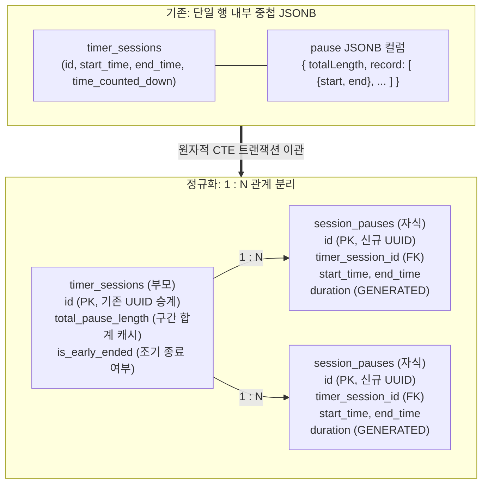

import DiagramPopout from "../../../src/components/DiagramPopout";
import Collapse from "../../../src/components/Collapse";

# 완료된 세션의 일시정지를 개별 행으로 분리한 원리

> [!NOTE] FE 맥락 보존 및 향후 AI API 연계 (1단계)
> 본 작업은 향후 AI API 등을 활용한 분석 기능 확장을 염두에 두고, **프론트엔드(FE)에서 실제로 발생한 일시정지 맥락을 데이터베이스에 온전히 전달·저장**하기 위해 진행되었습니다. 기존 세션 1개 행 내부에 JSONB 배열(`pause.record`)로 뭉뚱그려져 있던 일시정지 내역을 독립된 하위 테이블(`session_pauses`)의 개별 행으로 정규화하여, "언제 어떤 일시정지가 발생했는가"에 대한 정확한 시간축과 맥락을 확보했습니다.

기존 데이터 모델에서는 완료된 세션 1개 행 내부에 JSONB 배열(`pause.record`) 형태로 일시정지 내역이 중첩 저장되어 있었습니다. 이 문서는 중첩된 일시정지 데이터를 상위 세션 테이블(`timer_sessions`)과 독립적인 하위 일시정지 테이블(`session_pauses`)의 개별 행으로 정규화하여 분리·적재한 마이그레이션 절차를 정리합니다.

## 배경 및 정규화 목적 {#background}

과거 레거시 스키마에서는 `timer_sessions` 1개 행에 `pause` JSONB 컬럼이 포함되어 있었으며, 내부에 `{ totalLength: number, record: [{ start, end }] }` 형태로 일시정지 구간이 저장되었습니다.

```json
{
  "totalLength": 180000,
  "record": [
    { "start": 1710000000000, "end": 1710000060000 },
    { "start": 1710000120000, "end": 1710000240000 }
  ]
}
```

이러한 비정규화 중첩 구조는 다음과 같은 한계가 있었습니다:
- **인덱싱 및 필터링 제약**: 일시정지 구간이 독립 행이 아니므로, 특정 길이 이상의 일시정지나 기간별 집계를 하려면 매번 JSONB 배열을 풀어서(Unnesting) 스캔해야 했습니다.
- **집계 및 외래키 부재**: 일시정지 구간 자체에 대한 제약조건이나 세션과의 관계 무결성을 DB 엔진 차원에서 보장하기 어려웠습니다.

따라서 세션과 일시정지를 표준적인 1:N 관계의 독립 테이블로 정규화했습니다.

<DiagramPopout>



</DiagramPopout>

> [!NOTE] 테이블 명칭 이력
> 마이그레이션 작업 당시에는 데이터 검증을 위해 신규 테이블을 `timer_sessions_new`로 생성하고 원본을 `timer_sessions`로 유지했습니다. 이관 및 전수 검증이 완료된 직후 원본은 `timer_sessions_old`(백업용 보존)로, 신규 테이블은 `timer_sessions`로 이름을 변경했습니다. 기존 세션의 UUID는 그대로 승계하여 `pomodoros.timer_session_id` 등 외래키 참조를 안전하게 유지했습니다.

## 정규화 스키마 설계 및 제약조건 {#schema-design}

신규 테이블은 Drizzle 스키마를 통해 생성되었습니다. 일시정지 구간 길이(`duration`)는 DB 엔진 레벨의 `GENERATED ALWAYS` 가상/저장 컬럼으로 선언하여 불일치 가능성을 원천 차단했습니다.

<Collapse title={"도착 테이블 DDL 및 인덱스 정의 (session_pauses & timer_sessions)"}>

```sql
CREATE TABLE "session_pauses" (
  "id" uuid PRIMARY KEY DEFAULT gen_random_uuid() NOT NULL,
  "timer_session_id" uuid NOT NULL,
  "start_time" bigint NOT NULL,
  "end_time" bigint NOT NULL,
  "duration" bigint GENERATED ALWAYS AS (end_time - start_time) STORED NOT NULL,
  "reason" text,
  CONSTRAINT "session_pauses_end_after_start" CHECK ("end_time" >= "start_time"),
  CONSTRAINT "session_pauses_timer_session_id_fk"
    FOREIGN KEY ("timer_session_id") REFERENCES "timer_sessions"("id") ON DELETE CASCADE
);

CREATE TABLE "timer_sessions" (
  "id" uuid PRIMARY KEY DEFAULT gen_random_uuid() NOT NULL,
  "user_id" uuid NOT NULL REFERENCES "users"("id") ON DELETE CASCADE,
  "kind" timer_session_kind NOT NULL,
  "start_time" bigint NOT NULL,
  "end_time" bigint NOT NULL,
  "planned_duration" bigint,
  "edited_duration" bigint DEFAULT 0,
  "time_counted_down" bigint NOT NULL,
  "total_pause_length" bigint DEFAULT 0 NOT NULL,
  "is_early_ended" boolean DEFAULT false NOT NULL,
  "early_end_reason" text,
  CONSTRAINT "timer_sessions_end_after_start" CHECK ("end_time" >= "start_time"),
  CONSTRAINT "timer_sessions_planned_duration_nonnegative" CHECK ("planned_duration" >= 0),
  CONSTRAINT "timer_sessions_target_duration_nonnegative" CHECK ("planned_duration" + "edited_duration" >= 0),
  CONSTRAINT "timer_sessions_countdown_nonnegative" CHECK ("time_counted_down" >= 0),
  CONSTRAINT "timer_sessions_pause_length_nonnegative" CHECK ("total_pause_length" >= 0),
  CONSTRAINT "timer_sessions_early_end_reason_valid" CHECK ("is_early_ended" OR "early_end_reason" IS NULL)
);

CREATE UNIQUE INDEX "session_pauses_session_id_start_time_index"
  ON "session_pauses" ("timer_session_id", "start_time");
```

</Collapse>

### 삼치 논리(Three-valued logic)를 활용한 레거시 호환

신규 스키마의 `CHECK` 제약조건들은 PostgreSQL의 삼치 논리 특성을 활용하여 설계되었습니다:
- `planned_duration >= 0` 및 `planned_duration + edited_duration >= 0`: 컬럼 값이 `NULL`이면 조건식의 평가 결과가 `UNKNOWN`이 되므로 제약조건 위반(`FALSE`)으로 판정되지 않고 정상 통과합니다.
- 따라서 **향후 입력되는 신규 데이터의 음수 저장은 엄격히 차단**하면서도, 과거 레거시 행의 알 수 없는 값은 **`NULL` 상태 그대로 안전하게 보존**할 수 있습니다.

## 사전 데이터 단위 보정 (4대 그룹 분류) {#countdown-unit-alignment}

`time_counted_down`은 밀리초 단위로 저장되어야 하며, 정상 완료 세션의 경우 실제 벽시계 집중 시간인 `focus_wall = end_time - start_time - pause.totalLength`와 일치해야 합니다.

백필 직전 레거시 세션 2,108건을 `focus_wall`과 전수 대조한 결과, 4개 그룹으로 분류되었습니다:

| 데이터 그룹 | 건수 | 원인 및 처리 방식 |
| --- | ---: | --- |
| `time_counted_down = focus_wall` | 1,198개 | 이미 밀리초 단위로 정상 기록된 세션. 원본 값 유지 |
| 값이 1,000 미만이고 `값 * 60,000 = focus_wall` | 107개 | 과거 클라이언트 `buildSessionData` 유틸리티의 분 단위 대입 버그. `* 60,000` 곱하여 밀리초로 사전 보정 |
| `값 * 1,000 = focus_wall` (초 단위) | 4개 | 초기 테스트 시드 세션(25분, 30분, 30분, 5분). `* 1,000` 곱하여 보정 |
| `focus_wall`과의 차이가 1ms ~ 1,000ms | 799개 | 타이머 도중 End 버튼을 눌러 중단한 세션. 값 유지 및 `is_early_ended = true` 마킹 |

### 조기 종료(is_early_ended) 판별 휴리스틱

클라이언트 타이머의 종료 방식에 따라 시간 산출 메커니즘이 다릅니다:
- **자연 완료**: `end_time = start_time + pause.totalLength + time_counted_down`으로 오차가 0ms입니다 (`is_early_ended = false`).
- **End 버튼 중단**: `time_counted_down`은 초 단위(`(총초 - 남은초) * 1000`)로 떨어지지만, `end_time`은 버튼을 클릭한 순간의 밀리초 타임스탬프(`Date.now()`)로 기록됩니다. 이로 인해 두 값 사이에 **1ms 이상 1,000ms 이하의 서브세컨드 오차**가 발생합니다 (`is_early_ended = true`, 799건).
- 단순 5분 배수 여부로 조기 종료를 판정하지 않은 이유는, 사용자가 1분·2분·3분으로 설정하여 끝까지 정상 완주한 121건의 세션이 조기 종료로 오분류되는 문제를 방지하기 위함이었습니다.

> [!NOTE] 세션 경계를 벗어난 이상 일시정지 1건 보정
> 전체 667개 일시정지 구간 중 단 1건의 집중 세션에서 세션 시작 시각보다 4.4분 앞서 시작된 일시정지(총 352,977ms 중 89,686ms만 세션에 걸침)가 발견되었습니다. 인위적으로 구간을 쪼개지 않고 해당 이상 일시정지 전체를 제외하여, 해당 세션의 순수 집중 시간(`time_counted_down`)을 `3,600,000ms`에서 제외된 길이만큼 재가산한 `3,952,977ms`로 바로잡고, 정상 4개 구간(7,235,952ms)만 적재했습니다. 이에 따라 전체 일시정지 행 수는 666행으로 확정되었습니다.

## 단일 트랜잭션 마이그레이션 및 정합성 검증 {#migration-pipeline}

외래키 무결성과 원자적 롤백을 보장하기 위해, 시드 초 단위 보정과 부모·자식 적재를 단일 트랜잭션 내에서 실행했습니다.

```sql
BEGIN;

-- 1단계: 초 단위 시드 4행 밀리초 보정 (4행이 아니면 즉시 롤백)
UPDATE timer_sessions
SET time_counted_down = time_counted_down * 1000
WHERE time_counted_down * 1000 = (end_time - start_time - (pause->>'totalLength')::bigint)
  AND time_counted_down <> (end_time - start_time - (pause->>'totalLength')::bigint);

-- 2단계: 세션 2,108행 일괄 적재 (CTE로 유효 일시정지 합계 pause_sum 계산)
WITH kept AS (
  SELECT
    s.id,
    COALESCE(SUM((elem->>'end')::bigint - (elem->>'start')::bigint) FILTER (
      WHERE (elem->>'start')::bigint >= s.start_time
        AND (elem->>'end')::bigint <= s.end_time
    ), 0) AS pause_sum,
    (s.pause->>'totalLength')::bigint AS json_total
  FROM timer_sessions s
  LEFT JOIN LATERAL jsonb_array_elements(COALESCE(s.pause->'record', '[]'::jsonb)) elem ON true
  GROUP BY s.id, s.pause
)
INSERT INTO timer_sessions_new (
  id, user_id, kind, start_time, end_time,
  planned_duration, edited_duration,
  time_counted_down, total_pause_length,
  is_early_ended, early_end_reason
)
SELECT
  s.id, s.user_id, s.kind, s.start_time, s.end_time,
  NULL, NULL,
  CASE
    WHEN k.pause_sum <> k.json_total THEN s.end_time - s.start_time - k.pause_sum
    ELSE s.time_counted_down
  END,
  k.pause_sum,
  abs(s.time_counted_down - (s.end_time - s.start_time - k.json_total)) BETWEEN 1 AND 1000,
  NULL
FROM timer_sessions s
JOIN kept k ON k.id = s.id;

-- 3단계: 세션 유효 범위 내 일시정지 666행 적재 (LATERAL unnesting)
INSERT INTO session_pauses (timer_session_id, start_time, end_time)
SELECT
  s.id,
  (elem->>'start')::bigint,
  (elem->>'end')::bigint
FROM timer_sessions s
CROSS JOIN LATERAL jsonb_array_elements(s.pause->'record') elem
WHERE (elem->>'start')::bigint >= s.start_time
  AND (elem->>'end')::bigint <= s.end_time;

-- 4단계: 사후 검증 (아래 10대 기준 확인 후 COMMIT)
COMMIT;
```

### COMMIT 전수 검증 기준

| 검증 항목 | 기대값 | 기술적 검증 목적 |
| --- | ---: | --- |
| `timer_sessions_new` 총 행 수 | 2,108 | 원본 세션 1:1 전수 승계 (누락/중복 없음) |
| `session_pauses` 총 행 수 | 666 | 세션 경계 초과 1건 제외 후 전수 적재 |
| `is_early_ended = true` 행 수 | 799 | 1ms~1,000ms 오차를 가진 조기 종료 세션 수 일치 |
| `is_early_ended = false` 행 수 | 1,309 | 정상 완주 세션 수 일치 (1,305건 + 시드 4건) |
| `planned_duration` / `edited_duration` NOT NULL 행 | 0 | 과거 미보유 설정값을 임의 생성하지 않고 NULL 보존 |
| `early_end_reason` NOT NULL 행 | 0 | 과거 미보유 사유를 임의 생성하지 않고 NULL 보존 |
| `total_pause_length <> sum(duration)` 불일치 행 | 0 | 부모 캐시 필드와 자식 행 합계의 완벽한 밀리초 일치 |
| 이상치 보정 세션 (`total_pause_length = 7235952`) | 1 | 경계 초과 구간 제외 및 `time_counted_down` 재계산 확인 |
| 세션 시간 범위를 벗어난 일시정지 행 | 0 | 적재된 모든 일시정지의 세션 포함 관계 무결성 |
| 원본에 초 단위 미보정 잔존 행 | 0 | 시드 4행의 밀리초 보정 완료 확인 |
