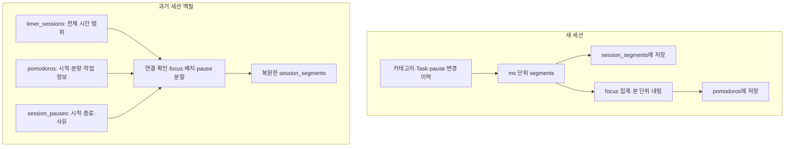
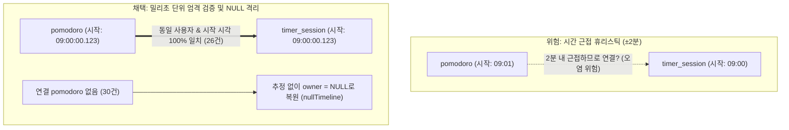
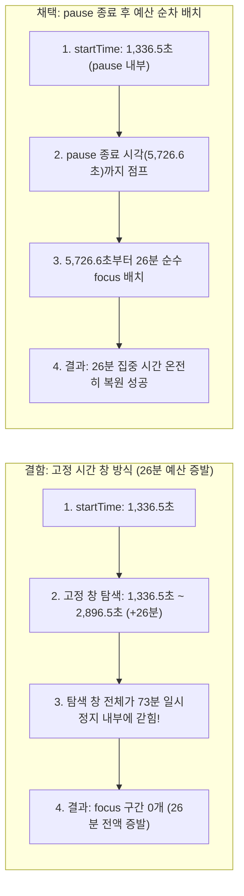
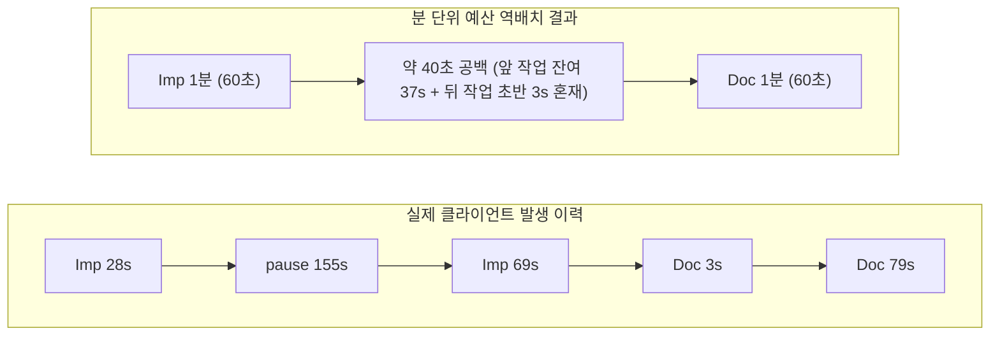

import DiagramPopout from "../../../src/components/DiagramPopout";
import Collapse from "../../../src/components/Collapse";

# Pomodoro와 일시정지에서 세션 구간을 복원한 원리

> [!NOTE] FE 맥락 보존 및 향후 AI API 연계 (2단계)
> 본 작업은 향후 AI API를 활용한 심층 분석에 대비하여, **프론트엔드(FE)에서 사용자가 실제로 수행했던 세션 내 작업 전환과 집중·휴식 맥락을 DB에 손실 없이 재현**하기 위해 진행되었습니다. 1단계에서 분리된 일시정지 타임라인을 기준으로, 과거 분 단위 집중 요약 기록(`pomodoros`)을 밀리초 단위 세그먼트(`session_segments`)로 역산 복원한 계산 로직을 다룹니다.

`session_segments` 테이블이 도입되기 이전에 저장된 과거 세션 데이터에는 상세 구간 배열이 존재하지 않습니다. 대신 세션 전체의 시작·종료 시각, 분 단위로 집계된 `pomodoros`, 그리고 초 단위의 정확한 시작·종료 시각을 가진 `session_pauses` 기록이 남아 있습니다. 이 세 가지 원천 데이터를 바탕으로 과거 세션의 시계열 타임라인을 정밀하게 역복원하는 작업이 세그먼트 백필(Backfill)입니다.

이 백필 작업은 향후 AI API 연동 시 과거 세션 기록까지 연속적인 타임라인과 비정형 작업 맥락(Context)을 단절 없이 온전히 활용할 수 있도록 하기 위해 선제적으로 수행되었습니다.

본 문서는 현재 백필 스크립트(`backfill-session-segments.ts`)의 `assignPomodoros`, `reconstructSessionSegments` 구현 로직 및 단위 테스트를 기준으로 타임라인 복원 계산 원리를 설명합니다. 초기 조사 문서에 기록되었던 후보 수와 예상 행 수는 사전 분석 당시의 수치이며, 2026-10-18에 `feature/ai-report` Neon DB에 실제로 반영된 최종 수치는 [데이터베이스 적재 결과](#loaded-rows)에 기술되어 있습니다.

## 새 기록 저장과 역복원의 차이 {#new-records-and-backfill}

클라이언트가 새로 저장하는 세션은 카테고리·Task·일시정지 변경 시각을 실시간으로 통합하여 ms 단위의 `session_segments`를 먼저 생성합니다. 이후 focus 구간의 길이를 합산하고 60초(1분) 단위로 내림(floor) 집계한 요약본이 `pomodoros`에 저장됩니다.

반면 과거 세션 백필은 이미 1분 단위로 요약 및 내림 처리된 `pomodoros`로부터 거꾸로 세그먼트를 복원하는 작업입니다. 따라서 과거 데이터를 역변환하더라도 원래 발생했던 모든 중간 변경 시각이나 1분 미만의 미세 focus 구간을 100% 완벽하게 원형 그대로 되살리는 것은 불가능하며, 수학적이고 일관된 예산 배치 규칙에 따라 근사 복원해야 합니다.

<DiagramPopout>

</DiagramPopout>

## 분 단위 기록을 예산으로 쓰는 이유 {#minute-budget}

데이터베이스에 저장된 `pomodoros` 1개 행은 실제 시계상의 연속된 시각 범위를 의미하지 않습니다. 과거 클라이언트(`category-change-utility.ts`)의 세션 집계 방식은 다음과 같았습니다.

1. `timestampsToSegmentsReducer`가 카테고리, Task, 일시정지(pause) 변경 시각마다 타임라인 구간을 쪼갭니다.
2. 일시정지(pause) 상태에서 카테고리나 Task가 바뀌면, 구간 타입은 여전히 `pause`로 유지되면서 `currentStartTime`만 해당 변경 시각으로 갱신됩니다.
3. `segmentsToDurationsReducer`는 `type === 'focus'`인 구간의 밀리초만 동일한 카테고리·Task별로 누적 합산합니다. 즉, 중간에 일시정지가 끼어 있더라도 동일한 작업의 집중 시간은 하나의 행으로 합쳐집니다.
4. `convertMilliSecToMin2`가 누적된 밀리초를 `Math.floor(ms / 60000)`으로 변환하여 분 단위 `duration`을 생성하며, 1분 미만(0분)인 행은 버려집니다.

따라서 `pomodoros`의 `duration`은 **일시정지 시간을 완전히 제외한 순수 집중 분량**입니다. 또한 `startTime` 역시 해당 작업이 실제로 집중을 시작한 시각과 다를 수 있습니다. 일시정지 중에 작업이 전환된 경우, 새 행의 `startTime`은 일시정지 구간 한가운데가 되지만 실제 분으로 인정된 시간은 일시정지가 끝난 이후에 진행된 집중 시간뿐이기 때문입니다.

만약 세션 전체 시간(`endTime - startTime`)에서 pause만 제외하고 단순 focus 단일 구간으로 일괄 처리한다면, 분 단위 pomodoro 행에 기록된 세부 작업 내역과 개별 작업 길이가 모두 유실됩니다. 반대로 행이 여러 개일 때 단순 보간을 수행하면 작업 사이의 비어 있는 시간까지 어느 한 작업의 집중으로 왜곡될 수 있습니다.

따라서 복원 로직은 분 단위로 기록된 양수 pomodoro마다 `duration × 60,000`ms를 해당 작업의 **집중 시간 예산(Focus Budget)**으로 부여합니다. focus를 배치하던 중 일시정지가 시작되면 그 길이만큼 focus를 둘로 쪼개고, 커서를 pause 종료 시각으로 건너뜁니다. 이때 pause 길이는 순수 집중 예산에서 차감하지 않습니다.

또한 세션의 `time_counted_down` 필드로 이 예산을 임의로 증액하지 않습니다. 실제 세션 데이터 전수 조사 결과 `time_counted_down`은 세션 전체 길이에서 pause 합을 뺀 값과 1초 오차 범위 내에서 일치했습니다. 즉, 분 단위 pomodoro 기록이 미기록 시간이나 공백을 임의로 채우는 근거가 될 수는 없습니다.

## 1. 세션에 속하는 원천 행을 모은다 {#source-records}

각 세션의 `timerSessionId`를 기준으로 관련 `session_pauses`와 `pomodoros`를 조회한 뒤 시작 시각순으로 정렬합니다. 길이가 양수(> 0)인 pause와 `duration > 0`인 pomodoro만 타임라인 복원 계산에 사용하며, 0분짜리 pomodoro는 집중 시간 복원의 근거로 사용하지 않습니다.

과거 데이터 중에는 외래키(`timerSessionId`)가 누락된 pomodoro도 일부 존재합니다. 백필 스크립트는 연결된 양수 pomodoro가 없는 집중 세션에 한해, **동일한 사용자 ID이면서 세션 시작 시각(`start_time`)과 밀리초 단위까지 정확히 일치하는 시작 시각**을 가진 미연결 양수 pomodoro를 찾아 FK 보정 대상으로 수집합니다. 단순히 세션 시간 범위 내에 포함된다는 모호한 이유로는 절대 연결하지 않습니다.

반대로 이미 세션에 연결되어 있으나, 시작 시각이 동일한 사용자의 다른 세션 시작 시각과 일치하는 pomodoro는 경계 충돌 행으로 간주하여 복원 입력에서 제외합니다. 이 제외 처리는 원본 DB 행을 삭제하는 것이 아니라 복원 계산 대상에서만 배제하는 안전 조치입니다. `feature/ai-report` DB 반영 전 사전 검증에서는 FK 보정 대상 26건, 경계 제외 대상 3건이 정확히 검출되었으며, 수치가 달라질 경우 스크립트가 실행을 즉시 중단하도록 설계되었습니다. (세 경계 행의 상세 ID는 [데이터베이스 적재 결과](#loaded-rows) 참조)

이미 클라이언트에서 생성한 정상 segment가 존재하는 세션은 덮어쓰지 않고 온전히 보존합니다.

<Collapse title={"설계 딜레마: 시간 근접(±2분) 휴리스틱을 배제하고 밀리초 일치(26건)만 보정한 이유"}>

초기 데이터 분석 당시, 외래키(`timerSessionId`)가 누락된 세션들을 복구하기 위해 세션 시작 전후 2분(`±2분`) 범위 내에 존재하는 pomodoro를 탐색하는 시간 근접 휴리스틱 연결 방식을 검토했습니다.

그러나 시간 근접성만으로 연결할 경우 심각한 정합성 왜곡이 발생할 수 있었습니다:
- 사용자가 이전 세션을 취소하고 곧바로 새로 시작했을 때 남은 잔여 pomodoro가 엉뚱한 세션에 결합될 위험
- 2분 탐색 창 내에 복수의 pomodoro가 존재할 때의 연결 모호성

<DiagramPopout>

</DiagramPopout>

따라서 스크립트는 **동일한 사용자이면서 밀리초 단위까지 정확히 일치하는 26건만 안전하게 FK를 채우고**, 시작 시각이 어긋나거나 근처에 행이 없는 30개 세션은 어떠한 카테고리나 Task도 자의적으로 추정하지 않은 채 `owner = NULL`인 순수 진행 구간으로 안전하게 격리 복원했습니다.

</Collapse>

## 2. 집중 시간을 pause를 건너뛰며 배치한다 {#focus-placement}

각 pomodoro의 `duration × 60,000`ms를 우선적으로 배치할 집중 시간 예산으로 사용합니다. 예를 들어 `duration = 20`이면 1,200,000ms의 집중 시간을 확보하여 타임라인에 배치합니다. 실제 시계상에서 소요되는 시간은 중간에 위치한 일시정지 때문에 20분보다 길어질 수 있습니다.

`placeFocusBudget` 함수의 실행 절차는 다음과 같습니다.

1. pomodoro의 `startTime`에서 배치를 시작합니다. 시작 시각이 일시정지(pause) 구간 내부라면 해당 pause가 종료되는 시각부터 배치를 시작합니다.
2. 다음 일시정지가 나타나기 전까지의 구간에 focus를 배치하고, 배치한 길이만큼 남은 집중 예산을 차감합니다.
3. 중간에 일시정지를 만나면 pause 길이는 집중 예산에서 차감하지 않은 채 커서만 pause 종료 시각으로 이동시킵니다.
4. 남은 집중 예산이 0이 될 때까지 focus를 이어서 배치합니다. 단, 세션 종료 시각(`endTime`)을 초과하는 구간은 생성하지 않습니다.

원본 pomodoro에 기록되어 있던 카테고리 ID 및 Task 정보를 분할된 각 focus 조각에 매핑합니다. DB의 `endTime`은 생성 컬럼(Generated Column)이므로 실제 저장 시에는 `startTime`과 `duration`만 계산하여 전달합니다.

<Collapse title={"설계 딜레마: 고정 시간 창(Window) 탐색 시 발생하는 26분 예산 증발 문제"}>

만약 복원 로직이 pomodoro의 `startTime`부터 `startTime + duration`까지의 고정된 시간 창(Fixed Window) 안에서만 focus 구간을 찾으려 했다면 어떤 문제가 발생하는지 `59f5f957-9e60-4e79-a103-e0425f60b6b7` 세션으로 확인할 수 있습니다.

- **세션 실제 기록 상황**:
  - 세션 시작: `0초` (Job Search 21분 집중 완료)
  - 긴 일시정지 발생: `1,304.632초 ~ 5,726.615초` (약 73분간 지속)
  - 일시정지 도중 작업 전환: Implementation 26분(`duration = 1,560초`), `startTime = 1,336.509초`

<DiagramPopout>

</DiagramPopout>

과거 클라이언트는 일시정지 중 작업이 바뀌면 `startTime`만 해당 시각으로 기록하고, 실제 집중 시간은 일시정지가 끝난 뒤에 누적했습니다. 만약 `startTime`을 기준으로 고정된 시간 창 안에서만 focus를 찾았다면, 2,896.5초까지의 창 전체가 73분짜리 일시정지 내부에 갇혀 **Implementation focus 행이 단 1줄도 생성되지 않는 치명적 결함**이 발생했을 것입니다.

따라서 복원 로직은 `startTime`이 pause 안이라면 pause 종료 시각으로 즉시 이동하여 26분의 예산을 온전히 배치하도록 설계되었습니다.

</Collapse>

### 일시정지가 focus 구간을 분할하는 예시 {#focus-pause-example}

09:00~09:25:30 동안 진행된 집중 세션에 09:10~09:15의 5분간 일시정지가 존재하고, 20분짜리 수학 pomodoro 1건이 기록되어 있다고 가정합니다.

| 구간 | 복원 세그먼트 | 길이 | 설명 |
| --- | --- | --- | --- |
| 09:00~09:10 | focus, 수학 | 10분 | 20분 예산 중 전반부 10분 배치 |
| 09:10~09:15 | pause, 수학 | 5분 | 일시정지 구간 (예산 차감 없음) |
| 09:15~09:25 | focus, 수학 | 10분 | 남은 10분 예산 배치 완료 |
| 09:25~09:25:30 | focus, 수학 (연장) | 30초 | 세션 종료 경계까지 남은 1분 미만 잔여 시간 흡수 |

그 결과 focus 10분, pause 5분, focus 10분 30초라는 총 3개의 세그먼트 행이 생성됩니다. 마지막 구간에 30초가 연장된 이유는 다음 규칙을 따릅니다.

## 3. 마지막 focus의 1분 미만 잔여 시간만 확장한다 {#tail-and-gaps}

과거 클라이언트의 1분 단위 내림(`Math.floor`) 처리로 인해 세션 종료 시점의 초 단위 잔여 시간이 누락될 수 있습니다. `extendLastTail` 함수는 **세션의 마지막 pomodoro에 속한 마지막 focus 조각**에 한하여, 다음 일시정지 시작 시각 또는 세션 종료 시각까지의 남은 간격(Gap)이 1분 미만(`0 < gap < 60,000ms`)인 경우 그 경계까지 focus 구간을 연장합니다.

- **정확히 60초 이상 남은 간격은 연장하지 않고 공백으로 둡니다.**
- **앞선 pomodoro와 뒤이어 시작하는 pomodoro 사이의 공백은 1분 미만이더라도 임의의 작업에 흡수시키지 않습니다.**
- 마지막 focus의 다음 경계가 일시정지 시작점이라면 해당 pause 시작 시각까지만 연장하며 pause 내부를 침범하지 않습니다.
- pomodoro의 예산이 너무 길어 세션 전체 범위를 벗어나는 경우 세션 종료 시각에서 강제로 자릅니다(Clipping). 이 경우 기록된 분량보다 실제 배치된 세그먼트 길이가 짧아질 수 있습니다.

예를 들어 작업 A가 09:00부터 1분, 작업 B가 09:01:10부터 1분으로 기록되어 있다면, 09:01~09:01:10 사이의 10초는 비워 둡니다. 이 10초는 비록 60초 미만이지만 마지막 구간의 꼬리가 아니라 작업 전환 경계의 간격이므로, 작업 A의 끝이나 작업 B의 앞에 임의로 붙이지 않고 빈 시간으로 남겨둡니다. 현재 segment type enum에는 공백(gap) 정의가 없으므로 해당 시간대에는 segment 행을 생성하지 않습니다.

<Collapse title={"설계 딜레마: 310e1da0 세션으로 검증한 작업 간 공백 보존 이유"}>

클라이언트가 실시간으로 기록한 실제 ms 단위 세그먼트가 보존되어 있는 `310e1da0-886f-45c5-acdc-2d606d1ad49c` 세션의 원본 기록을 살펴보면, 왜 작업 사이의 1분 미만 공백을 어느 한쪽에 붙이지 않고 비워두었는지 명확히 알 수 있습니다.

#### 1. 클라이언트의 실제 초 단위 세그먼트 기록 (원본 5행)
- `focus`: Implementation 28초
- `pause`: 155초
- `focus`: Implementation 69초
- `focus`: Documentation 3초 (작업 전환)
- `focus`: Documentation 79초

#### 2. 분 단위로 내림 집계되어 DB에 남은 pomodoros (요약 2행)
- **Implementation**: 1분 (`Math.floor((28초 + 69초) / 60초) = 1분`, 잔여 37초 누락)
- **Documentation**: 1분 (`Math.floor((3초 + 79초) / 60초) = 1분`, 잔여 22초 누락)

<DiagramPopout>

</DiagramPopout>

이 두 행을 분 단위 예산(각 60초)으로 역배치하면, Implementation과 Documentation 사이에 **약 40초의 빈 시간(Gap)**이 발생합니다.
- **앞 작업(Implementation)에 붙일 경우**: 뒤이어 시작된 Documentation의 3초 작업 내역까지 Implementation으로 둔갑하는 오염 발생.
- **뒤 작업(Documentation)에 붙일 경우**: 앞서 진행된 Implementation의 잔여 37초가 Documentation으로 둔갑하는 오염 발생.

반면 Documentation의 1분 예산이 끝나고 세션 종료 경계까지 남은 마지막 19초는 뒤에 다른 작업이 없으므로 안전하게 마지막 Documentation 끝에 연장할 수 있습니다.

따라서 복원 로직은 **마지막 구간의 꼬리만 연장하고, 작업과 작업 사이의 공백은 60초 미만이라도 어느 한쪽에 임의로 붙이지 않고 순수 공백으로 보존**하도록 판단했습니다.

</Collapse>

이러한 예산 배치의 정밀함은 실제 앵커 세션 `59f5f957-9e60-4e79-a103-e0425f60b6b7`에서도 확인할 수 있습니다. 첫 번째 작업(Job Search) focus 1,260초와 다음 일시정지 사이에 44.632초의 빈 간격이 존재하지만, 이 구간은 세션의 마지막 행이 아니므로 60초 미만임에도 억지로 늘리지 않고 공백을 보존했습니다. 오직 세션의 마지막 구간인 Implementation focus만 세션 끝까지 연장되었습니다. (상세 시각은 [실제 검증 사례: 앵커 세션 4건](#anchor-sessions) 참조)

따라서 백필로 복원된 세션이라고 해서 항상 `SUM(segment.duration) = endTime - startTime`이 성립하는 것은 아닙니다. 원본 기록의 분 단위 집계 오차와 의도적으로 보존된 공백을 함께 고려해야 합니다.

## 4. Pause 중 작업 변경도 구간 경계로 사용한다 {#pause-owner-changes}

원본 `session_pauses`는 시작 시각, 종료 시각, 그리고 일시정지 사유(`reason`)를 온전히 유지합니다. 만약 일시정지 진행 도중에 새로운 pomodoro의 `startTime`이 도래하면, `pausePieces` 함수가 해당 시각을 기준으로 일시정지 구간을 둘로 분할합니다. 분할된 각 조각의 소유자(owner: 카테고리 및 Task)는 **해당 시점까지 가장 최근에 시작된 양수 pomodoro**의 정보가 부여되며, 그 이전 작업 정보가 없다면 NULL이 됩니다.

예를 들어 09:10~09:15에 걸친 일시정지 도중 09:12에 새로운 작업이 시작되었다면 다음과 같이 복원됩니다.

| 시간대 | 구간 타입 | 소유자 (owner) | 설명 |
| --- | --- | --- | --- |
| 09:10~09:12 | pause | 이전 작업 (없으면 NULL) | 새 작업 시작 전까지의 일시정지 |
| 09:12~09:15 | pause | 신규 작업 | 새 작업이 지정된 상태의 일시정지 |
| 09:15 이후 | focus | 신규 작업 | 일시정지 종료 후 실제 집중 시간 배치 |

09:12부터 작업 정보가 바뀌더라도 09:15까지는 타이머가 멈춰 있는 일시정지 구간입니다. 분할된 조각들의 pause 길이를 모두 합산하면 원래 단일 일시정지의 총 길이와 완벽히 일치합니다. `session_pauses` 테이블은 1회의 일시정지를 1개 행으로 보존하므로, 원본 pause 횟수와 타임라인상의 pause 세그먼트 개수는 달라질 수 있습니다.

집중 효율 지표인 `focus / (focus + pause)`는 별도의 DB 컬럼으로 저장하지 않고 쿼리 시점에 계산합니다. 이때 한 번의 `session_pauses` 행에서 파생된 여러 세그먼트 조각은, 해당 pause에서 가장 시작 시각이 이른 조각의 작업 소유자(owner)에게 한 번만 합산합니다. 즉, 시각적인 타임라인 렌더링을 위해서는 구간을 쪼개어 표시하되, 집중 효율(Focus Ratio)을 계산할 때는 원래 하나의 일시정지였던 pause 시간 전체를 가장 이른 조각의 작업에 합산하여 산출합니다. 향후 pause의 `reason`에 담긴 비정형 사유에 따라 pause 전체를 다른 작업으로 재분류할 수도 있습니다. (사전 전수 조사 당시 사유가 기재된 pause는 전체 674건 중 1건이었습니다.)

실제 세션 `59f5f957`의 경우, 4,421.983초 동안 이어진 단일 일시정지가 Job Search(31.877초)와 Implementation(4,390.106초)이라는 2개의 세그먼트 조각으로 나뉘어 타임라인에 표시됩니다. 그러나 작업별 집중 효율을 산출할 때는 가장 먼저 시작된 Job Search 작업에 pause 4,421.983초 전체가 한 번에 귀속됩니다. 따라서 Job Search의 집중 시간 1,260초를 기준으로 `1,260 / (1,260 + 4,421.983) ≈ 0.22`의 효율이 계산되며, 뒤이어 시작된 Implementation 작업의 focus에는 이 일시정지 시간이 중복 합산되지 않습니다.

## 5. 휴식 세션과 작업 정보가 없는 집중 세션 {#unknown-owners}

휴식 세션(`kind = shortBreak` 또는 `longBreak`), 또는 연결된 양수 pomodoro가 전혀 없는 집중 세션은 `nullTimeline` 함수를 통해 복원합니다. 세션 전체 시간에서 일시정지 구간을 차감하여 진행 구간을 생성하되, 모든 소유자(categoryId, todoistTaskId 등) 필드는 NULL로 비워둡니다. pause 구간에는 원본 일시정지 사유(`reason`)만 유지합니다.

이때 휴식 세션의 진행 구간 역시 enum 타입 제약에 따라 `focus`로 저장됩니다. **따라서 휴식 세션의 복원 구간을 순수 공부/작업 집중 시간으로 집계하지 않도록, 상위 세션의 `kind = pomo` 여부를 반드시 함께 확인(WHERE 조건)해야 합니다.** 작업 정보가 누락된 집중 세션 역시 진행 구간 자체는 복원되지만, 확인되지 않은 카테고리나 Task를 인위적으로 추정하여 채워 넣지 않습니다.

또한 첫 번째 pomodoro가 세션 시작 후 한참 뒤에 시작된 집중 세션의 경우, 그 앞선 빈 시간을 임의의 작업으로 채우지 않고 공백으로 남깁니다. 이는 양수 pomodoro가 전혀 없어 세션 전체를 단일 NULL 진행 구간으로 채우는 `nullTimeline` 처리 방식과는 구별되는 정상적인 타임라인 보존입니다. 대표적인 예로 앵커 세션 `336259ac-7cc0-468f-b5a3-2c09c66b7566`은 첫 일시정지가 시작되기 전까지의 1,244.083초 동안 아무런 세그먼트 행이 생성되지 않고 온전한 공백으로 보존되었습니다.

## 6. 메타데이터 부착과 최종 저장 트랜잭션 {#metadata-and-storage}

복원 계산이 완료된 focus와 pause 세그먼트들을 시간순으로 정렬한 뒤 `sequenceOrder = 0, 1, 2, ...` 순번을 부여합니다. DB에 저장되는 필드는 세션 ID, 사용자 ID, 순서, 구간 타입(`type`), 시작 시각(`startTime`), 길이(`duration`), 카테고리 및 Task 정보, 그리고 일시정지 사유(`reason`)입니다.

- **메타데이터 정규화 및 스냅샷**: `categoryId`로 현재 시점의 카테고리 이름을 조회하고, `todoistTaskId`로 Todoist 원본 ID와 현재 작업명을 조회하여 스냅샷으로 저장합니다. 조회할 수 없는 값이나 빈 문자열은 NULL로 처리합니다. 단, 이 메타데이터는 백필 실행 당시 조회된 현재 기준의 명칭이므로 과거 세션 수행 당시의 명칭 스냅샷과 완전히 동일함을 100% 보장하지는 않습니다.
- **사유(reason) 매핑**: `reason`은 원본 일시정지(`session_pauses`)에서 가져오며, focus 구간은 항상 NULL입니다.
- **생성 컬럼(Generated Column)**: `endTime`은 DB 테이블 정의상 `startTime + duration`으로 자동 계산되는 생성 컬럼이므로 백필 INSERT 구문 대상에서 제외됩니다.
- **원자적 트랜잭션 보장**: 쓰기 모드(`--write`) 실행 시 FK 누락 pomodoro 보정과 대량의 세그먼트 배치 INSERT를 단일 데이터베이스 트랜잭션(`BEGIN ... COMMIT`) 내에서 수행합니다. 중간에 단 하나의 쿼리라도 실패하면 전체 작업이 즉시 롤백됩니다. 시뮬레이션 모드(`--dry-run`)에서는 실제 DB 변경 없이 복원 계산 결과 검증 요약만 출력합니다.

## 7. 실제 검증 사례: 앵커 세션 4건 {#anchor-sessions}

다음 네 가지 세션은 복원 로직의 주요 경계 조건(Edge Case)들을 검증하기 위해 선정한 대표 앵커(Anchor) 세션입니다. 표에 표시된 시각은 세션 시작 시각(`startTime`) 기준의 상대적 오프셋(초)이며, 길이는 DB에 저장된 `duration`입니다. 이 네 세션의 복원 결과는 `feature/ai-report` 브랜치의 Neon DB 적재 결과와 이후 배포된 `release` 브랜치 Neon DB 전수 대조 결과에서 밀리초 단위까지 완벽히 일치했습니다.

### 일시정지 중 작업 전환: 59f5f957-9e60-4e79-a103-e0425f60b6b7

Job Search 21분과 Implementation 26분이 동일한 Todoist 작업(`6h6Q6XjrcjhcvPpm`)을 공유하며 카테고리만 변경된 케이스입니다. 1,304.632초부터 5,726.615초까지 4,421.983초간 이어진 긴 일시정지 도중 1,336.509초에 Implementation 작업의 `startTime`이 도래하여 pause가 2개의 조각으로 분할되었습니다.

<Collapse title={"상세 복원 타임라인 오프셋 표 보기"}>

| 오프셋 (초) | 길이 (초) | 타입 | 카테고리 | 설명 |
| --- | ---: | --- | --- | --- |
| 0.000 | 1,260.000 | focus | Job Search & Application & Resume | 21분 focus 예산 소진 |
| 1,260.000~1,304.632 | (44.632초 공백) | 행 없음 | - | 마지막 행이 아니므로 60초 미만 공백 유지 |
| 1,304.632 | 31.877 | pause | Job Search & Application & Resume | 새 작업 시작 전까지의 pause 조각 |
| 1,336.509 | 4,390.106 | pause | Implementation | 작업 변경 후 pause 조각 |
| 5,726.615 | 1,586.935 | focus | Implementation | 26분(1,560초) + 잔여 26.935초 연장 |

</Collapse>

마지막 Implementation focus는 26분 예산(1,560초)에 세션 종료 경계까지 남은 26.935초의 1분 미만 잔여 시간을 더해 세션 종료 시각과 정확히 일치하도록 복원되었습니다.

### 선행 20분 공백(Leading Gap) 보존: 336259ac-7cc0-468f-b5a3-2c09c66b7566

양수 pomodoro는 Job Search 24분 1건만 존재하며, 그 시작 시각(오프셋 1,248.050초)이 첫 번째 일시정지 구간(1,244.083초~1,453.018초) 내부에 위치한 케이스입니다. (세션 시간: 2026-07-31T05:52:30.232Z ~ 06:41:42.455Z)

<Collapse title={"상세 복원 타임라인 오프셋 표 보기"}>

| 오프셋 (초) | 길이 (초) | 타입 | 소유자 (owner) | 설명 |
| --- | ---: | --- | --- | --- |
| 0.000~1,244.083 | (1,244.083초 공백) | 행 없음 | - | 세션 시작 후 약 20분간의 선행 공백 보존 |
| 1,244.083 | 3.967 | pause | NULL | 작업 시작 전 발생한 pause 조각 |
| 1,248.050 | 204.968 | pause | Job Search & Application & Resume | 작업 지정 후 pause 조각 |
| 1,453.018 | 1,499.205 | focus | Job Search & Application & Resume | 24분(1,440초) + 잔여 59.205초 연장 |

</Collapse>

focus는 pause가 종료된 시점부터 24분을 배치한 뒤, 세션 끝까지 남은 59.205초의 잔여 시간을 흡수하여 마무리되었습니다. 중요한 점은 첫 일시정지 시작 전까지의 약 20분(1,244.083초) 동안 작업 정보가 없었으므로, 이 구간을 임의로 Job Search 작업으로 채우지 않고 순수한 공백 상태로 정확히 보존했다는 점입니다.

### 세션 종료 경계 초과 예산 클리핑: dd8724b7-221a-40e4-8bdd-c4598313a2f4

세션 기간은 2026-02-26T10:01:07.298Z부터 10:07:48.573Z까지로 벽시계 전체가 약 401초에 불과합니다. 일시정지가 341.275초 동안 지속되었고 `time_counted_down`은 60초였습니다. 반면 원본 pomodoro에는 Implementation 5분(300초)이 기록되어 있었습니다.

<Collapse title={"상세 복원 타임라인 오프셋 표 보기"}>

| 오프셋 (초) | 길이 (초) | 타입 | 카테고리 | 설명 |
| --- | ---: | --- | --- | --- |
| 0.000 | 45.370 | focus | Implementation | 일시정지 시작 전까지 45.370초 배치 |
| 45.370 | 341.275 | pause | Implementation | 일시정지 구간 |
| 386.645 | 14.630 | focus | Implementation | 세션 종료 경계에서 클리핑(Clipping) |

</Collapse>

과거 클라이언트에서 5분으로 집계·저장된 구체적인 경위는 알 수 없으나, 복원 로직은 세션 종료 시각(`endTime`)을 벗어나는 초과 예산은 생성하지 않고 경계에서 잘라냅니다(Clipping). 결과적으로 focus 두 구간의 합계는 정확히 60.000초가 되며, 세션 경계를 초과하는 나머지 4분의 예산은 생성되지 않았습니다.

### 작업 정보 없는 세션의 단일 구간 복원: 3093a831-6622-42f2-8519-7b2075af2e58

2026-09-21에 수행된 집중 세션으로, 일시정지 기록도 없고 연결할 수 있는 양수 pomodoro도 전혀 없는 케이스입니다.

작업 소유자(owner) 정보가 없는 단일 focus 1개 행으로 복원되었으며, 길이는 세션 벽시계 전체인 5,400초(5,400,000ms, 90분)로 온전히 보존되었습니다.

## 8. 데이터베이스 적재 결과 {#loaded-rows}

2026-10-18에 `feature/ai-report` 브랜치의 Neon DB에서 FK 보정과 세그먼트 INSERT를 단일 트랜잭션으로 커밋했습니다. dry-run 단계에서 전체 세션의 분류 합계가 일치하고, 검증 건수 및 4개 앵커 세션의 복원 결과가 완전히 일치함을 확인한 후에만 실제 저장을 수행했습니다. 기대 건수와 불일치할 경우 트랜잭션 실행 전 즉시 중단되도록 안전장치를 두었습니다. 클라이언트가 실시간으로 남긴 기존 17개 세그먼트 행을 삭제하는 `--force` 옵션은 스크립트 레벨에서 실행을 거부하도록 차단되었습니다. (사전 백업 테이블 `session_segments_backup_20261016`은 읽기/쓰기 없이 보존되었습니다.)

| 항목 | 수량 |
| --- | ---: |
| 대상 `timer_sessions` 총수 | 2,122개 |
| 신규 삽입한 segment 행수 | 3,412행 |
| 보존된 기존 클라이언트 segment | 17행 (7개 세션) |
| 커밋 직후 `session_segments` 총 행수 | 3,429행 |
| 세그먼트가 누락된 세션 수 | 0개 |
| FK 보정으로 연결된 pomodoro | 26개 |
| 경계 충돌로 복원 입력에서 제외된 pomodoro | 3개 |

<Collapse title={"보존된 7개 세션 및 경계 제외 3개 세션 상세 ID 목록"}>

보존된 기존 클라이언트 세그먼트 17행은 다음 세션들에 속해 있습니다.

| 세션 ID | 세그먼트 행수 |
| --- | ---: |
| `0aa34cb1-a16e-4556-a3ab-a158499dcf8e` | 3 |
| `310e1da0-886f-45c5-acdc-2d606d1ad49c` | 5 |
| `324a2733-da41-4cc6-80d1-1921ac083aca` | 3 |
| `405a2895-7032-44b8-8134-470bb570d855` | 1 |
| `413c2991-70d0-4576-85ae-47dc7b493435` | 1 |
| `67cddc05-dfa4-49be-a60c-4bbc4f61ef03` | 1 |
| `8bbd2a88-82f6-41fd-8faf-6cbaaf682949` | 3 |

경계 충돌 pomodoro 3건은 원본 세션의 `timer_session_id`를 수정하지 않았습니다. 시작 시각이 동일 사용자의 다음 세션 시작 시각과 겹치는 이상 데이터였으므로 복원 입력에서만 안전하게 제외했습니다.

| pomodoro ID | 기존 할당 세션 ID |
| --- | --- |
| `650bfa10-95bd-4c1e-947f-5aaf7597ce69` | `673ca675-51dd-4172-8008-90ca83393d47` |
| `96730bd8-0e19-4723-ab56-60c5eaada22a` | `9a14a1d1-69bb-4d11-8132-941bbbbddd2c` |
| `d3b5b0a4-fb0c-4637-8824-0d82924e7bbf` | `791ba103-ee78-4bf0-845d-c7ba923bda0d` |

</Collapse>

FK 보정 대상 26건은 동일 사용자의 미연결 pomodoro 중 `startTime`이 집중 세션의 `start_time`과 밀리초 단위까지 일치하는 데이터였습니다. 해당 세션 ID를 `pomodoros.timer_session_id`에 정상 업데이트했습니다. 세션 시작 시각과 어긋난 다른 미연결 행들은 스크립트의 보정 대상에서 안전하게 제외되었습니다.

이후 동일한 복원 로직으로 `release` 브랜치의 Neon DB를 읽기 전용으로 대조 검증했습니다. 당시 release DB는 세션 2,346개, 세그먼트 3,894행 규모였으며 세션 누락 없이 모든 세그먼트가 적재되어 있었습니다. 이 중 2,334개 세션은 스크립트가 산출하는 시각, 길이, 카테고리, Task 메타데이터와 밀리초 단위까지 완벽히 일치했습니다. 핵심 검증 대상인 4개 앵커 세션, FK 보정 26건, 경계 제외 3건 역시 완벽히 일치했습니다. 나머지 차이가 발생한 12개 세션은 백필 시점 이후인 2026-10-31 이후에 새로 생성된 세션들이었습니다.

위 수치들은 각 데이터베이스를 검증하던 시점의 스냅샷 기준이며, 애플리케이션 운영에 따라 신규 세션이 생성되면 `COUNT(*)`는 계속 증가합니다.

## 9. 원리의 확인 범위 {#verification-scope}

백필 로직의 대표 케이스 단위 테스트는 마지막 잔여 시간 연장, pause 중 작업 전환, 세션 시작 전 선행 공백 유지, 세션 종료 경계에서의 클리핑, 작업 정보 없는 세션의 단일 focus 처리 등을 전수 검증합니다. 별도 테스트 스위트에서는 60초 이상 간격 보존, 작업 간 Gap 보존, FK 보정 및 경계 제외 로직까지 엄격히 테스트합니다. 실제 DB 레벨에서는 전체 세션의 형태 분류 일치 여부, 4개 앵커 세션 대조, FK 보정 26건, 경계 제외 3건, 기존 클라이언트 17행 보존, 그리고 release 브랜치 DB와의 전수 교차 검증을 완료했습니다.

과거 클라이언트의 분 단위 내림 집계로 인해 이미 손실된 초 단위 세부 이력은 백필만으로 100% 되살릴 수는 없습니다. 따라서 복원된 세그먼트를 쿼리하거나 LLM 분석에 활용할 때는, 과거 원본 pomodoro 기반의 복원 구간과 신규 클라이언트의 실시간 ms 단위 세그먼트 간의 해상도(Resolution) 차이를 인지하고 활용해야 합니다.

테이블 컬럼 구조, 외래키 제약조건, 삭제 정책 및 인덱스 설계는 [데이터베이스 개요 문서](../index.mdx#session-segments)에 상세히 정리되어 있습니다.
