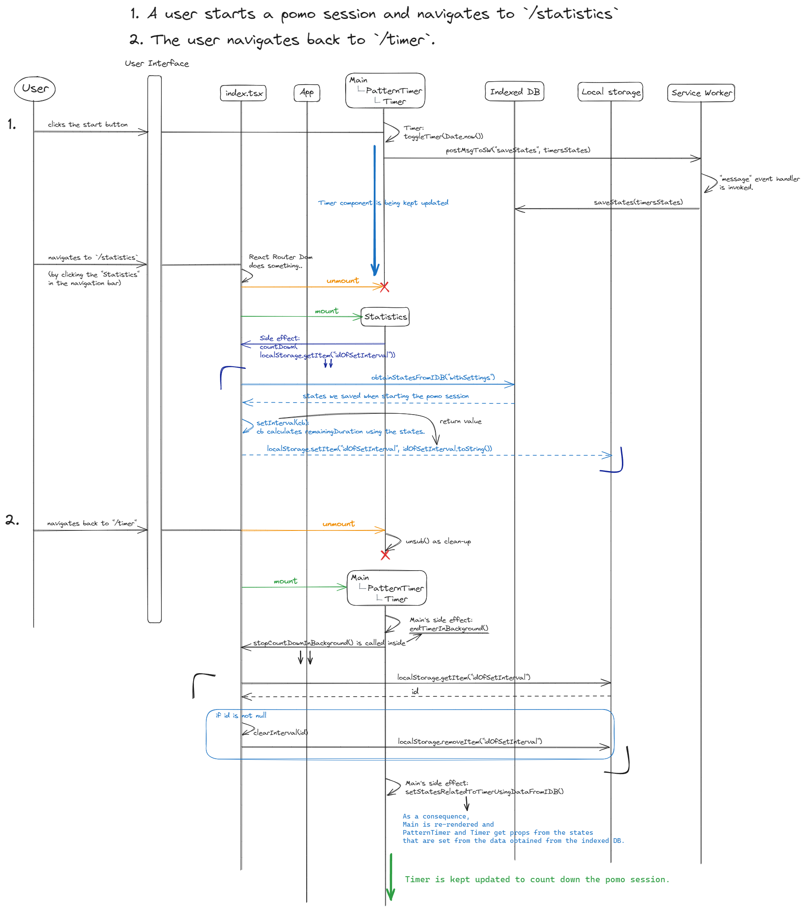
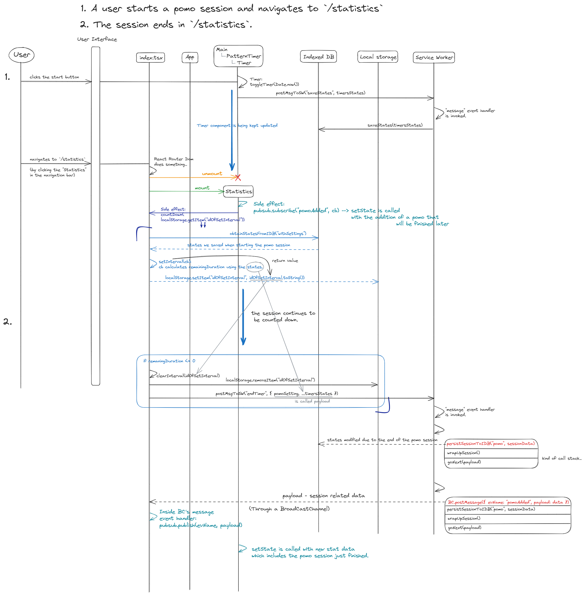
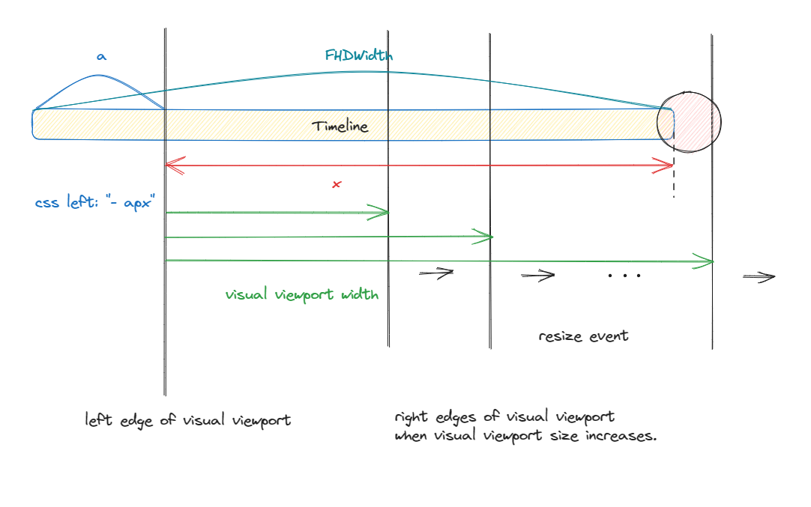
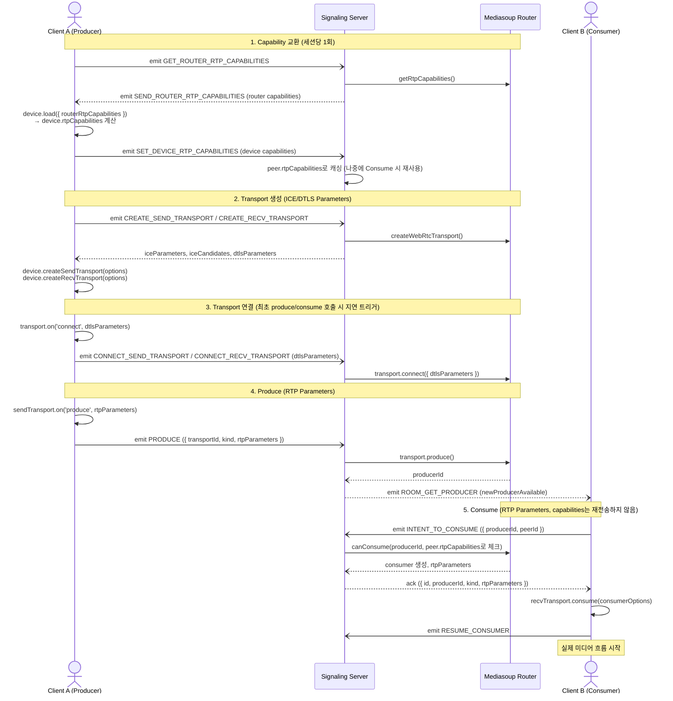
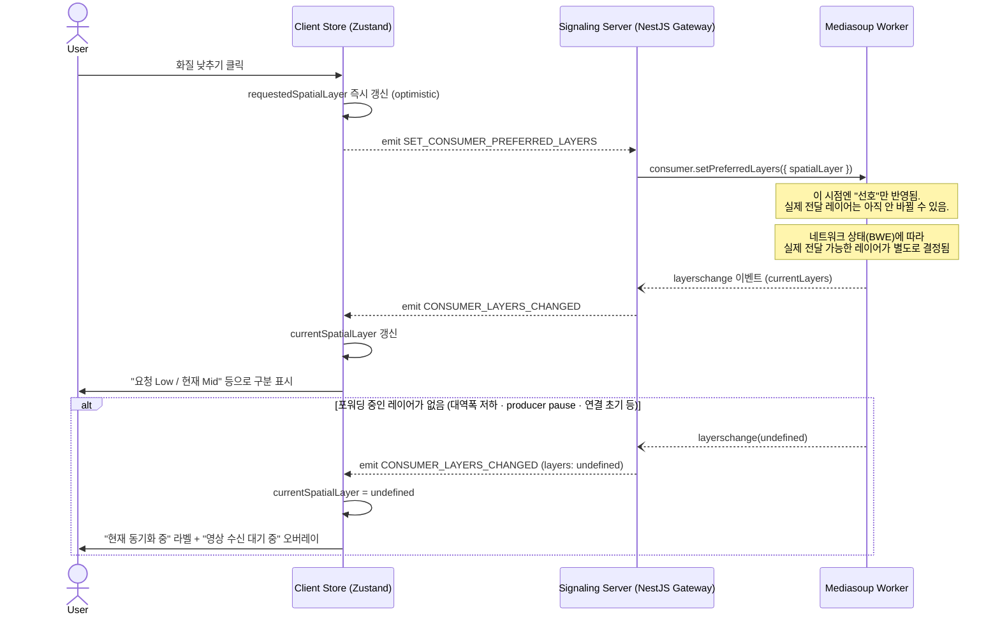
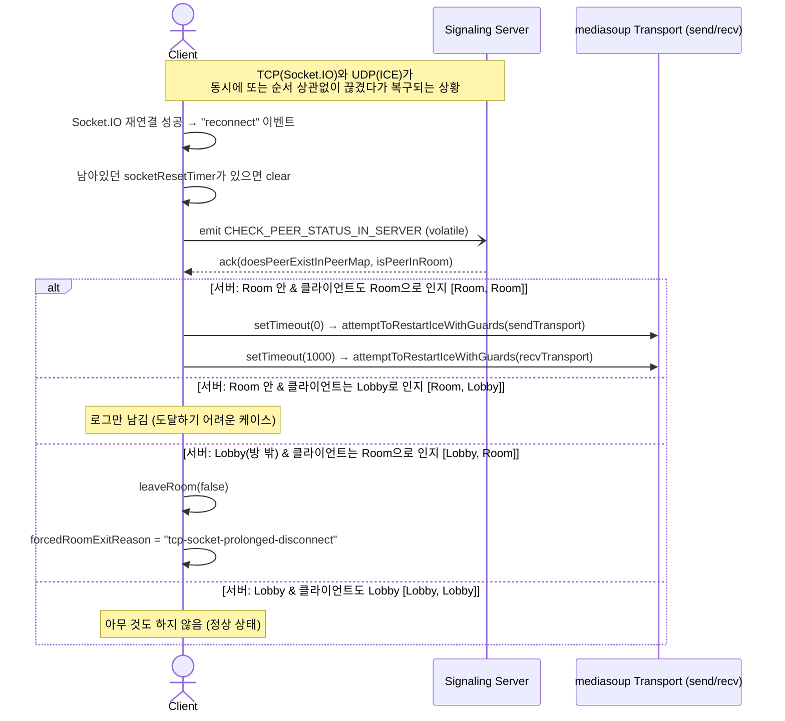
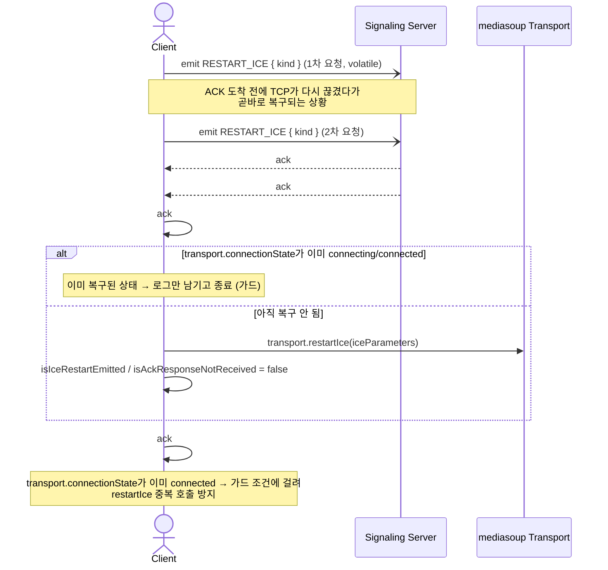

import { Highlight } from "../src/components/Highlight";
import Collapse from "../src/components/Collapse"
import DiagramPopout from "../src/components/DiagramPopout"

# Problem Solving

## **한 세션이 진행 중일 때(pomo or break 관계없이), 다른 페이지들을 자유롭게 방문할 수 있도록 하는 것**

### <u>A. 다른 페이지를 방문 후 세션이 종료되기 전에 `/timer`로 돌아오는 경우</u>

#### 문제 상황

우선 기본적으로 `/timer`에 렌더되는 countdown timer UI는 [PatternTimer](https://github.com/Yonghwan-Song/pomodoro/blob/bb5c1d3b0623ff6d507d14494f7d678837d16581/client/src/Components/PatternTimer/PatternTimer.tsx#L31-L38)[^1]와 [Timer](https://github.com/Yonghwan-Song/pomodoro/blob/bb5c1d3b0623ff6d507d14494f7d678837d16581/client/src/Components/Timer/Timer.tsx#L59-L71)에 의해 만들어집니다.
다시 말하면, 이 component들의 `timersStates`[^2]에 의해 타이머 UI가 적절한 값을 표현하게 됩니다 (몇 분 남았는지, 이번 세션이 pomo인지 break인지 등).
다른 페이지로 이동한다는 것은 이 component들이 unmount되어 state값들에 대한 접근을 잠시 잃어버리는 것을 의미합니다.

<span style={{ color: "#1565c0" }}>
  {" "}
  하지만 이 값들을 결국 `/timer`로 돌아올 때 사용해야 하므로 어디엔가 저장을 해야
  합니다.
</span>

#### 해결 방식

`timersStates`이 update 될 때마다(예를 들면, session의 종류가 바뀌거나 pause/resume을 할 때) **indexedDB**에 저장/update 해두었습니다. 그리고 나중에 사용자가 `/timer`로 돌아올 때 그 값을 이용해 PatternTimer와 Timer를 마운트 하였습니다.

#### 어려웠던 점

처음에는 `PatternTimer`와 `Timer`에서 `useEffect`를 사용해 각 컴포넌트의 상태값을 설정했습니다. <span style={{ color: "#1565c0" }}>하지만 이 방법은 컴포넌트가 마운트된 후에 상태가 업데이트되는 방식이라, 처음에 25분이라는 초기 상태값이 잠깐 보였다가 실제 남은 시간이 표시되는 과정이 부자연스러웠습니다.</span>
이를 해결하기 위해 각 컴포넌트의 초기 상태값을 `indexedDB`에 저장된 값으로 설정하려 했습니다. 그러나 `useState` 함수는 비동기 콜백함수를 argument로 받지 않고[^5], `indexedDB`의 작업은 모두 비동기 방식으로 처리된다는 것이 문제였습니다.
그래서 두 컴포넌트의 공통 부모인 `Main` 컴포넌트에서 indexedDB에 저장된 상태값들을 받아오는 useEffect를 다음과 같이 호출했습니다.

```tsx
export default function Main() {

...

  //
  useEffect(setStatesRelatedToTimerUsingDataFromIDB, []);

  //
  function setStatesRelatedToTimerUsingDataFromIDB() {
    const getStatesFromIDB = async () => {
      let states = await obtainStatesFromIDB("withoutSettings");
      setStatesRelatedToTimer(states);
    };
    getStatesFromIDB();
  }

...

}
```

그리고 그 값을 indexedDB에서 받아오기 전까지는 타이머 UI가 렌더되지 않도록 Main 함수에서 children을 조건부로 반환했습니다.
이렇게 하면, `PatternTimer`와 `Timer`는 prop을 이용해 실제 남은 세션 시간을 초기 상태값으로 설정할 수 있습니다.
결과적으로, 추가적인 렌더링 없이 타이머 UI를 한 번에 정확하게 렌더링할 수 있습니다.

#### Sequence Diagram

[원본 링크](https://github.com/Yonghwan-Song/pomodoro/assets/72689705/435773c7-a742-4c71-b6c6-fcedcac5544e)


### <u>B. 다른 페이지에 머무르는 동안 세션이 종료되는 경우</u>

#### 문제 상황

{/* pomodoro인지 break인지 그것의 duration은 어느 정도인지 등 타이머 UI에 표현되는 정보는 `timersStates`[^2]에 의해 결정됩니다. 그러므로 타이머 UI와 관련된 컴포넌트들이 렌더링되는 `/timer`이외 다른 페이지를 방문 중 어떤 한 세션이 종료되면, 1)`timersStates`를 **그 페이지에서** update해줘야 합니다. */}
{/* 그렇게 하면, `/timer`로 돌아왔을 때 타이머 UI에 다음 세션을 곧바로 나타낼 수 있습니다. 그리고 pomodoro 세션이 `/statistics`에서 종료되는 경우, 2)통계 그래프에 종료된 세션만큼의 시간 추가해야 합니다. */}

{/* new: */}
타이머 UI가 보여주는 정보는 세션의 종류 (pomodoro이나 break), 현재 세션이 얼마나 남았는지 등이 있는데, 이것들은 `timersStates`[^2]에 의해 결정됩니다.
다시 말하면, 한 사이클의 세션들이 매끄럽게 진행되기 위해서는 세션이 종료되었을때 `timersStates`를 update해줘야 합니다.
이것들은 타이머 UI가 렌더되는 `/timer`에서는 당연히 이뤄질 수 있지만,

1. 다른 페이지에서 세션이 종료되는 경우에도 이것을 적절히 update할 수 있어야 합니다.
2. 그리고 특히 `/statistics`에서 종료되는 경우, 통계 그래프에 종료된 pomodoro세션을 반영해야 합니다.

#### 해결 방식

우선 어떤 한 세션의 종료 시점을 계산하기 위해서는 `/timer`를 벗어난 순간부터 누군가는 계속 이어서 그 세션을 count down해야 하므로,
index.tsx파일에 다음처럼 [countDown 함수](https://github.com/Yonghwan-Song/pomodoro/blob/bb5c1d3b0623ff6d507d14494f7d678837d16581/client/src/index.tsx#L647)를 정의하여 export했습니다.
이것은 다른 페이지의 component가 mount되면 side effect으로 호출됩니다.

1. Service worker script를 이용해서, indexed db에 저장된 `timersStates`를 update합니다.
   이렇게 되면 `/timer`로 돌아왔을 때 indexedDB에서 가져오는 상태값은 세션 종료를 반영한 것이므로 이를 이용해서 바로 다음 세션 UI를 render할 수 있습니다.
2. `/statistics`에서 pomo session이 종료될 때, 그 값을 통계 그래프에 곧바로 반영하기 위해 <Highlight color="#25c2a0">**Pub/Sub 패턴**</Highlight>을 사용했습니다.

#### 어려웠던 점 - service worker가 작동하는 방식이 저의 예상과 달랐습니다.

##### Service worker를 사용한 계기

`/timer`외의 페이지는 그 페이지에서 하는 고유의 일이 있는데, 제가 해결해야 하는 것은 타이머 UI가 하는 작업이니 이것은 백그라운드에서 누군가 해줘야 한다는 생각이 있었습니다.
그래서 구글에 검색하던 도중 service worker는 리액트 앱이 돌아가는 main thread와는 다른 고유의 thread에서 돌아가기 때문에, 백그라운드 작업에 사용할 수 있다는 글을 읽었습니다.
그리고 브라우저에서 제공하는 API니까 이번 기회에 사용해봐야겠다는 생각이었습니다.

##### 예상치 못한 제약

- 세션 카운트 다운을 service worker script에서 `setInterval()`을 이용해 세션을 countdown하려 했는데, developer tools를 켜놓고 잘 돌아가는지 로그를 찍어서 확인할 때는 잘 작동했는데,
  developer tools를 끄고 실행하면 카운트 다운이 도중에 멈췄습니다. 이유는 서비스 워커 스크립트는 몇 가지 event에 반응하여 할당된 일을 마무리하면 바로 down되는 작동방식 때문이었습니다[^6].
- 그래서 코드를 수정하여 countDown을 sw.js에서 index.tsx로 옮기고 session이 끝날 때 sw.js에 message (event)를 날려서 기존에 작성했던 것들을 활용하여 필요한 작업들을 할 수 있게 했습니다[^4] .

<Collapse title={"pubsub definition"}>
```tsx
// reference: https://www.youtube.com/watch?v=aynSM8llOBs

type Callback = (data: any) => void;
interface PubsubType {
  events: { [index: string]: Set<(data: any) => void> };
  subscribe: (evName: string, cb: Callback) => () => void;
  unsubscribe: (evName: string, cb: Callback) => void;
  publish: (evName: string, data: any) => void;
}
export const pubsub: PubsubType = {
  events: {},

  subscribe: function (evName, cb) {
    if (!(evName in this.events)) {
      this.events[evName] = new Set();
    }
    this.events[evName].add(cb);

    return () => {
      this.events[evName].delete(cb);
    };
  },

  unsubscribe: function (evName, cb) {
    if (evName in this.events) {
      this.events[evName].delete(cb);
    }
  },

  publish: function (evName, data: any) {
    if (this.events[evName]) {
      this.events[evName].forEach((f) => {
        f(data);
      });
    }
  },
};

```
</Collapse>
<Collapse title={"publish()"}>
```tsx
// in client/src/sw.js
async function recordPomo(startTime, idTokenAndEmail, infoArray, sessionData) {
  let body = null;

  try {
    const { idToken, email } = idTokenAndEmail;
    const today = new Date(startTime);
    let LocaleDateString = `${
      today.getMonth() + 1
    }/${today.getDate()}/${today.getFullYear()}`;

    const final = convertMilliSecToMin(
      createDataSortedByTimestamp(
        infoArray,
        sessionData.pause.record,
        sessionData.endTime
      )
        .reduce(calculateDurationForEveryCategory, {
          durationArr: [],
          currentType: "focus",
          currentOwner: "",
          currentStartTime: 0,
        })
        .durationArr.reduce(aggregateFocusDurationOfTheSameCategory, {
          c_duration_array: [],
          currentCategoryName: "",
        }).c_duration_array
    ).map((val) => {
      if (val.categoryName !== "uncategorized") {
        return {
          userEmail: email,
          duration: val.duration,
          startTime: val.startTime,
          date: LocaleDateString,
          isDummy: false,
          category: {
            name: val.categoryName,
          },
        };
      } else {
        return {
          userEmail: email,
          duration: val.duration,
          startTime: val.startTime,
          date: LocaleDateString,
          isDummy: false,
        };
      }
    });

    BC.postMessage({
      evName: "pomoAdded", // <--------------------------------------------------------
      payload: final,
    });

    //...
  } catch (error) {
    console.warn(error);
  }
}

// in client/src/index.tsx
BC.addEventListener("message", async (ev) => {
  const { evName, payload } = ev.data;

  switch (evName) {
    case "pomoAdded":
      // type of the payload
      // {
      //   userEmail: string;
      //   duration: number;
      //   startTime: number;
      //   date: string;
      //   isDummy: boolean;
      //   category?: {
      //     name: string;
      //   };
      // }[]
      pubsub.publish(evName, payload); // <--------------------------------------------
      break;

    // ...

    default:
      console.warn(`Unhandled event name: ${evName}`);
      break;
  }
});

```
</ Collapse>

<Collapse title={"subscribe()"}>
```tsx
  // in client/src/Pages/Statistics/Statistics.tsx
  useEffect(() => {
    countDown(localStorage.getItem("idOfSetInterval"));

    const unsub = pubsub.subscribe(
      "pomoAdded",
      (
        final: {
          useEmail: string;
          duration: number;
          startTime: number;
          date: string;
          isDummy: boolean;
          category?: {
            name: string;
          };
        }[]
      ) => {
        setStatData((prev) => {
          if (!prev) {
            return prev;
          } else {
            let today = new Date();
            const todayDateString = `${
              today.getMonth() + 1
            }/${today.getDate()}/${today.getFullYear()}`;
            let days = ["Sun", "Mon", "Tue", "Wed", "Thu", "Fri", "Sat"];

            let cloned = [...prev];
            let doesTodayStatExist =
              cloned.length !== 0 &&
              cloned[cloned.length - 1].date === todayDateString;

            if (doesTodayStatExist) {
              for (const pomoDoc of final) {
                cloned[cloned.length - 1].total += pomoDoc.duration;
                if (pomoDoc.category) {
                  cloned[cloned.length - 1].subtotalByCategory[
                    pomoDoc.category.name
                  ].duration += pomoDoc.duration;
                } else {
                  cloned[cloned.length - 1].withoutCategory += pomoDoc.duration;
                }
              }
            }
            if (!doesTodayStatExist) {
              const now = new Date();
              const startOfTodayTimestamp = new Date(
                now.getFullYear(),
                now.getMonth(),
                now.getDate()
              ).getTime();

              let dayStat: DayStat = {
                date: todayDateString,
                timestamp: startOfTodayTimestamp,
                dayOfWeek: days[today.getDay()],
                total: 0,
                subtotalByCategory: createBaseCategorySubtotal(),
                withoutCategory: 0,
                weekNumber: getISOWeek(Date.now()),
              };

              for (const pomoDoc of final) {
                dayStat.total += pomoDoc.duration;
                if (pomoDoc.category) {
                  dayStat.subtotalByCategory[pomoDoc.category.name].duration +=
                    pomoDoc.duration;
                } else {
                  dayStat.withoutCategory += pomoDoc.duration;
                }
              }

              cloned.push(dayStat);
            }

            setSum((prev) => {
              const retVal = { ...prev };
              for (const pomoDoc of final) {
                retVal.today += pomoDoc.duration;
                retVal.thisWeek += pomoDoc.duration;
                retVal.thisMonth += pomoDoc.duration;
                retVal.allTime += pomoDoc.duration;
              }
              return retVal;
            });

            return cloned;
          }
        });
      }
    );

    return () => {
      unsub();
    };
  }, []);
```
</Collapse>

#### Sequence Diagram

[원본 링크](https://github.com/Yonghwan-Song/pomodoro/assets/72689705/c146532e-f4c5-45c5-a16f-c74333aeb3f3)



### [비판적 질문들](./questions.mdx#한-세션이-진행-중일-때pomo-or-break-관계없이-다른-페이지들을-자유롭게-방문할-수-있도록-하는-것) 

## **Horizontal Timeline 만들기**

### 문제 상황 및 구현하게 된 계기

집중과 휴식 세션들을 어떻게 진행했는지 직관적인 feedback이 필요했고, 이를 위해 timeline을 만들기로 했습니다. 제 앱의 use case에 맞는 적절한 horizontal timeline UI를 제공하는 라이브러리를 찾기 어려웠고 이 기회에 CSS를 연습해보자는 생각으로 직접 구현하게 되었습니다.

### Design and Implementation

- 1분을 나타내는 px을 정해서 Timeline component의 width를 24시간만큼의 크기로 설정
- 오른쪽으로 갈수록 시간이 흘러간다고 가정하고 Timeline의 가장 왼쪽 끝을 하루의 시작인 12:00 am으로 정함
- 완료된 세션은 타임라인 가장 왼쪽 끝으로부터 얼마나 떨어트려 놓을지 계산하여 적절한 위치를 잡음
  - absolute position과 left CSS property를 이용
- 타임라인을 좌우로 움직이기 위해 마우스 스크롤과 드래그에 대해 Timeline component의 left 값을 변화시킴
  - session들은 모두 Timeline에 대해 absolutely positioned 되었기 때문에 그 위에서 함께 움직임

#### 어려웠던 점들

##### [윈도우 사이즈 변화에 responsive하게 반응](https://github.com/Yonghwan-Song/pomodoro/issues/19)

- 아래 그림처럼, visual viewport의 넓이가 x보다 커지면, 빨간색 부분처럼 빈 부분이 생김
- window resize event handler에서 visual viewport width가 x보다 커지면 timeline의 right CSS property를 0으로 설정했습니다.


Before
<br/>

<br />
After
<br />


##### [Responsive관련 css가 작동하지 않아서 Web API를 이용](https://github.com/Yonghwan-Song/pomodoro/issues/29#issue-1994595288)

- 사용하게 된 계기
  - media query를 사용하기 위해 inline style을 이용한 Timeline component를 styled component로 바꿨습니다.
  - 그런데 기존의 drag와 wheel event handler들이 ref를 이용해 Timeline element의 style object에 직접 접근하는데, 관련 코드들이 Styled Component로 바꿨을 때 잘 작동하지 않았습니다.
  - 디버깅하기에는 너무 복잡해 보여서 기존의 inline 스타일을 유지하면서 CSS media query 없이 responsive design을 적용할 방법을 찾아봤습니다.

- 전반적인 원리
  - window object의 matchMedia() method는 mediaQuery을 argument로 받고, MediaQueryList object를 반환합니다.
  - 이때, window는 현재 앱이 놓여있는 tab에 관한 것이므로, MediaQueryList이 갖게 되는 정보는 **이 tab이 mediaQuery을 만족하는지 등에 관한 것입니다.**
  - 그 정보와 MediaQueryList object가 제공하는 몇 가지 기능들을 이용하면, 앱을 여러 media에 대해 responsive하게 만들 수 있습니다.

- 바꿔야 하는 것: 몇 pixel을 가지고 24시간을 나타낼 지.
  - 예를 들면, 작은 device일수록, 작은 pixel을 이용해 24시간을 나타냅니다.
  - 이것이 결정되면 비례식으로 1초, 1분, 1시간이 몇 pixel에 해당하는지 계산하여, Scale component를 적절히 render할 수 있습니다.

```tsx
const msToPx = useRef<number>(PIXEL.PER_SEC.IN_FHD / 1000);
const fullWidthOfTimeline = useRef<number>(PIXEL.PER_HR.IN_FHD * 24);
```
```ts
export const PIXEL = {
  PER_SEC: {
    IN_MOBILE: 16 / 300,
    IN_TABLET: 16 / 225,
    IN_FHD: 8 / 60,
    IN_QHD: 16 / 90,
    IN_UHD: 4 / 15,
  },
  PER_MIN: {
    IN_MOBILE: 16 / 5,
    IN_TABLET: 64 / 15,
    IN_FHD: 8,
    IN_QHD: 32 / 3,
    IN_UHD: 16,
  },
  PER_HR: {
    IN_MOBILE: 192, // 576 <-> 3h
    IN_TABLET: 256, // 768 <-> 3h
    IN_FHD: 480, // 1920 <-> 4h
    IN_QHD: 640, // 2560 <-> 4h
    IN_UHD: 960, // 3840 <-> 4h
  },
};
```

- 처음 마운트 및 update되어 re-render되는 경우
  - 예를 들면, mobile, tablet, fhd를 target으로 하는 range에 대한 MediaQueryList를 각각 만들면,
  - 각 object의 matches property는 현재 tab이 자신들을 만족하고 있는지를 boolean 값으로 나타냅니다.
  - 따라서 component가 render되면 이 property들을 확인해서 어떤 pixel값을 적용해야 할지 결정합니다.

```tsx
if (mobileRange.matches) {
  msToPx.current = PIXEL.PER_SEC.IN_MOBILE / 1000;
  fullWidthOfTimeline.current = PIXEL.PER_HR.IN_MOBILE * 24;
} else if (tabletRange.matches) {
  msToPx.current = PIXEL.PER_SEC.IN_TABLET / 1000;
  fullWidthOfTimeline.current = PIXEL.PER_HR.IN_TABLET * 24;
} else if (fhdRange.matches) {
  msToPx.current = PIXEL.PER_SEC.IN_FHD / 1000;
  fullWidthOfTimeline.current = PIXEL.PER_HR.IN_FHD * 24;
} else if (qhdRange.matches) {
  msToPx.current = PIXEL.PER_SEC.IN_QHD / 1000;
  fullWidthOfTimeline.current = PIXEL.PER_HR.IN_QHD * 24;
} else if (uhdRange.matches) {
  msToPx.current = PIXEL.PER_SEC.IN_UHD / 1000;
  fullWidthOfTimeline.current = PIXEL.PER_HR.IN_UHD * 24;
}
```

- 마운트 후 윈도우 사이즈가 변화하는 경우
  - 예를 들면 mobile range를 나타내는 mediaQuery을 이용해서 만든 MediaQueryList가 있다고 할 때,
  - 양쪽 중 어느 쪽으로든 그 범위를 벗어나면, change event가 발생하고 이는 MediaQueryList에 전달됩니다.
  - 그러므로 event handler를 component내에서 정의하여 어느 range로 변화하는지를 포착해 적절한 msToPx값을 설정할 수 있도록 합니다.

```tsx
const handleTabletRangeAtDetailedArea = useCallback(
  (ev: MediaQueryListEvent) => {
    if (ev.matches) {
      console.log("TABLET IN DETAIL_AREA");
      divRef.current &&
        (divRef.current.style.width = PIXEL.PER_HR.IN_TABLET * 24 + "px");
      msToPx.current = PIXEL.PER_SEC.IN_TABLET / 1000;
    }
  },
  []
);

mobileRange.addEventListener("change", handleMobileRangeAtDetailedArea);
tabletRange.addEventListener("change", handleTabletRangeAtDetailedArea);
fhdRange.addEventListener("change", handleFHD_RangeAtDetailedArea);
qhdRange.addEventListener("change", handleQHD_RangeAtDetailedArea);
uhdRange.addEventListener("change", handleUHD_RangeAtDetailedArea);
```


<br />
Before
<br/>

<br />
After
<br />


### [비판적 질문들](./questions.mdx#horizontal-timeline-만들기) 

## **[인터넷 연결이 끊길 때에도 핵심 기능 사용할 수 있게 하기](https://pomodoro-doc.vercel.app/features#network-disconnection-handling)**

### 문제 상황 및 구현하게 된 계기 - 인터넷이 끊긴 동안 사용한 결과는 서버에 저장되지 않는다
평소에 대학교 도서관에서 작업하는데, 시험기간에 사람이 많이 몰리는 시간에는 인터넷이 간헐적으로 끊겼습니다. 이때 앱을 계속 사용하더라도 서버에 데이터가 보내지지 않기 때문에 나중에 인터넷이 연결된 후 다시 사용할 때 문제가 있었습니다. 예를 들면, 인터넷이 끊긴 상태에서 타이머가 종료되면 그 집중한 시간은 기록되지 않았습니다. 또는 어떤 집중 시간 진행 도중에 인터넷이 끊기고 카테고리를 변경하는 경우 이것은 반영되지 않습니다. 이런 식으로 인터넷이 몇 번씩 끊겼다가 연결되었다가 하면 앱에 대한 사용자 경험 안정성이 근본적으로 저하되었습니다.

### 해결 방식 - request를 보관 후 다시 보내기

- `errController` object를 정의해 이곳에 request를 보관 후 인터넷이 다시 연결되면 서버에 보냈습니다.

- 사용자가 로그아웃하거나 브라우저 탭을 닫은 후 나중에 인터넷이 연결되는 경우

  - `errController`에 있는 request를 indexed db에 저장

  - 앱을 열거나 로그인하면, 그 사용자의 request들을 가져와서 다시 서버로 보냅니다.

#### 데이터 합치기

- patch request는 resource를 변경하는 것이므로 하나로 통합할 수 있습니다.

  - 예를 들면, `/categories` 에대한 patch request는 `Categories` collection에 있는 한 카테고리 object를 수정하는 것이고,
  - 다시 말하면 그것의 property를 수정하는 것입니다.
  - *같은 object를 수정하는 request들은 하나로 통합해서 한번 보냅니다.*

  - 여러 개의 category object를 수정하게 되는 경우를 위해 batch URL을 정의

#### 어려웠던 점

category object를 식별하는 방식이 name과 userEmail의 조합의 유일성을 이용하는 것인데,

이름을 바꾸는 patch request때문에 이것을 이용할 수 없었습니다.

그래서 F.E 한정으로 사용하는 _uuid를 batch request의 경우에 한해서 식별자로 사용했습니다.

- 흐름
  - interceptor에서 `/categories`로 보내지는 patch는 interceptor에서 바로 `errController`에 등록하지 않고 error를 throw
  - axios patch를 호출한 함수에서 그 error를 catch한 후
  - _uuid를 넣어서 `errController`에 등록.

#### Service Worker에서 request 보내기

- axios대신 fetch API를 이용하므로 fetch 호출을 try catch block에 넣어서 error를 잡아냅니다.

- Error가 TypError이면 `BroadcastChannel` API를 이용해서 main thread에 데이터를 보냅니다.
- event handler가 그 데이터를 받아서 `errController`에 저장합니다.

### [비판적 질문들](./questions.mdx#인터넷-연결이-끊길-때에도-핵심-기능-사용할-수-있게-하기) 

## **Category·Task 변경 이력을 결합한 session segmentation** {#session-segmentation}

### 문제 상황

한 focus session 안에서 Category와 Task는 서로 상관없이 바뀝니다. 두 이력은 각자 자기가 바뀐 시각만 기록합니다. 그래서 "이 순간 어떤 (Category, Task) 조합이었는지"를 바로 알 수 없습니다.

여기에 pause가 겹칩니다. pause 중에도 Category와 Task를 바꿀 수 있어서, 세 종류의 이벤트가 시간축 위에서 아무 순서로나 섞입니다.

통계에는 각 조합에 실제로 집중한 시간만 남아야 합니다. 겹치는 구간도, 빠지는 구간도 없이 잘라내야 합니다.

입력은 세 곳에서 옵니다.

| 소스 | 기록 시점 | 저장 위치 |
| --- | --- | --- |
| `categoryChangeInfoArray` | Category를 바꿀 때 | Zustand, IndexedDB, PostgreSQL |
| `taskChangeInfoArray` | Task를 바꿀 때 | Zustand, PostgreSQL |
| `pause.record` | pause 시작·종료 | 현재 타이머 상태 |

세션이 시작될 때 첫 Category와 Task의 timestamp를 세션 시작 시각으로 맞춥니다. 세션이 끝나면 현재 선택 하나만 남기고 timestamp를 `0`으로 되돌립니다.

### 해결 방식

25분 세션(09:00~09:25)을 예로 들겠습니다. Category가 pause 도중에 바뀌는 경우입니다.

```mermaid
gantt
    title 25분 세션 하나가 (Category, Task) 조합별 segment로 쪼개지는 과정
    dateFormat HH:mm
    axisFormat %H:%M

    section Category 이력
    수학                  :a1, 09:00, 10m
    영어 (pause 중 변경)   :a2, 09:10, 15m

    section Task 이력
    미적분 3장             :b1, 09:00, 18m
    영단어 100개           :b2, 09:18, 7m

    section pause 기록
    pause                 :crit, c1, 09:08, 4m

    section 결과 segment
    focus 수학·미적분 8분    :done, d1, 09:00, 8m
    pause 수학·미적분 2분    :crit, d2, 09:08, 2m
    pause 영어·미적분 2분    :crit, d3, 09:10, 2m
    focus 영어·미적분 6분    :done, d4, 09:12, 6m
    focus 영어·영단어 7분    :done, d5, 09:18, 7m
```

<DiagramPopout>



</DiagramPopout>

세션이 끝나면 [`recordPomo`](https://github.com/Yonghwan-Song/pomodoro/blob/main/client/src/utils/recordPomo.ts)가 세 단계로 변환합니다.

#### 1단계. 세 소스를 같은 모양으로 합친다

`makeTimestampsFromRawData`가 세 배열을 `{ kind, subKind, timestamp }` 형태로 통일해 하나로 합치고, timestamp 순으로 정렬한 뒤 마지막에 세션 종료 시각을 넣습니다. 위 예시는 이렇게 됩니다.

```ts
{ kind: 'category',     subKind: '수학',         timestamp: 09:00 }
{ kind: 'task',         subKind: '미적분 3장',    timestamp: 09:00 }
{ kind: 'pause',        subKind: 'start',        timestamp: 09:08 }
{ kind: 'category',     subKind: '영어',         timestamp: 09:10 }
{ kind: 'pause',        subKind: 'end',          timestamp: 09:12 }
{ kind: 'task',         subKind: '영단어 100개',  timestamp: 09:18 }
{ kind: 'endOfSession',                          timestamp: 09:25 }
```

#### 2단계. 한 번 순회하며 구간을 자른다

`makeSegmentsFromTimestamps`는 이벤트를 하나 만날 때마다 **직전 이벤트부터 지금까지**를 segment 하나로 확정하고, 그 다음에 현재 조합(owner)을 새 값으로 바꿉니다.

:::tip 순서가 중요합니다

segment를 먼저 확정하고, owner는 그 다음에 바꿉니다. 반대로 하면 조합이 바뀐 시점 이후의 시간이 이전 조합에 붙습니다.

:::

| # | 구간 | owner (Category, Task) | type | duration |
| --- | --- | --- | --- | --- |
| 1 | 09:00 ~ 09:08 | 수학, 미적분 3장 | focus | 8분 |
| 2 | 09:08 ~ 09:10 | 수학, 미적분 3장 | pause | 2분 |
| 3 | 09:10 ~ 09:12 | **영어**, 미적분 3장 | pause | 2분 |
| 4 | 09:12 ~ 09:18 | 영어, 미적분 3장 | focus | 6분 |
| 5 | 09:18 ~ 09:25 | 영어, 영단어 100개 | focus | 7분 |

2번과 3번이 위 규칙의 결과입니다. Category는 09:10에 바뀌었으므로 09:08~09:10은 아직 수학이고, 영어는 09:10부터입니다.

<Collapse title={"timestamps_to_segments - segment 확정 후 owner 갱신"}>
```ts
// client/src/Pages/Main/Category-Related/category-change-utility.ts
const duration_in_ms = val.timestamp - _array[idx - 1].timestamp;

switch (val.kind) {
  case 'category':
    // 1) 직전 구간을 "바뀌기 전" owner로 확정하고
    acc.segmentDurationArr.push({
      owner: [acc.currentOwner[0], acc.currentOwner[1]],
      duration: duration_in_ms,
      type: acc.currentType,
      startTime: acc.currentStartTime,
    });
    // 2) 그 다음에 owner를 바꾼다
    acc.currentOwner[0] = val.subKind!;
    acc.currentStartTime = val.timestamp;
    break;
  // task, pause도 같은 순서. pause는 type만 focus <-> pause로 바뀐다.
}
```
</Collapse>

#### 3단계. focus만 합산한다

pause segment는 빼고, 두 가지 기준으로 각각 더합니다.

| 결과 배열 | 합산 기준 | 위 예시의 결과 | 저장 위치 |
| --- | --- | --- | --- |
| `pomodoroRecordArr` | (Category, Task) 조합별 | (수학, 미적분) 8분<br/>(영어, 미적분) 6분<br/>(영어, 영단어) 7분 | `pomodoros` 테이블 |
| `taskTrackingArr` | Task별 | 미적분 3장 14분<br/>영단어 100개 7분 | `todoist_tasks.total_focus_duration`에 누적 |

focus 21분 + pause 4분 = 25분으로, 세션 길이와 맞습니다.

`recordPomo`는 두 배열을 하나의 요청으로 보내고 서버는 두 저장을 한 transaction으로 처리합니다. 같은 함수가 통계 캐시도 갱신하고, 사용자가 스터디 방에 있다면 오늘 총 집중 시간을 소켓으로 알립니다.

`/timer` 밖에서 세션이 끝나는 경우에도 `index.tsx`가 IndexedDB의 Category 이력과 Zustand의 Task 이력을 읽어 같은 함수를 호출합니다. 이름과 일부 주석에 Service Worker가 남아 있지만, countdown은 현재 브라우저 main thread에서 실행됩니다.

:::caution 현재 한계

- TimerSession과 Pomodoro는 별도 요청으로 저장하며, 신규 Pomodoro의 `timer_session_id`는 아직 연결하지 않습니다.
- 두 파생 배열을 클라이언트가 따로 계산하므로 서버가 서로의 합계를 재검증하지 않습니다.
- duration을 분 단위로 내림하므로 1분보다 짧은 segment는 저장 결과에서 제외될 수 있습니다.

:::

## **시그널링 채널 설계: Socket.IO를 요청-응답 채널로 쓰기**

브라우저끼리는 서로의 코덱·네트워크 후보·암호화 파라미터를 직접 주고받을 수 없기 때문에, 이를 대신 전달해 줄 채널이 필요합니다. 이 프로젝트에서는 그 채널을 NestJS Gateway 위의 Socket.IO로 직접 구현했습니다. 현재 이벤트 이름 34개를 클라이언트·서버가 공유하고, 서버에는 메시지 핸들러 23개가 있으며 그중 16개는 ack로 응답합니다.

아래 두 절은 미디어(mediasoup) 자체가 아니라, **그 아래에서 메시지를 주고받는 소켓 계층을 어떻게 설계했는지**에 대한 기록입니다.

### 라이브러리 콜백과 네트워크 왕복을 연결하기

#### 문제 상황

`mediasoup-client`의 Transport는 연결이 필요한 시점에 `connect` 이벤트를 발생시키고, **콜백을 호출해 줄 것을 요구**합니다. 시그니처는 `(params, callback, errback)`입니다.

문제는 이 콜백에 넘길 답이 **서버에 다녀와야만 나온다**는 점입니다. 클라이언트가 만든 `dtlsParameters`를 서버의 mediasoup Transport에 적용해야 하고, 그 결과는 네트워크 왕복 뒤에 도착합니다. 즉 동기적인 콜백 계약과 비동기적인 소켓 통신을 이어 붙여야 합니다.

이 지점이 까다로웠던 이유는 실패 방식 때문입니다.

- `callback()`을 호출하지 않으면 **아무 에러도 발생하지 않고** Transport가 영원히 연결되지 않은 상태로 남습니다. `produce()`는 그냥 pending 상태로 멈춥니다. 로그에도 흔적이 남지 않습니다.
- 서버에서 실패했는데 `errback()` 대신 `callback()`을 호출하면, 클라이언트는 연결에 성공했다고 믿고 다음 단계로 진행합니다.
- 즉 **성공 경로만 이어 붙이면 절반만 동작**하고, 나머지 절반은 조용히 망가집니다.

#### 해결 방식

Socket.IO의 ack 콜백을 mediasoup 콜백에 그대로 이어 붙이고, 성공과 실패를 각각 `cb`와 `err`로 분기했습니다.

<Collapse title={"transport.on('connect') / on('produce') — 클라이언트"}>
```ts
// client/src/zustand-stores/connection-slices/transportSlice.ts
transport.on('connect', ({ dtlsParameters }, cb, err) => {
  get().socket?.emit(
    EventNames.CONNECT_SEND_TRANSPORT,
    { transportId: transport.id, dtlsParameters },
    (ack: AckResponse) => {
      ack.success ? cb() : err(new Error(ack.error));
    },
  );
});

transport.on('produce', (params, cb, err) => {
  get().socket?.emit(
    EventNames.PRODUCE,
    {
      transportId: transport.id,
      kind: 'video',
      rtpParameters: params.rtpParameters,
    },
    (ack: AckResponse<any>) => {
      ack.success
        ? cb({ id: ack.data.producerId }) // 서버가 만든 producerId를 라이브러리에 돌려준다
        : err(new Error(ack.error));
    },
  );
});
```
</Collapse>

서버에서는 NestJS `@SubscribeMessage` 핸들러의 **반환값이 그대로 ack로 전달**되는 성질을 이용해, 모든 요청-응답 이벤트가 같은 형태를 반환하도록 통일했습니다.

<Collapse title={"AckResponse 규약과 서버 핸들러"}>
```ts
// nest-server/src/common/webrtc/payload-related.ts
export type AckResponse<T = any> = {
  success: boolean;
  error?: string;
  data?: T;
};
```

```ts
// nest-server/src/signaling/signaling.gateway.ts
@SubscribeMessage(EventNames.PRODUCE)
async handleMediaProduceRequest(
  @ConnectedSocket() clientSocket: Socket,
  @MessageBody()
  payload: {
    transportId: string;
    kind: 'audio' | 'video';
    rtpParameters: ProducerOptions['rtpParameters'];
  },
): Promise<AckResponse<{ producerId: string }>> {
  return await this.groupStudyManagementService.createProducer(
    clientSocket,
    payload.transportId,
    payload.kind,
    payload.rtpParameters,
  );
}
```

`createProducer` 내부에서 transport 불일치 등을 발견하면 `{ success: false, error }`를 반환하고, 이 값이 위의 `err(new Error(ack.error))`까지 그대로 전달되어 클라이언트의 `produce()` Promise가 reject됩니다. 실패 경로가 라이브러리 API 수준까지 이어지는 셈입니다.
</Collapse>

그래서 이벤트를 두 종류로 나눠 사용합니다.

| 성격 | 방식 | 예시 |
| --- | --- | --- |
| 요청-응답 (호출한 쪽이 결과를 알아야 함) | `emit` + ack 콜백, 응답은 `AckResponse<T>` | `CONNECT_SEND_TRANSPORT`, `PRODUCE`, `INTENT_TO_CONSUME`, `RESTART_ICE` |
| 브로드캐스트 (다른 참가자에게 상태 전파) | 서버가 room으로 `emit`, 응답 없음 | `ROOM_GET_PRODUCER`, `PRODUCER_CLOSED`, `CONSUMER_LAYERS_CHANGED` |

순서를 지켜야 하는 요청은 **ack 콜백 안에서 다음 요청을 보내는 방식**으로 직렬화했습니다. 예를 들어 Consumer는 서버에서 `paused: true`로 생성되므로, `INTENT_TO_CONSUME`의 ack 안에서 `recvTransport.consume()`을 먼저 끝내고 그 안에서 다시 `RESUME_CONSUMER`를 emit합니다. 두 요청을 나란히 보내면 아직 존재하지 않는 Consumer를 resume하려는 요청이 될 수 있습니다.

#### 남은 문제와 판단

- `CREATE_SEND_TRANSPORT`처럼 **이벤트 쌍**(`emit` 후 별도 이벤트를 `once`로 수신)으로 구현된 흐름이 아직 남아 있습니다. 이 방식은 리스너 생명주기를 직접 관리해야 해서, 방을 나갔다 다시 들어올 때 리스너가 중복 등록되는 문제를 겪었습니다. 지금은 `leaveRoom`에서 명시적으로 `off`하고 있지만, 애초에 ack로 통일하는 편이 맞다고 판단합니다.
- **ack는 도착 보장이 아닙니다.** 요청 직후 연결이 끊기면 응답이 오지 않고, 재연결 뒤에 늦게 도착하거나 두 번 도착할 수도 있습니다. 실제로 ICE Restart 요청에서 ACK가 중복 수신되는 상황을 만났고, 콜백 안에 가드를 두어 같은 재협상이 두 번 수행되지 않도록 처리했습니다 ([두 레이어가 동시에 단절되는 경우](#두-레이어가-동시에-단절되는-경우)).

### 소켓 세션의 생명주기: 재연결 시 소유권 승계

#### 문제 상황

Socket.IO는 재연결할 때마다 **새로운 `socket.id`를 발급**합니다. 그런데 서버가 들고 있는 `Peer`(Transport, Producer, Consumer, 방 참여 정보)는 그대로 살아 있어야 합니다. 소켓을 신원으로 삼으면, 잠깐 끊겼다 돌아온 사용자가 매번 새로운 사람이 됩니다.

여기에 이벤트 순서 문제가 겹칩니다. 클라이언트가 재연결에 성공해 새 소켓이 이미 세션을 넘겨받은 뒤에, **끊어진 옛 소켓의 `disconnect` 이벤트가 뒤늦게 서버에 도착**할 수 있습니다. 이때 아무 조건 없이 정리 로직을 실행하면, 방금 복구한 세션을 스스로 지워버립니다.

#### 해결 방식

**1) 신원을 소켓에서 분리했습니다.** handshake 미들웨어에서 Firebase ID 토큰을 검증하고 그 결과를 `socket.data`에 심어, 이후 모든 핸들러가 `socket.id`가 아니라 `uid`로 사용자를 찾도록 했습니다. 인증이 연결 이후의 첫 메시지가 아니라 **연결 수립 단계**에서 끝납니다.

<Collapse title={"handshake 인증 미들웨어"}>
```ts
// nest-server/src/signaling/signaling.gateway.ts
afterInit(server: Server) {
  server.use(async (socket, next) => {
    const token = socket.handshake.auth?.token;
    if (!token) return next(new Error('Authentication token required'));
    try {
      const decoded = await admin.auth().verifyIdToken(token);
      socket.data.uid = decoded.uid;
      socket.data.userEmail = decoded.email ?? null;
      // ...
      next();
    } catch (err) {
      next(new Error('Authentication failed'));
    }
  });
}
```
</Collapse>

**2) 재연결이면 기존 Peer를 승계합니다.** `handleConnection`에서 같은 `uid`의 Peer가 이미 있으면 새 연결이 아니라 재연결로 간주하여, 예약된 정리 타이머를 취소하고 `currentSocketId`를 새 소켓으로 교체한 뒤 원래 있던 방에 다시 `join`시키고 그동안 놓친 데이터를 내려보냅니다(`SYNC_DATA_TO_PEER_RECONNECTED`). 자세한 코드는 [TCP 단절](#tcp-단절)에 있습니다.

**3) 늦게 도착한 옛 소켓의 disconnect는 무시합니다.** 이 한 줄이 위에서 말한 순서 문제를 막습니다.

```ts
// nest-server/src/signaling/signaling.gateway.ts - handleDisconnect
// 재연결로 이미 대체된 구 소켓의 disconnect는 무시
if (peer && clientSocket.id !== peer.currentSocketId) {
  return;
}
```

**4) 끊긴 이유에 따라 정리 정책을 다르게 적용합니다.** Socket.IO는 `disconnect`와 함께 reason을 넘겨주는데, "사용자가 의도적으로 끊은 것"과 "네트워크가 끊긴 것"은 전혀 다르게 다뤄야 합니다. 전자를 유예해 두면 로그아웃한 사용자가 방에 남아 있고, 후자를 즉시 정리하면 잠깐 끊긴 사용자가 방에서 쫓겨납니다.

| disconnect reason | 해석 | 서버 처리 |
| --- | --- | --- |
| `client namespace disconnect` | 클라이언트가 `disconnect()`를 직접 호출 — 이 앱에서는 로그아웃할 때만 호출합니다 | 즉시 방 퇴장 + `peerMap`에서 제거 |
| `ping timeout` | 지정된 시간 안에 ping이 오가지 않음 | 유예 시간 뒤 정리 (로비면 Peer만, 방 안이면 퇴장까지) |
| `transport close` | 연결 자체가 닫힘 — 네트워크 유실, WiFi↔LTE 전환, 절전모드 등 | 유예 시간 뒤 방 퇴장 + 제거 |
| `transport error` / 그 외 | 전송 계층 오류 | 즉시 정리 |

유예 시간은 `Peer.removalTimer`로 관리하며, 재연결이 성공하면 `handleConnection`에서 이 타이머를 취소하는 것이 2)와 3)에 연결됩니다. 현재 값은 테스트를 위해 3분으로 두었고 운영에서는 30분을 검토 중입니다. 각 reason이 실제로 어떤 상황에서 발생하는지 확인한 내용은 저장소의 [`socket-disconnect-reasons-q-and-a.md`](https://github.com/Yonghwan-Song/pomodoro/blob/main/nest-server/src/signaling/readme/socket-disconnect-reasons-q-and-a.md)에 정리해 두었습니다.

**5) 클라이언트도 같은 기준으로 대칭 처리합니다.** 의도적인 종료(`io client disconnect`, `io server disconnect`)는 즉시 정리하고, 나머지는 서버와 같은 유예 시간을 둔 타이머로 처리합니다. 서버와 클라이언트의 제한 시간이 정확히 같을 수는 없으므로, **양쪽 판단이 어긋나는 경우까지 상태 조합으로 나눠** 처리했습니다.

재연결 직후 클라이언트는 서버에 자신의 상태를 물어보고, 그 응답과 자기 자신의 상태를 대조합니다.

```ts
// client/src/zustand-stores/connection-slices/socketSlice.ts
newSocket.volatile.emit(
  EventNames.CHECK_PEER_STATUS_IN_SERVER,
  (res: AckResponse<PeerStatus>) => {
    // 서버 관점: peerMap에 남아 있는가 / 방에 남아 있는가
    // 클라이언트 관점: 나는 방에 있다고 생각하는가
    // 두 관점의 조합으로 분기한다
  },
);
```

`volatile`을 쓴 이유는, 연결이 끊긴 동안 버퍼에 쌓였다가 뒤늦게 전달되는 상태 질의는 이미 의미가 없기 때문입니다. 조합별 분기(양쪽 모두 방 안 / 서버만 방 안 / 클라이언트만 방 안)는 [두 레이어가 동시에 단절되는 경우](#두-레이어가-동시에-단절되는-경우)의 시퀀스 다이어그램에 정리해 두었습니다.

### 현재 구조의 한계

- 서버는 `peerMap`·`roomMap`을 **프로세스 메모리**에 들고 있어 단일 인스턴스를 전제합니다. 수평 확장하려면 Socket.IO Redis adapter와 sticky session, 그리고 방별 mediasoup Router 분리가 함께 필요합니다.
- 요청-응답 이벤트 중 일부가 아직 이벤트 쌍 방식으로 남아 있어 두 규약이 섞여 있습니다.
- 유예 시간(3분)과 ICE Restart 재시도 횟수 같은 값이 코드에 상수로 박혀 있습니다. 설정으로 뽑아내는 것이 다음 단계입니다.
- 동시 접속에 대한 부하 테스트는 아직 수행하지 않았습니다.

## **WebRTC 연결 수립 흐름: Capability, Transport, Producer/Consumer**

### 핵심 개념: ICE와 DTLS는 서로 다른 레이어를 담당한다

mediasoup가 클라이언트와 주고받는 값은 크게 세 종류로 나뉘고, 이 값들은 서로 다른 레이어에서 각기 다른 문제를 해결합니다.

```
[3] Media        RTP/RTCP → SRTP/SRTCP로 암호화되어 실제 영상/음성 전달
                  (codec, SSRC, encodings 등 = RTP Parameters)
        ↑ DTLS가 여기서 쓸 암호화 키를 만들어줌
[2] Security     DTLS Handshake → 통신 채널을 "암호화"
                  (fingerprint, role = DTLS Parameters)
        ↑ ICE가 뚫어놓은 경로 "위에서" 동작
[1] Connectivity ICE → 어떤 네트워크 경로가 실제로 뚫리는지 "탐색/검증"
                  (candidate, ufrag/pwd = ICE Parameters)
```

**ICE는 "패킷이 도달하는지" 확인**하는 역할이고, **DTLS는 그 위에서 "도달한 채널을 암호화"**하는 역할입니다. ICE로 경로를 뚫어야 DTLS 핸드셰이크를 보낼 수 있고, DTLS로 키를 만들어야 그 키로 SRTP 미디어를 암호화할 수 있으므로 순서가 고정됩니다.

**ICE Candidate**: 한쪽이 가질 수 있는 "나에게 도달 가능한 IP:Port:Protocol 조합" 후보입니다. 자기 기기의 로컬 IP(`host`), STUN 서버를 통해 알아낸 NAT 밖 공인 IP(`srflx`), TURN 서버를 거치는 중계 주소(`relay`) 세 종류가 있습니다. 양쪽이 후보를 교환한 뒤 모든 후보 쌍에 대해 STUN Binding Request로 connectivity check를 수행해, 실제로 왕복이 되는 쌍을 찾아냅니다.

> 다만 이것은 일반적인 P2P WebRTC의 이야기이고, 이 프로젝트의 mediasoup 서버는 ICE-Lite로 동작합니다. 즉 서버는 `listenInfos`에 지정한 주소로 만든 host candidate만 내보내고 connectivity check에는 응답만 하며, 후보 쌍을 검증하는 쪽은 클라이언트입니다. STUN/TURN 서버는 따로 두지 않았기 때문에 `srflx`/`relay` 후보는 사용하지 않습니다.

**ufrag / pwd (ICE username fragment / password)**: connectivity check(STUN Binding Request)에 실리는 인증 정보입니다. `ufrag`는 이번 ICE 세션을 식별하는 짧은 랜덤 문자열로 STUN 요청의 `USERNAME` 필드에 실리고, `pwd`는 메시지의 HMAC(`MESSAGE-INTEGRITY`)을 계산하는 데 쓰여 제3자의 위조를 막습니다. [ICE Restart](#udp-단절)는 정확히 이 `ufrag`/`pwd` 쌍을 새로 발급하는 것을 의미합니다 — RFC 8445에 따라 ICE agent는 credential이 바뀌면 이를 완전히 새로운 세션으로 인식하고 connectivity check를 처음부터 다시 시작합니다.

**DTLS Parameters (fingerprint, role)**: ICE가 뚫어놓은 UDP 경로 위에서 진행되는 암호화 핸드셰이크에 필요한 값입니다. `fingerprint`는 상대방 인증서를 해시한 값으로, 이미 신뢰된 시그널링 채널(Socket.IO)을 통해 미리 교환해두고 실제 핸드셰이크 중 받은 인증서와 대조해 중간자 공격을 막습니다. `role`은 누가 클라이언트/서버로 핸드셰이크를 시작할지를 정합니다. 핸드셰이크가 끝나면 그 세션에서 SRTP(미디어 암호화)에 쓸 키가 파생됩니다(DTLS-SRTP).

> Host Candidate가 브라우저 정책(프라이버시 보호)에 의해 의도적으로 차단되어 연결이 막혔던 실제 트러블슈팅 사례는 [Miscellaneous 문서](./miscellaneous.mdx#webrtc-로컬-연결-장애-트러블슈팅-host-candidate와-프라이버시-정책)에서 확인할 수 있습니다.

### 문제 상황

SFU 구조에서는 서버(Router)가 코덱 협상의 기준점이 되어야 합니다. 클라이언트가 만들어내는 RTP Parameters는 결국 "Router가 이해할 수 있는 능력치(Capabilities) 안"에서 정해져야 하므로, Capability 교환이 항상 Transport 생성이나 Produce/Consume보다 먼저 일어나야 합니다. 아래 세 종류의 값이 서로 다른 시점에 오간다는 것을 명확히 구분하지 않으면 순서를 잘못 설계하기 쉽습니다.

- **Capabilities**: "나는 어떤 코덱·확장을 다룰 수 있다"는 정적 스펙. 특정 스트림과 무관하며 세션당 한 번만 교환합니다.
- **Transport Parameters**: 특정 네트워크 경로를 어떻게 연결할지에 대한 값(ICE/DTLS Parameters). 미디어 코덱과는 무관합니다.
- **RTP Parameters**: 하나의 특정 스트림(트랙)을 어떤 코덱/SSRC/인코딩으로 주고받을지에 대한 구체값. Produce/Consume 시점에 오갑니다.

### 해결 방식: 5단계로 나눠 순서를 강제

<DiagramPopout>



</DiagramPopout>

`INTENT_TO_CONSUME` 단계에서 capabilities를 다시 보내지 않는 이유는, 1단계에서 서버가 이미 `peer.rtpCapabilities`로 캐싱해두었기 때문입니다. Capability는 세션당 한 번만 교환하고, 이후에는 서버가 계속 재사용하는 구조입니다.

## **WebRTC 수신 화질: 요청과 실제의 괴리 다루기**

### 문제 상황

- mediasoup는 트랜스코딩(재인코딩) 없이 패킷을 그대로 중계하는 SFU입니다. 송신자가 하나의 화질로만 스트림을 올리면, 서버는 수신자 각각의 네트워크 상태에 맞춰 화질을 새로 만들어낼 수 없고 패킷을 버리는 것 말고는 할 수 있는 일이 없습니다.
- 이를 해결하기 위해 송신자가 여러 해상도(spatial layer)를 동시에 인코딩해서 올리는 [Simulcast](https://mediasoup.org/documentation/v3/mediasoup/simulcast/)를 도입해, 서버가 수신자별로 적절한 해상도를 골라 전달할 수 있도록 했습니다.
- 문제는 여기서 발생했습니다. 사용자가 UI에서 특정 화질을 "요청"하더라도, 이는 mediasoup에게 어디까지나 **선호(preferred) 값**을 전달하는 것일 뿐입니다. 실제로 전달되는 화질(**current layer**)은 그 순간의 네트워크 대역폭(BWE)에 따라 서버가 별도로 결정합니다.
- 즉 요청값 하나만 들고 UI를 만들면, 네트워크가 좋지 않은 환경에서 "고화질을 요청했지만 실제로는 저화질이 전달되는 중"인 상태를 사용자에게 "고화질"이라고 잘못 알려주게 됩니다. 그래서 화질 UI를 도입하는 시점부터 요청값과 실제값을 별도의 상태로 다뤄야 했습니다.

### 해결 방식

`consumer.setPreferredLayers({ spatialLayer })` 호출 시 `temporalLayer`는 의도적으로 생략했습니다. 생략하면 mediasoup worker가 해당 Consumer에서 가능한 최대 temporal layer(FPS)를 채워주므로, "해상도(spatial)만 사용자가 직접 낮추고, 프레임 수(temporal)는 항상 최대로 유지"하는 정책을 코드 변경 없이 구현할 수 있었습니다.

<Collapse title={"setConsumerPreferredLayers"}>
```ts
// group-study-management.service.ts
async setConsumerPreferredLayers(
  uid: string,
  consumerId: string,
  spatialLayer: number,
) {
  const peer = this.requirePeer(uid, 'setConsumerPreferredLayers');
  if (!peer) {
    return { success: false, error: 'Peer does not exist' };
  }

  try {
    // temporalLayer를 생략하면 mediasoup worker가 해당 consumer에서 가능한
    // 최대 temporal layer를 기본값으로 채운다. 즉 현재 정책은
    // "spatial(해상도)만 명시적으로 낮추고 temporal(fps 계층)은 최대 유지"다.
    //
    // 이 호출은 preferred layer를 바꾸는 것이고, 실제로 선택된 current layer는
    // 네트워크 상태나 producer 상태에 따라 더 낮아질 수 있다. 실제 값은
    // 위의 `layerschange` 이벤트를 통해 클라이언트에 전달된다.
    return await peer.setPreferredLayersOfConsumer(spatialLayer, consumerId);
  } catch (error) {
    // ...
  }
}
```
</Collapse>

실제로 전달 중인 화질은 요청 시점이 아니라, mediasoup Consumer의 `layerschange` 이벤트를 통해서만 확인할 수 있습니다. 서버는 이 이벤트를 받아 그대로 소켓 이벤트(`CONSUMER_LAYERS_CHANGED`)로 클라이언트에 중계합니다.

`layerschange`의 payload가 `undefined`로 전달되는 경우는 단순한 화질 정보 부재가 아니라, "지금 이 Consumer에게 포워딩 중인 레이어가 하나도 없다"는 상태 신호로 해석해서 처리했습니다. 대역폭 저하로 SFU가 할당할 레이어를 찾지 못한 경우가 대표적이지만, producer pause나 연결 초기처럼 아직 실제 RTP 흐름이 잡히지 않은 경우에도 같은 값이 오기 때문에, 원인을 단정하지 않고 "영상이 아직 오지 않는 상태"로 묶어서 UI에 표시했습니다.

<Collapse title={"consumer.on('layerschange', ...)"}>
```ts
// group-study-management.service.ts
consumer.on('layerschange', (layers: ConsumerLayers | undefined) => {
  // mediasoup의 `layerschange`는 "preferred layer를 이렇게 원한다"가 아니라
  // "지금 실제로 forwarding 중인 current layer가 이렇게 바뀌었다"는 신호다.
  // 그래서 UI 표시값은 preferredLayers보다 이 이벤트 payload를 신뢰하는 편이 맞다.
  //
  // [주의: BWE(Bandwidth Estimation) 기반 Network Drop 감지]
  // 송출자나 수신자의 네트워크 상태가 악화되어 BWE 값이 심각하게 낮아지면,
  // SFU는 더 이상 적절한 미디어 레이어를 전송할 수 없다고 판단해 스스로
  // 할당할 spatial layer를 찾지 못하게 된다. 이때 mediasoup는 `layers`를
  // `undefined`로 전달하며, 이는 "네트워크 문제로 해당 Consumer에 대한
  // 미디어 포워딩이 사실상 중단된 상태"임을 알리는 heartbeat 역할을 한다.
  const payload: ConsumerLayersChangedPayload = {
    consumerId: consumer.id,
    layers,
  };

  clientSocket.emit(EventNames.CONSUMER_LAYERS_CHANGED, payload);
});
```
</Collapse>

마지막으로, 클라이언트 상태를 "사용자가 요청한 값(`requestedSpatialLayer`)"과 "서버로부터 확인된 실제 값(`currentSpatialLayer`)"으로 분리하여, UI가 이 둘을 구분해서 보여줄 수 있도록 했습니다.

<Collapse title={"ConsumerLayerState"}>
```ts
// client/src/zustand-stores/connection-slices/types.ts
export type ConsumerLayerState = {
  requestedSpatialLayer?: number;
  currentSpatialLayer?: number;
  isPausedByProducer?: boolean;
  isPausedLocallyByViewer?: boolean;
};
```
</Collapse>

전체 흐름을 시퀀스 다이어그램으로 정리하면 다음과 같습니다. 요청(request)과 실제 반영(current)이 같은 타이밍에 일어나지 않는다는 점, 그리고 네트워크가 나빠지면 `layerschange`가 `undefined`로 오는 경우까지 함께 표현했습니다.

<DiagramPopout>



</DiagramPopout>

이렇게 요청값과 실제값을 분리한 덕분에, 네트워크가 나쁜 상황에서도 사용자에게 "지금 고화질을 요청했지만 실제로는 낮은 화질로 전달되고 있다"는 사실을 정직하게 보여줄 수 있게 되었습니다.

## [**WebRTC Disconnection Handling**](https://pomodoro-doc.vercel.app/features#%EB%B6%88%EC%95%88%EC%A0%95%ED%95%9C-%EC%9D%B8%ED%84%B0%EB%84%B7-%EC%97%B0%EA%B2%B0-%EB%8B%A4%EB%A3%A8%EA%B8%B0)

### 문제 상황

- Signaling server는 TCP 위에, Media stream은 UDP(mediasoup SFU server)를 통해 전달됩니다.
- 따라서 두 프로토콜이 개별적으로 단절되는 케이스는 물론, 두 레이어가 동시에 단절되는 구간도 존재합니다.
- 이러한 모든 예외 상황을 고려하여 예외 처리를 안정적으로 구현하는 것이 가장 까다로운 과제였습니다.

### TCP 단절

방 입장 후 미디어(화면 및 음성)를 송수신하는 핵심 객체는 `Peer` 엔티티 클래스로 정의됩니다.

최초 연결 시 `Peer` 객체는 사용자의 `socket.id`를 참조하여 클라이언트 세션을 식별하고 이에 대한 소유권을 갖습니다. 하지만 네트워크가 일시적으로 단절된 후 재연결이 발생하면 Socket.IO가 새로운 `socket.id`를 부여합니다. 이 때문에 새롭게 부여된 `socket.id`만으로는 이전 사용자를 식별할 수 없어, 기존 `Peer` 객체의 세션을 복구(재소유)하는 데 어려움이 있었습니다.

이를 해결하기 위해, 변하지 않는 고유 식별자인 Firebase UID를 `Peer` 엔티티의 고유 식별 키로 도입했습니다. 재연결 요청 시 전달받은 Firebase UID를 이용해 기존 `Peer` 객체의 존재 여부를 먼저 조회하고, 일치하는 객체가 존재하면 재연결 세션으로 간주하여 새로 발급된 `socket.id`를 바인딩하는 방식으로 사용자의 연결 상태를 자연스럽게 유지하도록 구현했습니다.

<Collapse title={"socket connection and peer entity"}>
```ts
const newSocket = io(BASE_URL, {
  auth: async (cb) => {
    const currentUser = auth.currentUser;
    const token = currentUser ? await currentUser.getIdToken() : '';
    cb({ token });
  },
  reconnection: true,
  reconnectionDelay: 1000,
  reconnectionDelayMax: 5000,
  randomizationFactor: 0.5,
});
```
```ts
// signaling.gateway.ts
function handleConnection(clientSocket: Socket, ...args: any[]) {
    const uid = clientSocket.data.uid as string;
    const existingPeer = this.groupStudyManagementService.getPeer(uid);

    if (existingPeer) {
      if (existingPeer.removalTimer !== null) {
        console.log(
          `about to clear existingPeer scheduled removal of ${existingPeer.id}`,
        );
        clearTimeout(existingPeer.removalTimer);
      }

      this.groupStudyManagementService.updatePeerCurrentSocket(
        uid,
        clientSocket.id,
      );

      this.logConnectedSockets('reconnect');
    }

  //...
}
```
```ts
export class Peer {
  public readonly id: string; // Firebase uid — never changes across reconnects
  public currentSocketId: string; // current socket.id — swapped on reconnect
  public userEmail: string | null; // 받아만 두고 딱히 프론트에 보내지는 말기. 개인정보.
  public userNickname: string | null;
  public picture: string | null;
  public room: Room | null;
  public rtpCapabilities?: RtpCapabilities; // mediasoup-client의 device initialization의 결과. This means that the peer's device in the client has this `rtpCapabilities`, which we call normally just device RtpCapabilities.
  public sendTransport?: WebRtcTransport;
  public recvTransport?: WebRtcTransport;
  public readonly producerMap: Map<string, Producer> = new Map();
  public readonly consumerMap: Map<string, Consumer> = new Map(); // consumerId, Consumer

  // [Added for Real-time Duration Sync]
  // Peer가 현재까지 집중한 오늘 총 시간(분)을 서버 메모리 상에 보관합니다.
  // 방에 새로 들어오는 사람에게 이 값을 전달해주기 위해 필요합니다.
  public todayTotalDuration: number = 0; // 본인의 데이터는 더하거나 뭐 다른 method를 사용하는게 아니라 public이니까 그냥 직접 assignment하는 방식으로 update한다.
  public chatMessages: ChatMessageInfo[] = []; // sender here is peer himself // TODO: leave room -> chatMessages도 지워야함.
  // public readonly chatMessages: Array<{ message: string; peerId: string; timestamp: number }>

  public removalTimer: NodeJS.Timeout | null;

  constructor(params: {
    uid: string;
    socketId: string;
    userEmail: string | null;
    userNickname: string | null;
    picture: string | null;
  }) {
    const { uid, socketId, userEmail, userNickname, picture } = params;

    this.id = uid;
    this.currentSocketId = socketId;
    this.userEmail = userEmail;
    this.userNickname = getNickname({
      userNicknameFromGoogleAccount: userNickname,
      uid,
    });
    this.picture = picture;
    this.room = null;
  }

  //...
}
```
</Collapse>


### UDP 단절

- TCP 연결은 유지되나 UDP만 유실(drop)되는 경우, `mediasoup-client` transport의 `connectionstatechange` 이벤트를 감지하여 ICE Restart를 시도합니다.
- `connectionstatechange`가 `disconnected`에서 `failed` 상태로 전환되면 ICE Restart를 수행하고, 새로운 ICE parameters가 설정되면 UDP 연결을 자동으로 재시도하도록 구현했습니다.

#### ICE Restart의 원리

ICE agent가 `failed` 상태에 도달하면 RFC 8445 규격에 따라 connectivity check를 완전히 중단합니다. 이 상태에서는 네트워크가 물리적으로 복구되더라도 자동으로 재연결되지 않습니다.

따라서 ICE Restart를 통해 새로운 ICE credential(`ufrag`/`pwd`)을 발급함으로써 ICE agent가 이를 '새로운 세션'으로 인식하도록 유도하고, connectivity check를 처음부터 다시 수행하도록 만듭니다.

<Collapse title={"connectionstatechange handler"} >
```typescript
transport.on('connectionstatechange', (state) => {
  if (state === 'failed') {
    get().attemptToRestartIceWithGuards(transport, 'send', socket); // IMPT: 내부에서 socket과 transport를 이용해서 guard한다.
  }
});
```
</Collapse>

### 두 레이어가 동시에 단절되는 경우

Socket이 연결되어 있을 때만 signaling server를 통해 ICE 협상에 필요한 parameters를 교환할 수 있습니다. 따라서 Socket.IO Manager의 `reconnect` 이벤트 핸들러 내부에서 `attemptToRestartIceWithGuards()`를 호출하도록 설계했습니다.

두 레이어가 모두 단절된 상태에서 네트워크가 복구되는 시나리오는 다음과 같이 구분할 수 있습니다.

1. **UDP down → TCP down → UDP up → TCP up**
2. **UDP down → TCP down → TCP up → UDP up**
3. **TCP down → UDP down → UDP up → TCP up**
4. **TCP down → UDP down → TCP up → UDP up**

어떤 순서로 복구되더라도 Socket이 다시 연결되는 시점에 ICE Restart를 수행하여 미디어 연결까지 함께 복구하도록 구현했습니다.

<Collapse title={"reconnect handler"} >
```ts
newSocket.io.on("reconnect", () => {
  const {
    leaveRoom,
    attemptToRestartIceWithGuards,
    sendTransport,
    recvTransport,
    isUserInRoom: isUserInRoomInClient,
    socketResetTimer,
  } = get();


  // DECISION: ClearTimeout AS SOON AS a "reconnect" event occurs
  if (socketResetTimer !== null) {
    clearTimeout(socketResetTimer);
    set({ socketResetTimer: null }, false, "socket/initialize-reset-timer");
  }

  newSocket.volatile.emit(
    EventNames.CHECK_PEER_STATUS_IN_SERVER,
    (res: AckResponse<PeerStatus>) => {
      if (res.success && res.data) {
        const {
          doesPeerExistInPeerMap: doesPeerExistInPeerMapInServer,
          isPeerInRoom: isPeerInRoomInServer,
        } = res.data;
        // DESIGN: 위에 주석에 해당되는 부분
        // IMPT: 3가지 분기점 A, B, C -> [1]이것들 모두 서버로부터의 peerStatus를 가지고 판단한다. [2]그리고, 그 분기점들 내부에서 room check를 한번 해준다([FE]정보 크로스체크)
        // 3 * 2 = 총 6개의 가능성 => 서버쪽을 기준으로 맞춰야함. 왜냐하면, 단절된 당사자의 UX보다 단절되지 않고 참가하고 있는 participants의 UX가 더 중요함.
        if (doesPeerExistInPeerMapInServer) {
          // 항상 true 애초에 peerMap에 등록되고나서 이 message가 전달될 수 밖에 없다.
          if (isPeerInRoomInServer) {
            // NOTE: A
            if (isUserInRoomInClient) {
              // NOTE: [2]
              console.log("[SS, FE] -> [Room, Room]");
              setTimeout(() => {
                console.log(
                  "invoking attemptToRestartIce with send in CHECK_PEER_STATUS_IN_SERVER ack cb",
                );
                sendTransport !== null &&
                  attemptToRestartIceWithGuards( // <--------------------------------------------------------
                    sendTransport,
                    "send",
                    newSocket,
                  );
              }, 0);

              setTimeout(() => {
                console.log(
                  "invoking attemptToRestartIce with recv in CHECK_PEER_STATUS_IN_SERVER ack cb",
                );
                recvTransport !== null &&
                  attemptToRestartIceWithGuards( // <--------------------------------------------------------
                    recvTransport,
                    "recv",
                    newSocket,
                  );
              }, 1000);
            } else {
              console.log("[SS, FE] -> [Room, Lobby]");
            }
          } else {
            // 애초에 연결 끊겼을 당시에 lobby에서 끊긴 경우
            // NOTE: B
            if (isUserInRoomInClient) {
              // NOTE: [2]
              console.log("[SS, FE] -> [Lobby, Room]");
              leaveRoom(false);
              set({
                forcedRoomExitReason: "tcp-socket-prolonged-disconnect",
              });
            } else {
              console.log("[SS, FE] -> [Lobby, Lobby]");
            }
          }
        }
      } else {
        console.warn("dead path is reached. Something went wrong.");
      }
    },
  );
});
```
</ Collapse>

Socket이 다시 연결됐을 때 클라이언트와 서버가 서로의 상태(Room에 있는지 Lobby에 있는지)를 확인하고, 그 조합에 따라 어떻게 분기하는지를 시퀀스 다이어그램으로 정리하면 다음과 같습니다. 서버 쪽 판단을 기준으로 삼는 이유는, 위 코드 주석에도 있듯 "단절된 당사자의 UX보다 단절되지 않고 남아있는 참가자들의 UX가 더 중요하기" 때문입니다.

<DiagramPopout>



</DiagramPopout>

#### Edge Cases

- **ICE Restart 요청에 대한 ACK response를 받기 전에 TCP가 다시 단절되는 경우**
  - TCP Socket이 복구되는 시점에 ICE Restart를 다시 시도합니다.
- **ICE Restart 요청을 전송한 직후, ACK response가 도착하기 전에 TCP가 단절되는 경우**
  - TCP가 곧바로 복구되면 ICE Restart 요청을 한 번 더 전송합니다.
  - 이 경우, 먼저 보낸 요청과 나중에 보낸 요청의 ACK response가 모두 도달하는 중복 수신 문제가 발생할 수 있습니다.
  - 동일한 ICE Restart가 중복으로 수행되어 리소스가 낭비되거나 세션이 꼬이지 않도록, ACK callback 함수 내부에 가드 조건문을 추가하여 중복 재협상을 원천 방지했습니다.

<Collapse title={"emit RESTART_ICE"} >
```ts
socket.volatile.emit(
  EventNames.RESTART_ICE,
  { kind },
  async (ack: AckResponse<{ iceParameters: IceParameters }>) => {
    console.log(`[${kind}] transport AckResponse has been received.`);
    console.log(
      `[${kind}] transport ${transport.id} RESTART_ICE_ACK_CB is invoked with res ${ack}`,
    );

    if (ack.success && ack.data?.iceParameters) {
      try {
        if (
          transport.closed ||
          transport.connectionState === "connecting" ||// <---------------------------------
          transport.connectionState === "connected"    // <---------------------------------
          // "new": not started yet. It doesn't mean "freshly connected"
        ) {
          // For example, additional RESTART_ICE message, which was actually unnecessary, might have been sent before one arrived because of abrupt socket connection up and down again.
          // In that case, this callback is supposed to be invoked
          console.log(
            `[${kind}] transport has been recovered already, inside RESTART_ICE Ack Callback`,
          );
        } else {
          console.log(`[${kind}] about to call restartIce`);
          await transport.restartIce({
            iceParameters: ack.data.iceParameters,
          });

          set((state) => {
            state.iceSignalingStatus[kind].isIceRestartEmitted = false;
            state.iceSignalingStatus[kind].isAckResponseNotReceived = false;
          });

          if (timersForIceRestartAttempt[kind]) {
            clearTimeout(timersForIceRestartAttempt[kind]);
          }

          if (navigator.userAgent.includes("Firefox")) {
            console.log("I am using Firefox");
            const timerId = setTimeout(() => {
              if (
                transport.connectionState !== "connected" &&
                !transport.closed
              ) {
                if (socket !== null && get().isSocketConnected !== false)
                  console.log(
                    `[${kind}] Right before attempting to restart ICE inside attemptToRestartIce itself (for FF)`,
                  );
                get().attemptToRestartIceWithGuards(transport, kind, socket);
              }
            }, 10000); // 최초에 한번 호출되는 것은 무조건 socket연결성을 무시하고 호출된다. 그게 맞아. 다만 이 함수 내부에서 판단해주는거지.

            set((state) => {
              state.timersForIceRestartAttempt[kind] = timerId;
            });
          }
        }
      } catch (e) {
        console.error(
          `[${kind}] restartIce function call with the new iceParameters failed`,
          e,
        );
      }
    } else if (!ack.success) {
      console.warn(`[${kind}] ack error`, ack.error);
    }
  },
);
```
</Collapse>

두 번째 Edge Case(중복 ACK 수신)를 시퀀스 다이어그램으로 표현하면 다음과 같습니다. 가드 조건문이 없다면 동일한 transport에 대해 `restartIce()`가 두 번 호출되어 리소스가 낭비되거나 ICE 세션이 꼬일 수 있습니다.

<DiagramPopout>



</DiagramPopout>

### (로컬에서) 테스트 방법

#### TCP 차단 테스트

- **상황**: 클라이언트 앱과 서버를 모두 로컬 환경(`localhost`)에서 실행하며 개발을 진행했습니다.
- **한계**: 특정 피어(Peer)에 할당된 TCP 소켓을 강제로 종료하더라도, 클라이언트 단의 소켓 자동 재연결(Auto-reconnect) 로직으로 인해 세션이 즉시 복구되어 통제가 어려운 상태였습니다.
- **해결 방법**:
  - 모바일 기기에 `adb reverse`를 설정하여 노트북의 로컬 개발 서버(`localhost:3000`/`3001`)에 접근할 수 있도록 터널링을 구축합니다.
  - `ss` 명령어로 `localhost:3000`에 연결된 adb reverse 담당 소켓 정보를 추적하여 포트 번호를 찾아낸 후, `tcpkill`을 사용하여 강제로 연결을 차단합니다.
  - 이때, 기존에 매핑되어 있던 `adb reverse` 규칙까지 함께 제거하여 클라이언트가 새로운 임시 포트(Ephemeral Port)를 통해 자동으로 재연결을 수립하는 것을 방지합니다.

<Collapse title={"down-tcp.sh"} >
```bash
#!/bin/bash

if [ "$#" -ne 1 ]; then
echo "Error: ADB가 수립한 로컬 TCP 포트 번호가 필요합니다."
echo "다음 명령어를 실행하여 포트를 확인하세요:"
echo "ss -tnp | grep ':3000'"
exit 1
fi

ESTB_PORT_BY_ADB=$1

# 자동 재연결 방지를 위해 adb reverse 규칙 제거 후 TCP 패킷 강제 차단

adb reverse --remove tcp:3000
sudo tcpkill -i lo port "$ESTB_PORT_BY_ADB"
````
</ Collapse>

#### UDP 차단 테스트 (AP Isolation 우회 및 패킷 제어)

##### AP Isolation 우회하기

- **배경**: 의도적인 TCP 연결 끊김(Disconnection) 시나리오를 검증하기 위해서는 모바일 실제 기기(실기기)를 연동한 테스트가 필수적이었습니다. 하지만 주 개발 장소인 충남대학교 도서관 와이파이 환경에서는 공유기의 보안 설정으로 인해 간헐적으로 패킷이 차단되는 현상이 있었습니다.
- **문제 현상**: 화면 공유가 시작되기 전, 시그널링 채널을 통해 파라미터를 교환하는 SDP 및 ICE Candidate 협상 단계까지는 정상적으로 완료됩니다. 그러나 실제 RTP 미디어 패킷을 전송하려고 하면 접속이 불통되는 현상이 발생했습니다.
- _원인 분석_: NestJS의 mediasoup SFU 모듈의 수신 IP(`announcedIP`)를 충남대 도서관 LAN에서 할당받은 사설 IP로 설정했기 때문입니다. 도서관 내 공유기의 **AP Isolation(액세스 포인트 격리)** 기능이 활성화되어 있어, 동일한 와이파이망 내에 있는 모바일 기기(Client)와 노트북(SFU Server) 간의 직접적인 로컬 UDP 패킷 전송을 라우터 단에서 드롭(Drop)시킨 것이 원인이었습니다.

- **해결 방식**:
- 모바일 기기의 **USB 테더링(USB Tethering)** 기능을 활성화하여, 모바일 기기 자체가 소프트웨어 라우터(게이트웨이) 역할을 하도록 네트워크 구성을 변경합니다.
- USB로 연결된 노트북은 테더링망 내에서 생성된 독자적인 서브넷(Subnet) 내부의 사설 IP를 새롭게 할당받게 되며, 이 IP를 mediasoup SFU의 `announcedIP`로 설정합니다.
- 이 구조를 적용하면 모바일과 노트북 브라우저가 RTP 미디어 패킷을 SFU로 보낼 때 도서관 공유기를 거치지 않고 오직 USB 케이블 내부의 1:1 네트워크 경로를 통해서만 패킷을 전송하게 되므로, 도서관 와이파이의 **AP Isolation 정책으로부터 완벽하게 자유로워집니다.**

<Collapse title={"adb_start.sh"}>

```bash
#!/usr/bin/env bash
set -euo pipefail

adb start-server

adb reverse tcp:3000 tcp:3000
adb reverse tcp:3001 tcp:3001

adb reverse --list
```

</ Collapse>

<Collapse title={"adb_reconnect_tcp.sh"}>

```bash
#!/usr/bin/env bash
set -euo pipefail

adb start-server
adb reverse tcp:3000 tcp:3000
adb reverse --list
```

</ Collapse>

<Collapse title={"down-udp.sh"}>

```bash
#!/bin/bash

# 인자 개수 확인 (4개가 아닐 경우 사용법 출력 후 종료)
if [ "$#" -ne 4 ]; then
  echo "Usage: $0 <interface> <ip_address> <send_port> <recv_port>"
  echo "Example: $0 enp102s0f3u1 10.66.99.225 40031 52874"
  exit 1
fi

# 변수 할당 (서버 측 패킷 제어를 위한 설정)
# AP Isolation 우회 시에는 테더링 네트워크 인터페이스 이름과 할당받은 IP 주소를 입력해야 합니다.
INTERFACE=$1
IP_ADDR=$2
SEND_PORT=$3
RECV_PORT=$4

echo "Applying iptables INSERT rules..."
echo "Interface: $INTERFACE, IP:$IP_ADDR, Send Port: $SEND_PORT, Recv Port:$RECV_PORT"

# Send transport (미디어 송신 포트 차단)
sudo iptables -I INPUT -i "$INTERFACE" -p udp -d "$IP_ADDR" --dport "$SEND_PORT" -j DROP
sudo iptables -I OUTPUT -o "$INTERFACE" -p udp -s "$IP_ADDR" --sport "$SEND_PORT" -j DROP

# Recv transport (미디어 수신 포트 차단)
sudo iptables -I INPUT -i "$INTERFACE" -p udp -d "$IP_ADDR" --dport "$RECV_PORT" -j DROP
sudo iptables -I OUTPUT -o "$INTERFACE" -p udp -s "$IP_ADDR" --sport "$RECV_PORT" -j DROP

echo "Done."
```

</ Collapse>

<Collapse title={"up-udp.sh"}>
```bash
#!/bin/bash

# 인자 개수 확인 (4개가 아닐 경우 사용법 출력 후 종료)
if [ "$#" -ne 4 ]; then
  echo "Usage: $0 <interface> <ip_address> <send_port> <recv_port>"
  echo "Example: $0 enp102s0f3u1 10.66.99.225 40031 52874"
  exit 1
fi

# 변수 할당
INTERFACE=$1
IP_ADDR=$2
SEND_PORT=$3
RECV_PORT=$4

echo "Applying iptables DELETE rules..."
echo "Interface: $INTERFACE, IP:$IP_ADDR, Send Port: $SEND_PORT, Recv Port:$RECV_PORT"

# Send transport 차단 해제
sudo iptables -D INPUT -i "$INTERFACE" -p udp -d "$IP_ADDR" --dport "$SEND_PORT" -j DROP
sudo iptables -D OUTPUT -o "$INTERFACE" -p udp -s "$IP_ADDR" --sport "$SEND_PORT" -j DROP

# Recv transport 차단 해제
sudo iptables -D INPUT -i "$INTERFACE" -p udp -d "$IP_ADDR" --dport "$RECV_PORT" -j DROP
sudo iptables -D OUTPUT -o "$INTERFACE" -p udp -s "$IP_ADDR" --sport "$RECV_PORT" -j DROP

echo "Done."
```
</ Collapse>


{/* #### Elastic scroll에 의한 bouncing effect 제외시키기

현상 및 원인

- Document를 위로 움직이는 스크롤을 하면 타임라인이 우측으로 움직이는 동시에 위아래로 튕기는 효과가 나타났습니다.
- 이것은 edge 브라우저에서 `elastic scroll`이 default 값으로 설정되어 있기 때문이었습니다.

해결 방식

-  */}
{/* - media query를 사용하기 위해 inline style을 이용한 Timeline component를 styled component로 바꿨습니다.
- 그런데 기존의 drag와 wheel event handler들이 ref를 이용해 Timeline element의 style object에 직접 접근하는데, 관련 코드들이 Styled Component로 바꿨을 때 잘 작동하지 않았습니다.
- 디버깅하기에는 너무 복잡해 보여서 기존의 inline 스타일을 유지하면서 CSS media query 없이 responsive design을 적용할 방법을 찾아봤습니다.
- 다행히도 MediaQueryList Web API가 존재해서 그것들을 사용했습니다.
  - 원하는 range에 해당하는 MediaQueryList object 정의
  - 각 list object에 change event listener를 정의하여 responsiveness 적용 */}


<br />
<br />

[^1]: The component name has now been renamed to `TimerController`.
[^2]: `type TimersStatesType = TimerStateType & PatternTimerStatesType` - [Github source code link](https://github.com/Yonghwan-Song/pomodoro/blob/bb5c1d3b0623ff6d507d14494f7d678837d16581/client/src/types/clientStatesType.ts#L1-L15)
[^3]: [subscribe](https://github.com/Yonghwan-Song/pomodoro/blob/main/client/src/Pages/Statistics/Statistics.tsx#L632),[publish](https://github.com/Yonghwan-Song/pomodoro/blob/main/client/src/index.tsx#L159), [pubsub.ts](https://github.com/Yonghwan-Song/pomodoro/blob/main/client/src/pubsub.ts)
[^4]: [index.tsx](https://github.com/Yonghwan-Song/pomodoro/blob/bb5c1d3b0623ff6d507d14494f7d678837d16581/client/src/index.tsx#L678), [sw.js](https://github.com/Yonghwan-Song/pomodoro/blob/bb5c1d3b0623ff6d507d14494f7d678837d16581/client/src/sw.js#L82-L84)
[^5]: `function useState<S>(initialState: S | (() => S)): [S, Dispatch<SetStateAction<S>>]`
[^6]: https://w3c.github.io/ServiceWorker/#service-worker-lifetime
